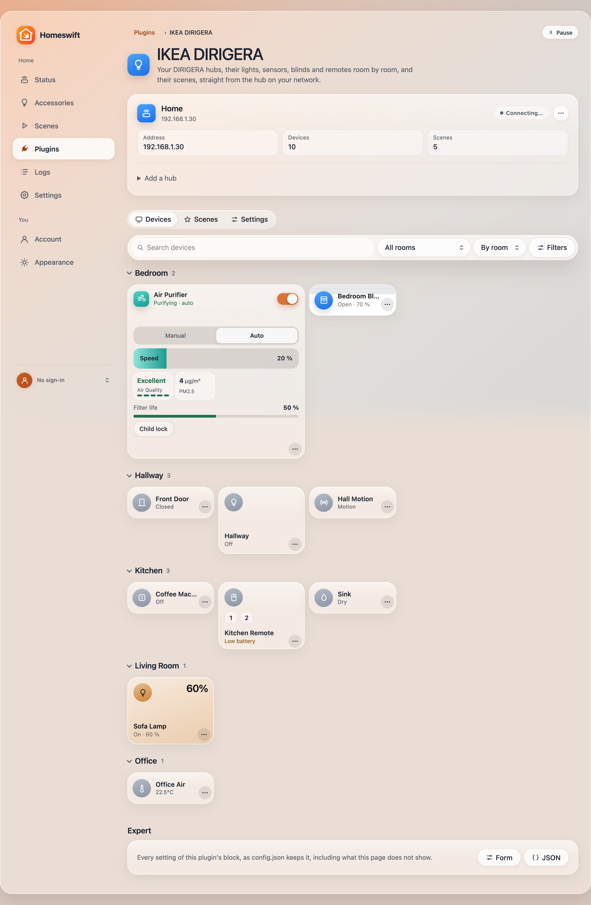
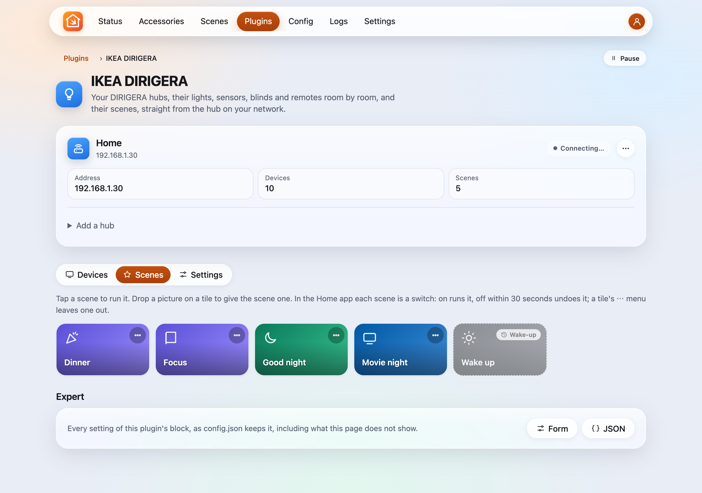

# IKEA DIRIGERA

IKEA lights, outlets, sensors, blinds, air purifiers, remotes and scenes in HomeKit through a DIRIGERA hub's local
API, without the cloud: lights with their brightness, colour and white temperature, outlets, door and window, motion,
light, air quality and water leak sensors with their battery, blinds, the STARKVIND air purifier, a programmable
switch per remote button, and a switch per scene. The hub pushes its changes over a websocket, so the Home app follows
the IKEA Home smart app and the remotes at once.

Written for Homeswift (not a port); the block is [homebridge-dirigera](https://github.com/uboness/homebridge-dirigera)'s,
so a Homebridge configuration works unchanged. The wire details follow Leggin/dirigera and lpgera/dirigera (both MIT;
no code taken; the sensors', blinds', purifiers' and remotes' attributes and the `remotePressEvent` are lpgera/dirigera's
types). Tested against a DIRIGERA hub (firmware 2.975.3, API 1.6.7): pairing, its plugs, a light driver and PARASOLL
sensors; the other kinds, writes, scenes and events against a fake hub in the tests. Maintained by the Homeswift authors.



## Configuration

```json
{
  "platforms": [
    { "platform": "Dirigera", "name": "IKEA DIRIGERA", "hubs": [{ "host": "192.168.1.30" }] }
  ]
}
```

A hub without a `token` pairs from the plugin's page: **Pair** (on a hub found on the network, or an address), then
press the action button under the hub within a minute. The token is kept in the plugin's folder
(`plugins/Dirigera-<name>/hubs.json`), never in config.json, with the hub's certificate pinned on first use. A token
from homebridge-dirigera in `token` works as it is.

| Option | Default | What it does |
|---|---|---|
| `hubs` | `[]` | The hubs: `host`, optional `token` and `name` (the scenes accessory is "<name> Scenes") |
| `transitionMs` | `100` | How long a light takes to reach a new level or colour; `0` changes at once |
| `scenes` | `true` | A switch for each scene of the hub (see below) |
| `excludeDevices` | `[]` | Device names or ids to leave out of HomeKit |
| `excludeScenes` | `[]` | Scene names or ids to leave out |

### Scenes

The hub's user scenes are switches on one accessory per hub: **On** triggers the scene and the switch goes back off a
second later; **Off** within 30 seconds of triggering undoes it (the hub's undo window). Wake-up and playlist scenes,
which run on their own schedule, are left out.

### Sensors, blinds, air purifiers and remotes

| On the hub (`deviceType`) | In HomeKit |
|---|---|
| `motionSensor`, `occupancySensor` (VALLHORN, MYGGSPRAY) | Motion Sensor (`isDetected`) |
| `lightSensor` (VALLHORN's) | Light Sensor (`illuminance`, in lux) |
| `environmentSensor` (VINDSTYRKA, ALPSTUGA, TIMMERFLOTTE) | what it measures: Temperature and Humidity Sensors, an Air Quality Sensor (PM2.5, and the VOC index: whichever is worse makes its quality, PM2.5 on the US EPA's breakpoints), a Carbon Dioxide Sensor (abnormal above 1,000 ppm) |
| `waterSensor` (BADRING, KLIPPBOK) | Leak Sensor (`waterLeakDetected`) |
| `blinds` (FYRTUR, KADRILJ, PRAKTLYSING, TREDANSEN) | Window Covering: IKEA's level is 0 fully open to 100 closed, HomeKit's position the other way round; Hold Position stops it (`blindsState: stopped`) |
| `airPurifier` (STARKVIND) | Air Purifier (Active, Auto or manual, the speed as the motor's 0 to 50, the child lock), its Filter (life left from `filterElapsedTime` and `filterLifetime`, change when the hub says) and its PM2.5 as an Air Quality Sensor |
| `controller` (STYRBAR, RODRET, SOMRIG, TRÅDFRI shortcut button, BILRESA) | a Stateless Programmable Switch per button, numbered under a Service Label: the hub's `remotePressEvent` gives `singlePress`, `doublePress` or `longPress` (not every remote sends all three) |
| `batteryPercentage` | Battery, low below 10 % |

Devices that are parts of one product (`relationId`: a VALLHORN's motion and light sensors, a remote's buttons) are
one accessory, `Dirigera:<relationId>`; the others keep `Dirigera:<device id>`. `excludeDevices` takes a part's name or
id, or the group's id. A remote's button keeps working with what it controls on the hub; in the Home app it can run
scenes and automations too.

## The web page

With the web UI on, the plugin's page lists the hubs (their state, devices and scenes, **Pair** with a countdown, the
hubs found on the network to pair, an address to add), then three tabs: **Devices**, every device drawn by the
Accessories page's widgets (a remote's buttons light as they are pressed), room by room or by name under the Hue page's
toolbar: a search, a room, and filters for lights, outlets, sensors, blinds and air, remotes, low battery and No
Response; **Scenes**, a tile per scene (a tap runs it; drop a picture on it, or choose
one from its ⋯ menu, to give the scene its own, kept in the plugin's folder; the same menu leaves it out of the Home
app); **Settings**, the transition on a 12-step speed scale (Very slow to Extreme; Fast, 100 ms, by default) and the scenes switch.



## The Assistant

With the Assistant on, the web UI's chat and MCP clients get `Dirigera_list_scenes`, `Dirigera_run_scene` and
`Dirigera_list_devices`: "it's movie time" finds the scene whose name and icon fit and runs it.

## How it works

Pairing is the hub's OAuth 2 with PKCE: `GET /v1/oauth/authorize` with a S256 challenge, then `POST /v1/oauth/token`
until the button is pressed (403 before). The plugin reads `GET /v1/devices` and `GET /v1/scenes`, then follows the
websocket at `wss://<hub>:8443/v1` (`deviceStateChanged` updates a device, `remotePressEvent` fires a button's switch;
added and removed devices and scenes read the hub again), reconnecting when it drops.

A light's changes of one moment go out in the order the hub wants, one `PATCH /v1/devices/<id>` each: `isOn` first when
it turns on, `lightLevel`, then `colorHue` and `colorSaturation` together or `colorTemperature` (kelvin), each with
`transitionTime`; off alone. Plugs list `lightLevel` among their attributes but only switch, so they are outlets.
A PARASOLL sensor is a contact sensor (`isOpen`) with a battery service (`batteryPercentage`, low below 10 %).
The accessory ids are `Dirigera:<device id>` and `Dirigera:scenes:<hub address>`.
