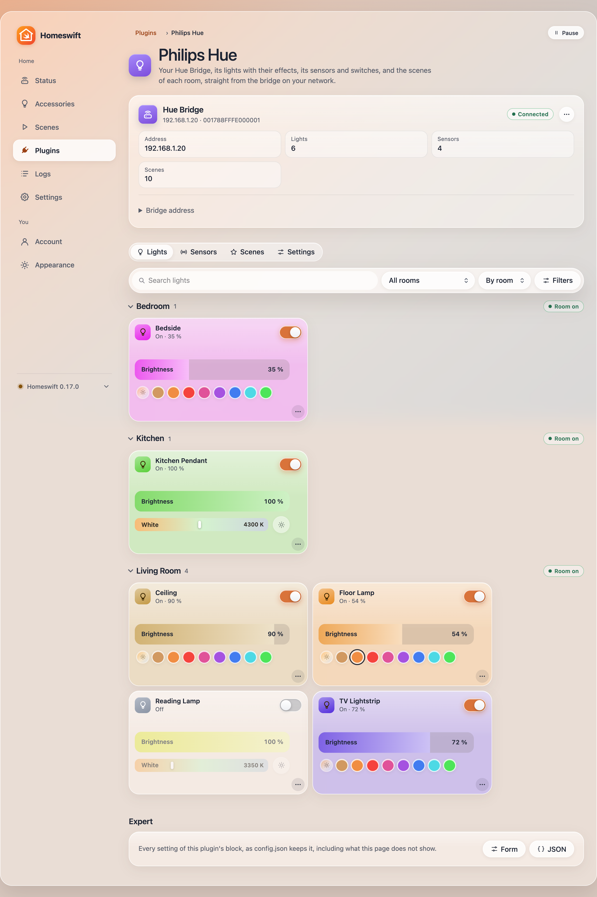
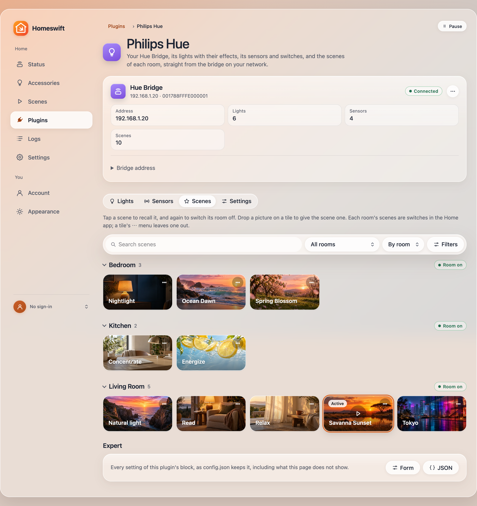

# Philips Hue

Philips Hue lights, scenes and effects in HomeKit through a Hue Bridge's local API v2 (CLIP v2), without the
cloud: every light with its brightness, colour and white temperature, a switch for each effect a light plays
(candle, fireplace, sparkle, prism…), the scenes of each room and zone as switches, and optionally a Flash switch
and a light per colour point of gradient lightstrips. A light's changes go to the bridge in one command, with a
transition you choose, so moods and the Home app change colour and brightness together.

Written for Homeswift (not a port). Tested against a Hue Bridge Pro (BSB003, firmware 2071524040): pairing, 48 lights
and 201 scenes read; writes, scenes, effects and Flash against a fake bridge in the tests. Maintained by the Homeswift
authors.



## Configuration

```json
{
  "platforms": [
    { "platform": "PhilipsHue", "name": "Philips Hue" }
  ]
}
```

That is enough: the plugin finds the bridge on the network (mDNS `_hue._tcp`, else Philips' discovery service) and,
the first time, pairs with it. Press the round link button on top of the bridge when the log, or the plugin's page,
asks; the application key is kept in the plugin's folder (`plugins/PhilipsHue-<name>/bridge.json`), never in
config.json, with the bridge's certificate pinned on first use. One block per bridge.

| Option | Default | What it does |
|---|---|---|
| `host` | found | The bridge's address (`192.168.1.20`), for a network without multicast |
| `transitionMs` | `100` | How long a light takes to reach a new colour or brightness; `0` changes at once (flashes, fast moods); the Hue app uses about 400 |
| `pollingInterval` | `2` | Seconds between reads of the bridge, for changes made in the Hue app or with a switch |
| `scenes` | `true` | A switch for each scene of a room or zone, on one accessory per room or zone (see below) |
| `dynamicScenes` | `false` | Recall every scene with its colours moving, as if the Hue app's play button were pressed each time; off, each scene follows its own Autoplay |
| `excludeScenes` | `[]` | Scene names, `Room/Scene` or ids to leave out |
| `sceneTransitions` | none | Scenes with a transition of their own instead of `transitionMs`: `[{ "scene": "Living room/Relax", "transitionMs": 2000 }]`, by "Room/Scene" or by a scene's name in any room |
| `effects` | `true` | A switch for each effect a light has |
| `roomLights` | `false` | A lightbulb on each room's and zone's accessory: on, off and brightness for all its lights in one command, as the Hue app's room controls |
| `flashSwitch` | `false` | A switch on each light that makes it flash for five seconds (Hue's signaling) |
| `gradientPoints` | `false` | On gradient lightstrips and lamps, a lightbulb per colour point (up to five), so each part takes its own colour |
| `excludeLights` | `[]` | Light names or ids to leave out of HomeKit |

### Scenes

Each room and zone with scenes is an accessory, "<Room> Scenes", with a switch per scene: **On** recalls it (with the
transition), the switch shows on while the bridge says the scene is active, and **Off** switches the room's lights off.
Smart scenes (natural light) are switches too: On activates, Off deactivates. Scenes made in the Hue app show up at
the next poll.

### Room lights

With `roomLights`, each room and zone also gets a lightbulb, named after it, at the head of its accessory (a zone
without scenes gets an accessory for it alone). It drives the room's `grouped_light`, as the Hue app's room controls
do: on, off and brightness reach every light of the room in one command, with the transition, where the Home app's
room controls send one command per light and the lights change one after the other. It shows the on and brightness
the bridge reports for the room. Colour stays with the scenes: the bridge does not report a room's colour. The
plugin reads rooms and zones and never changes them; they are made in the Hue app.

### A Hue Bridge already in the Home app

Pairing the plugin with the bridge does not touch the bridge's own HomeKit pairing (a bridge keeps many application
keys), but the lights then show twice in the Home app: once from the bridge, once from Homeswift, both working.
Either keep the bridge in the Home app and leave the lights out of Homeswift (`excludeLights`, or a light's ⋯ menu on
the page), using it for scenes, room lights and what HomeKit's Hue lacks; or remove the bridge from the Home app and
use Homeswift's accessories, with effects, Flash, gradient points and room lights, putting rooms and automations on
them again. The Hue app keeps working either way.

### Effects, Flash and gradients

An effect switch plays the effect on the bulb itself (`effects_v2`, or `effects` on older bulbs), so it flickers and
flows as smoothly as in the Hue app; Off stops it. Flash uses the bridge's signaling (`on_off`, five seconds). With
`gradientPoints`, writing a point's hue and saturation sends the whole gradient with that point changed.

## The web page

With the web UI on, the plugin's page shows the bridge (its address, id, how many lights and scenes, **Pair** with a
countdown for the link button, and its address to change), then three tabs:

- **Lights**: every light drawn by the Accessories page's own widgets (power, brightness, colours, white; effects and
  the rest in All controls), with **Identify**, **Leave out of the Home app** and its log in each widget's menu. They
  come room by room (a light's room is the room its device is in) or by name, under the same toolbar as the scenes: a
  search, a room, and filters for on now, colour lights, with effects and No Response.
- **Scenes**: each room's scenes as tiles painted with the scene's palette, under a toolbar that finds one among
  dozens: a search (scene and room names), a room, by room or by name, and filters with their counts (on now,
  Autoplay, colour scenes, which leaves out the whites of Hue's standard scenes, with a picture, not in the Home app),
  kept in the page's address and held under the header while the list scrolls; a room's name folds it away; a tap
  recalls one, and a tap on the active one switches its room off, as its switch in the Home app does. Once a scene is
  on, a play button at the centre of its tile makes its colours move until you pause it, as in the Hue app;
  **Autoplay** in the tile's ⋯ menu is the scene's own Autoplay on the bridge, so it plays whenever it is recalled
  (neither for a natural light scene, which follows the time of day, nor for one without a palette). Drop a picture on
  a tile (or choose one from its ⋯ menu) to give the scene its own: the page shrinks it to 640 pixels, and the bridge
  keeps it in the plugin's folder (`scene-pictures/`, JPEG, PNG or WebP, checked by its bytes, 1 MB at most). The same
  menu removes it, leaves the scene out of the Home app, and gives it a **Speed** of its own (the transition its
  recall takes, from the page and the Home app; Settings' speed otherwise).
- **Settings**: the transition on a 12-step speed scale (Very slow to Extreme; Fast, 100 ms, by default), the polling interval, and what the Home app shows.



Without a picture of your own, a tile uses the scene's palette from the bridge. The pictures the Hue app shows are
Signify's artwork, served by their own service and not by the bridge's API, so the plugin does not show them.

## The Assistant

With the Assistant on (a `HomeswiftAiKit` block), the web UI's chat and MCP clients get `PhilipsHue_list_scenes`,
`PhilipsHue_recall_scene` and `PhilipsHue_list_lights`. The scene list gives each scene's room and its look in words
("warm: orange, pink and red", "cool daylight white"), so "make the living room cozy" or "something like Tokyo" picks a
fitting scene and recalls it.

## How it works

Every `pollingInterval` the plugin reads every resource of the bridge in one request (`GET /clip/v2/resource`) and
shows the values; a light just written is left alone for two seconds, since the bridge may still report the old
values, and a colour the bridge reports as sent keeps the hue and saturation HomeKit asked for (the gamut moves pure
red to about 9°). HomeKit's hue and saturation become CIE xy inside the light's gamut with Philips' published
conversion (sRGB gamma, the Wide RGB D65 matrix), as homebridge-lib's `Colour` does.

Writes from the Home app arrive together (the bridge server runs one request's writes at the same time); the plugin
gathers a light's changes for 30 ms and sends one `PUT /clip/v2/resource/light/<id>` with `on`, `dimming`, `color` or
`color_temperature` and `dynamics.duration`. At most three requests are in flight (the bridge answers 429 beyond),
and 429 or 503 is retried. A light whose Zigbee connectivity reports a problem shows No Response. The accessory ids
are `PhilipsHue:<light id>` and `PhilipsHue:scenes:<room or zone id>`.

The Entertainment API (Hue Sync's 25 updates a second) needs DTLS, which Homeswift's networking does not have yet.
