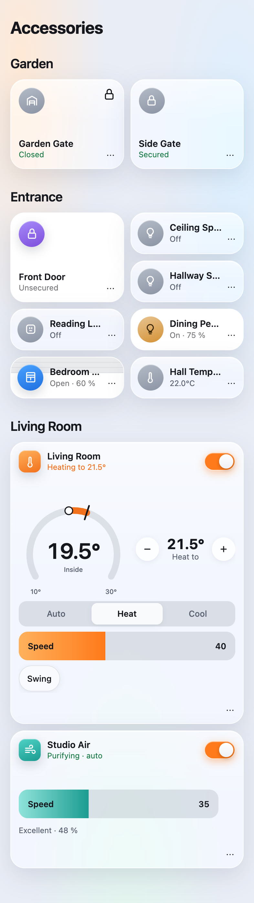

<p align="center">
  
</p>

<h1 align="center">Homeswift</h1>

<p align="center">
  The HomeKit Accessory Protocol in Swift: put your own devices in the Home app, alone or behind a bridge.
</p>

<p align="center">
  <a href="https://github.com/mp-consulting/homeswift/actions/workflows/ci.yml"></a>
  
  
  <a href="LICENSE"></a>
</p>

> **Status: early.** Pairing, control, identify and events work with the Home app. Linux builds and passes the
> tests in CI but has not been paired with a real Home app yet. The API may still change before 1.0. See [CHANGELOG.md](CHANGELOG.md).

Homeswift is a library for the accessory side of HomeKit over IP, the part
[HAP-NodeJS](https://github.com/homebridge/HAP-NodeJS) plays for Homebridge. You describe accessories with
services and characteristics, react to writes from the Home app, set values when your device changes, and
Homeswift takes care of pairing, encryption, Bonjour and keeping the accessory's identity across launches.

It is also a Homebridge written in Swift: the `homeswift` bridge reads a Homebridge-style `config.json` and
runs the plugins compiled into it, one small binary, no Node.js, no npm. Fourteen plugins come with it, from Elgato Key
Lights to UniFi Protect cameras, Philips Hue and IKEA DIRIGERA straight from their bridges, and Wingman, which brings in the Home app's own accessories through a Mac; [docs/plugins.md](docs/plugins.md) explains how to write or port one. Its web UI
shows every accessory as a widget of its kind, on a wall you arrange. Drag and resize tiles, combine compatible
lights, switches, fans or blinds into dashboard groups, and filter devices that do not respond. See
[the widget guide](docs/widgets.md) and [the web UI guide](docs/ui.md).

The **Scenes** page includes 143 original photographic palettes in 28 themes, searchable and sortable,
with horizontal browsing on phones. Build automations with triggers, conditions and device-specific
controls, including light colour pickers. Running scenes and moods can restore the previous accessory
state with **Stop**; restoration of locks, doors and alarms still requires confirmation. Pick sunrise and
sunset coordinates on a map or search an address. Appearance settings include photographic and abstract
wallpapers. See [scene artwork](docs/scene-artwork.md) for the image catalogue and provenance.


<p align="center">
  
</p>

## What it does

- **Pairing**: pair setup with the 8-digit setup code (SRP-6a, 3072-bit), pair verify, and the pairings the Home
  app adds and removes for other users and home hubs. Up to 16 controllers; removing the last admin unpairs.
- **Encrypted sessions**: ChaCha20-Poly1305 framing on every request after pair verify.
- **Accessories**: a single accessory or a bridge with any number of bridged accessories. All 73 services and 252
  characteristics HomeKit knows, with their formats, units, ranges and valid values.
- **Reads, writes and events**: read and write handlers per characteristic, events to every subscribed controller
  except the one that made the change, timed writes (locks, garage doors), write responses, multi-status errors.
- **Stable identity**: the device ID, keys, pairings, port and every accessory's aid and iids are saved, so
  rooms, scenes and automations survive restarts. Adding or removing accessories bumps the configuration
  number, and the Home app refreshes on its own.
- **Bonjour**: `_hap._tcp` advertising through dns_sd on macOS and Avahi on Linux, updated when pairing changes.
- **Setup code and setup URI**: a random code on first launch (or your own), shown as the Home app shows it
  (`0052-1956`), and the `X-HM://` URI for a QR code.
- **Cameras and doorbells**: live video and snapshots over SRTP, HomeKit Secure Video recording, two-way audio
  and the doorbell's ring, with HAP-NodeJS's `CameraController` API; `HomeswiftFFmpeg` does the encoding.

Not included: Bluetooth LE and Thread accessories, Siri audio, MFi authentication. Without MFi, the Home app shows
the accessory as uncertified when you add it and asks you to confirm.

## Install

Add Homeswift to your package:

```swift
dependencies: [
    .package(url: "https://github.com/mp-consulting/homeswift.git", from: "0.1.0"),
],
targets: [
    .executableTarget(name: "MyBridge", dependencies: [
        .product(name: "Homeswift", package: "homeswift"),
    ]),
]
```

macOS 14 or later, or Linux with Swift 6.1 or later. On Linux, install Avahi's dns_sd compatibility library and
keep the Avahi daemon running:

```bash
sudo apt install libavahi-compat-libdnssd-dev avahi-daemon
```

## Example

A bridge with a dimmable lamp:

```swift
import Homeswift

let light = Service(.lightbulb, name: "Desk Lamp", optional: [.brightness], isPrimary: true)

// Writes from the Home app. changesOnly skips writes of the value the lamp already has.
light.characteristic(.on).onWrite(changesOnly: true) { value in
    try await myLamp.setPower(value.boolValue ?? false)
}
light.characteristic(.brightness).onWrite(changesOnly: true) { value in
    try await myLamp.setBrightness(value.intValue ?? 100)
}

let lamp = Accessory(
    id: "desk-lamp",              // stable across launches: a serial number, a MAC, your own key
    name: "Desk Lamp", manufacturer: "Acme", model: "L1",
    category: .lightbulb, services: [light],
    onIdentify: { await myLamp.blink() })

let bridge = Accessory(id: "bridge", name: "My Bridge", category: .bridge, services: [])
let server = try HAPServer(bridge: bridge, accessories: [lamp], storage: FileStorage(name: "my-bridge"))

print("Setup code:", server.setupCode)   // 1234-5678, as the Home app shows it
try await server.run()
```

When the lamp changes on its own (a wall switch, another app), set the value and every subscribed Home app
updates:

```swift
light.characteristic(.on).value = true
```

A few things to know:

- Throw `HAPStatusError(.serviceCommunicationFailure)` from a handler when the device does not answer: the Home
  app shows "No Response" for it.
- `onRead` fetches a fresh value for every read. Most devices are better served by setting `value` when they
  report a change.
- Use `sendEvent(_:)` for stateless events such as a programmable switch press, where the same value repeats.
- Leave `changesOnly` off when the stored value can drift from the device, so tapping the tile again still
  reaches it.
- `FileStorage(name:)` keeps state in `~/.homeswift/<name>.json` (owner-only). Delete the file to start over with
  a new identity; the old accessory must then be removed from the Home app.
- Run one server per identity: two processes advertising the same device ID confuse the Home app.

## Run a bridge with plugins

`homeswift` is the bridge: it reads `~/.homeswift/config.json`, runs the plugins listed in it, and prints the
setup code.

```bash
swift run --scratch-path ~/Library/Caches/homeswift-build homeswift
```

The first run creates a `config.json` with a random username and pin. Add platform blocks to it; a block
written for the Homebridge version of a plugin works unchanged:

```json
{
  "bridge": { "name": "Homeswift", "username": "0E:1A:2B:3C:4D:5E", "pin": "031-45-154" },
  "platforms": [
    { "platform": "ElgatoKeyLights", "name": "Elgato Key Lights" }
  ]
}
```

`homeswift plugins` lists the plugins compiled in, `-U <dir>` uses another directory, `-D` logs debug output.
A block with `_bridge` runs on its own child bridge, with its own pairing. Accessories are cached, so they
are back in the Home app at the next launch before the plugin has reached its devices. On macOS the
`homeswift` binary carries an Info.plist (`Sources/HomeswiftCLI/Info.plist`, linked into its `__info_plist`
section) with the Bluetooth usage description CoreBluetooth requires, so the Govee plugin can reach devices
over Bluetooth; macOS asks once for Bluetooth access for the app that runs it (the terminal, or launchd).

| Plugin | Platform | Devices |
|---|---|---|
| [Daikin Cloud](Plugins/DaikinCloud) | `DaikinCloud` | Daikin air conditioners and Altherma heat pumps, through the Onecta cloud |
| [Dolphin Pool Cleaner](Plugins/DolphinPoolCleaner) | `DolphinPoolCleaner` | Maytronics Dolphin pool robots, through the MyDolphin Plus cloud |
| [Dyson Pure Cool](Plugins/DysonPureCool) | `DysonPureCool` | Dyson purifiers, Hot+Cool, Humidify+Cool and fans, over each device's local MQTT |
| [eWeLink](Plugins/EWeLink) | `eWeLink` | SONOFF and other eWeLink devices: switches, outlets, lights, curtains, sensors, RF Bridge, Zigbee (cloud and LAN) |
| [Elgato Key Lights](Plugins/ElgatoKeyLights) | `ElgatoKeyLights` | Key Light, Key Light Air, Key Light Mini, Ring Light |
| [Govee](Plugins/Govee) | `Govee` | Govee lights, plugs, heaters, purifiers, humidifiers and sensors (cloud, AWS IoT, LAN, Bluetooth) |
| [EcoFlow](Plugins/EcoFlow) | `EcoFlow` | Experimental battery and power monitoring through the developer API or EcoFlow app sign-in, with energy history |
| [IKEA DIRIGERA](Plugins/Dirigera) | `Dirigera` | IKEA lights, outlets, door and window sensors and scenes, through a DIRIGERA hub on the network (paired from the web UI) |
| [LG ThinQ](Plugins/LGThinQ) | `LGThinQ` | LG ThinQ appliances: air conditioners, purifiers, washers, dryers, fridges, ovens, dishwashers |
| [Philips Ambilight TV](Plugins/PhilipsAmbilightTV) | `PhilipsAmbilightTV` | Philips Android TVs with Ambilight (JointSpace API, paired from the web UI) |
| [Philips Hue](Plugins/PhilipsHue) | `PhilipsHue` | Hue lights, scenes, effects and gradients, through a Hue Bridge's local API v2 (paired from the web UI) |
| [UniFi Access](Plugins/UniFiAccess) | `UniFi Access` | UniFi Access hubs and readers: door locks, doorbells, sensors, followed through the controller's events |
| [UniFi Protect](Plugins/UniFiProtect) | `UniFi Protect` | UniFi Protect cameras and doorbells (live video, HomeKit Secure Video), sensors, lights, chimes |
| [Wingman](Plugins/Wingman) | `Wingman` | The Home app's accessories (Matter ones too) through [Homeswift Wingman](https://github.com/mp-consulting/homeswift-wingman) on a Mac: in the web UI, moods, scenes and MCP, never published to HomeKit again |

### In a container, on a NAS

`ghcr.io/mp-consulting/homeswift` is the bridge in a container, for `linux/amd64` and `linux/arm64`, with
Avahi and FFmpeg inside and the web UI on from the first run. It needs host networking, for mDNS.
[docs/synology.md](docs/synology.md) walks through a Synology NAS with Container Manager and
[docker-compose.yml](docker-compose.yml); on any Linux server with Docker:

```bash
docker compose up -d
```

### On a Synology NAS

The **Synology package** runs the bridge without Docker, on DSM 7.0 or later and on models without Container
Manager: download `homeswift-<arch>-<version>.spk` from the release and install it in Package Center with
**Manual Install** ([docs/synology.md](docs/synology.md#the-package)). The install wizard creates the web UI's
account; over SSH, `sudo homeswift` runs the bridge's commands on the package's data.

## The Assistant

Add a `HomeswiftAiKit` block and the bridge gets an AI assistant: it explains device errors, diagnoses
logs, answers questions and writes configuration blocks, on Claude, OpenAI, Gemini, a local
OpenAI-compatible server, or Apple's on-device model (macOS 26 with Apple Intelligence; no key, nothing
leaves the Mac). Plugins reach it through `context.assistant`; the command line through
`homeswift ask`, `homeswift explain` and `homeswift diagnose`. Secrets are redacted before anything is
sent. See [docs/ai.md](docs/ai.md).

```json
{ "platform": "HomeswiftAiKit", "provider": "apple" }
```

The same block can turn on an **MCP server**, so Claude Desktop, Claude Code or Cursor control the
bridge: accessories, config.json and the log, with scoped tokens, confirmations for locks and
configuration changes, and an audit log. `homeswift mcp --snippets` prints the client configs. See
[docs/mcp.md](docs/mcp.md).

## The web UI

A `HomeswiftUI` block adds a web interface on port 8581, behind a login created on the first visit with a set-up
code from the bridge's output:

```json
{ "platform": "HomeswiftUI" }
```

- **Accessories** as widgets of their kind, chosen from what HomeKit knows about each one: an air conditioner's
  gauge, setpoints and modes, a purifier's air readings and filter, a light's brightness, colours, white and
  Adaptive Lighting, a shutter you slide, a valve that counts down, a gate held to open, cameras live. Each in
  the size you choose (S, M, L or XL) on a wall you arrange by dragging, kept by the bridge.
  Every control of an accessory is a tap away in its sheet; a paused plugin's accessories rest, striped.
- **Status**: the bridges and their pairing codes with QR codes, memory, CPU and how fast the bridge and the
  plugins answer, over the last hour to the last week.
- **Plugins**: each one's settings as a form from its `config.schema.json`, its own page when it has one, pause and
  resume; the raw config.json; the live log with its history; a Restart button; the Assistant's chat.

<p align="center">
  
  
</p>

See [docs/ui.md](docs/ui.md) for the UI and [docs/widgets.md](docs/widgets.md) for the widgets, with how a plugin
gets the best of them. Explore the real controls and every HomeKit characteristic in the
[interactive design system](https://homeswift.dev/design/) ([maintainer guide](docs/design-system.md)).

## Demo

`homeswift-demo` is a bridge with a lamp, a switch and a temperature sensor that drifts. Install it with
Homebrew (macOS 15 or later; it builds from source with Swift 6.1 or later):

```bash
brew install mp-consulting/tap/homeswift
```

```bash
homeswift-demo
```

Or run it in the background, at login, with `brew services start homeswift`; the setup code is then in
`$(brew --prefix)/var/log/homeswift.log`. From a checkout, `swift run homeswift-demo` does the same.

It prints the setup code. In the Home app choose **Add Accessory**, then **More options**, pick **Homeswift
Bridge** and enter the code. Set `HAP_SETUP_CODE=031-45-154` for a fixed code and `HAP_DEBUG=1` to log every
request. Its state lives in `~/.homeswift/homeswift-demo.json`.

## How it works

| Layer | Files |
|---|---|
| Model: accessories, services, characteristics, values, the generated definitions | `Sources/Homeswift/Model` |
| Crypto: TLV8, SRP-6a over a C Montgomery multiplication (`CHAPMath`), HKDF and ChaCha20-Poly1305 | `Sources/Homeswift/Crypto` |
| Pairing: setup code, pair setup (M1–M6), pair verify (M1–M4), pairings | `Sources/Homeswift/Pairing` |
| Server: SwiftNIO listener, HTTP and EVENT messages, encrypted sessions, endpoints, storage, Bonjour advertising and browsing | `Sources/Homeswift/Server` |
| Cameras (streams, HomeKit Secure Video), HomeKit Data Stream, Adaptive Lighting | `Sources/Homeswift/Camera`, `DataStream`, `Controllers` |
| Plugin API and runtime: `HomeswiftPlugin`, `PluginContext`, `PluginHost`, config.json, the accessory cache, child bridges | `Sources/HomeswiftPlugin` |
| The `homeswift` bridge: command line, logging, the plugins compiled in | `Sources/HomeswiftCLI` |
| The Assistant: chat providers over plain HTTP, Apple's on-device model, redaction, prompts, schema-checked JSON | `Sources/HomeswiftAI` |
| The MCP server: JSON-RPC, sessions, scopes, elicitation, the audit log, tools over the bridge, Streamable HTTP on NIO, the stdio proxy | `Sources/HomeswiftMCP` |
| The web UI: login and sessions, the JSON API over the same control surface, the pages (`Web/`, embedded) | `Sources/HomeswiftUI` |
| Transports for plugins: HTTP with self-signed certificates, Digest, Wake-on-LAN, UDP, WebSocket, MQTT, AWS Signature V4 | `Sources/HomeswiftNetwork` |
| FFmpeg for camera plugins: options per host and accelerator, the process, RTP, fMP4 recordings | `Sources/HomeswiftFFmpeg` |
| Plugins, one directory each with sources, tests, README and config schema | `Plugins/` |

Each connection handles its requests in order on one task; handlers are `async`, so a slow device never blocks
other connections. Crypto comes from [swift-crypto](https://github.com/apple/swift-crypto) (CryptoKit on macOS).

Apple no longer publishes the HAP specification outside the MFi program. The protocol details follow HAP-NodeJS
and the tests check SRP against [fast-srp-hap](https://github.com/homebridge/fast-srp)'s vectors.
`Sources/Homeswift/Model/Definitions.swift` is generated from HAP-NodeJS's service and characteristic
definitions:

```bash
node Scripts/generate-definitions.js path/to/hap-nodejs > Sources/Homeswift/Model/Definitions.swift 2>/dev/null
```

## Documentation

| | |
|---|---|
| [docs/plugins.md](docs/plugins.md) | Writing a plugin, porting one from Homebridge, the runtime's files |
| [docs/design-system.md](docs/design-system.md) | The interactive component explorer: foundations, widget stories and every characteristic |
| [docs/widgets.md](docs/widgets.md) | The Accessories page's widgets: sizes, the wall, and what a plugin does to get good ones |
| [docs/ui.md](docs/ui.md) | The web UI: configuration, pages, security, a plugin's own page |
| [docs/mcp.md](docs/mcp.md) | The MCP server: scopes, confirmations, resources, prompts |
| [docs/ai.md](docs/ai.md) | The Assistant: providers, the command line, what reaches a provider |
| [docs/synology.md](docs/synology.md) | The Synology package and the container image |

## Development

```bash
swift build
swift test
```

On macOS, if `swift test` fails to code sign the test bundle (files under `~/Documents` can carry Finder
metadata), build outside the repository with `--scratch-path ~/Library/Caches/homeswift-build`.

To propose a plugin or contribute a change, see [CONTRIBUTING.md](CONTRIBUTING.md).

## License

MIT, see [LICENSE](LICENSE). Most plugins, the FFmpeg utilities and the HAP definitions are ported from other
projects (Homebridge plugins under MIT, ISC and Apache-2.0, HAP-NodeJS under Apache-2.0); their notices and the parts
that come from each are in [THIRD-PARTY-NOTICES.md](THIRD-PARTY-NOTICES.md).

Homeswift is not made or endorsed by Apple. HomeKit, Swift and the Swift logo are trademarks of Apple Inc.
