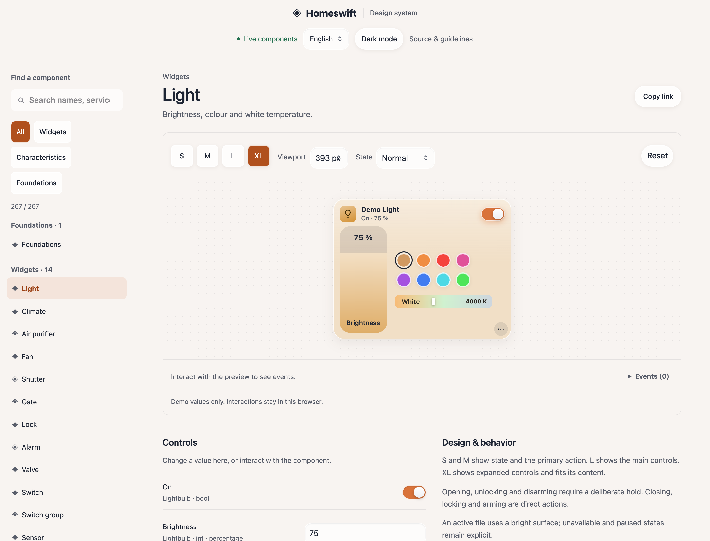
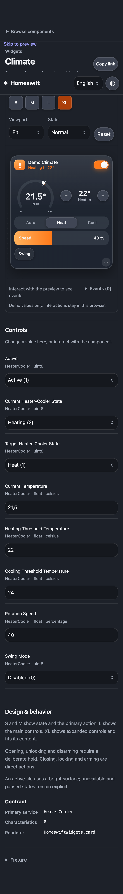

# Interactive design system

The [Homeswift design system](https://homeswift.dev/design/) is a Storybook-style explorer built into the
website. Website footers link to it in English, French, Spanish and Portuguese. It runs without a bridge,
an account, a framework or a build step.



## Find and exercise a component

On phones, **Browse components** opens the component list and selecting a story brings the preview back into view.
Desktop navigation preserves keyboard focus on the selected story; mobile selection moves focus to its heading.
The explorer uses scalable text, 44 px size targets and neutral surfaces around the production widget.
The sidebar contains foundations, 14 widget stories, and one story for each of the 252 characteristics in
`Definitions.swift`. Search by a characteristic's name, Swift identifier, service identifier or short UUID.
Filters separate widgets, characteristics and foundations.

- **Widgets** render the production accessory card. Select S, M, L or XL; change values in Controls or operate
  the widget itself. The widget's ⋯ menu also offers the four sizes as a segmented control.
- **Characteristics** render the production inspector row for that characteristic, with its exact format,
  permissions, ranges, steps, units, enum values, maximum string length and supporting services. Fields the
  UI deliberately hides, including protocol payloads, explain why they have no standalone control.
- **Foundations** show the live colour, shape (radius), type-size and weight tokens, the rules for layout and interaction, and
  the time range control every page uses (`HomeswiftCommon.rangeControl`: presets, then Custom…'s pop-over), live.

Use the canvas toolbar to choose a viewport or Fit, simulate a paused or unavailable accessory, or remove
write permissions. The Controls panel simulates incoming readings even for read-only characteristics.
The feedback line beneath the canvas shows the latest reading, write or failure; expand Events for its history.
Enum controls show names alongside protocol values, such as Auto (0), Heat (1) and Cool (2). Expand Fixture to
inspect the data sent to the renderer. Reset restores the story's demonstration values. Theme and language apply to both the explorer and its canvas.
Copy link preserves the story, size, viewport, state and language, for example:

- [Expanded light](https://homeswift.dev/design/?size=xlarge&viewport=393#widget/light)
- [Brightness inspector](https://homeswift.dev/design/#characteristic/brightness)
- [Protocol-only field](https://homeswift.dev/design/#characteristic/pairSetup)
- [Foundations](https://homeswift.dev/design/#foundations)



## Component rules

| Data / capability | Inspector treatment | Widget treatment |
|---|---|---|
| Writable boolean or numeric on/off | Named switch | Primary power action where appropriate |
| Enumerated state | Named choices when the production UI knows the labels | Modes, status labels or segmented controls |
| Bounded number | Range with the characteristic's bounds and step | Brightness, speed, position, temperature or other specialised control |
| Writable string | Text field, committed when editing finishes | Accessory-specific controls where available |
| Read-only value | Value, named state and unit | Summary, gauge, sensor reading or status |
| Input identifier | Named TV inputs from input-source services | Input selector |
| Remote key / volume command | Dedicated command buttons | TV remote and volume controls |
| Security write | Confirmation in the generic inspector | Hold to open, unlock or disarm; direct close, lock or arm |
| Protocol bookkeeping, opaque data or TLV8 | Explanation instead of invented bytes | Kept out of everyday controls |

The rules are implemented in `Sources/HomeswiftUI/Web/widgets.js`; this table describes them rather than
introducing another rendering implementation. The widget guide documents [service selection and plugin
contracts](widgets.md#for-plugin-developers).

### Size, state and visual foundations

S is a compact summary and M a tall summary; both keep the primary action. L exposes the main controls. XL
exposes expanded controls. L and XL measure their actual content and span whole grid rows, so a sparse
widget does not reserve empty space. All controls remain available in the accessory sheet.

The wall uses columns starting at 176 px on larger viewports, two flexible columns on phones, 10 px gaps and rows of at
least 64 px. Accessories use a 22 px radius and 40 px summary icons. System type and a distinct name/status
hierarchy keep the content readable. Active tiles use the bright tile surface, and a light that is on takes its own colour, pale, as its background; paused and unavailable states
remain explicit. The foundations story reads its tokens directly from the production stylesheet.

### Tokens

`Sources/HomeswiftUI/Web/style.css` defines every token on `:root`. Widgets, pages and plugin pages use these
tokens, not literal values:

| Family | Tokens | Use |
|---|---|---|
| Colour | `--text`, `--muted`, `--line`, `--accent`, `--accent-ink`, `--accent-fill`, `--ok`, `--warn`, `--error`, `--series-1`…`7` | Orange words take `--accent-ink`; white words on orange take `--accent-fill` (both WCAG AA); `--accent` is for marks, rings and glows. A tint of a colour is `color-mix(in srgb, var(--accent) 35%, transparent)`, not a copied `rgba()` |
| Backdrop | `--backdrop`, `--bg`, `--bg-warm`, `--bg-cool`, `--bg-mint` | Apricot frost's apricot-to-stone gradient behind everything; Ember's warm charcoal in dark mode |
| Material | `--material-chrome`, `--material-frame`, `--material-thick`, `--material`, `--material-thin`, `--material-solid`, `--surface`, `--control`, `--field` | Header, a wide window's frame, cards, chips and groups, white details on a card, controls (see the comment above `.card`). The current item (a section, a segmented control's choice, a tab) is a `--control` pill with its icon in `--accent-ink` |
| Attention | `--attention`, `--attention-text`, `--attention-muted`, `--attention-glow`, `--attention-error`, `--attention-warn` | `.card.attention`, the one dark card for what needs attention or an important action; it redefines `--text`, `--muted`, `--error`, `--warn` and the control tokens for its children |
| Shape | `--radius-xs` 6, `--radius-sm` 10, `--radius-md` 14, `--radius-lg` 18, `--radius` 22, `--radius-xl` 26, `--radius-pill` | Chips and swatches; small controls and icon tiles; controls and rows; groups and menus; cards; sheets, panels and dialogs; capsules (a radius of half the height). A shape nested in another takes the outer radius minus the inset between them (`calc(var(--radius-md) - 3px)` for a segmented control's thumb), so the curves stay concentric. Only hairline marks (bars, ticks, grabbers) go under 6 px |
| Spacing | `--space-4`, `-6`, `-8`, `-10`, `-12`, `-14`, `-16`, `-18`, `-20`, `-24` (named by size) | 4 to 8 inside a control, 10 to 14 between controls and rows, 16 to 24 around groups and cards. Odd and 1 to 3 px values are optical nudges and stay literal |
| Type | `--text-2xs` 11 … `--text-base` 15 … `--text-3xl` 22, `--text-display` 36 for a page's title (in rem) | Sizes follow the browser's text size. Fields stay at 16 px on touch screens, where less makes iOS zoom |
| Weight | `--weight-regular`, `-medium`, `-semibold`, `-figure` (650), `-bold` | `--weight-figure` is for numbers set large: stats, readings, chart figures |
| Motion | `--ease-out`, `--fast` (120 ms), `--normal` (200 ms) | Every transition; under reduced motion a component drops its movement and keeps at most a fade |
| Layer | `--layer-tabbar`, `--layer-panel`, `--layer-menu`, `--layer-drag`, `--layer-tip` | What floats over the page; a scrim takes `calc(var(--layer-…) - 1)`. Stacking inside a component keeps small local numbers |

`DesignTokenTests` fails when a rule writes a value that has a token (a radius of 6 px or more outside `calc()`, a
size of the type ramp, a weight, a spacing step, a copy of the accent's `rgba()`), and when the two dark blocks
differ. The dark tokens are written twice, for the system's dark mode and for a theme chosen in the web UI:
`light-dark()` would share them, but it is missing before iOS 17.5, where every colour would fall back. Widget
figures in px, display sizes and fields' 16 px stay literal. homeswift.dev's `site.css` carries the same shape scale.

HomeKit temperatures remain Celsius in the fixture; presentation follows the temperature preference.
Colour temperature remains mireds in the fixture and appears as Kelvin in the light widget. Controls retain
the production keyboard, focus, accessible-name and reduced-motion behaviour.

## Isolation and limits

The canvas renders directly in the page: the public host blocks frames through CSP and `X-Frame-Options`.
Before loading the real controls, `transport.js` installs an in-memory fetch adapter. It accepts local demo accessory commands, echoes values
back as accessory events, and supplies a local camera illustration as a permitted data URL.
The unavailable state returns a demo 503. Content Security Policy disables network connections in the explorer.

No bridge, cloud service or physical device is contacted. The camera story demonstrates snapshots, not a
real video stream; valve timers and device transitions use fixture values. The explorer does not model a
complete accessory server. Protocol-only stories document the real contract without attempting pairing,
recording or other protocol exchanges. Custom characteristics outside the generated catalog require their
own story.

## Keep it aligned with production

| File | Responsibility |
|---|---|
| `site/design/index.html`, `explorer.js`, `explorer.css` | Navigation, controls, contract documentation and canvas toolbar |
| `site/design/canvas.js` | Inline canvas and the production renderer |
| `site/design/stories.js` | Demonstration accessory fixtures for each widget |
| `site/design/translations.js` | Explorer-specific French, Spanish and Portuguese strings |
| `site/design/transport.js` | Local simulated writes, failures and camera still |
| `site/design/catalog.js` | Generated characteristic and service contracts |
| `site/design/runtime/` | Byte-for-byte copies of the production UI assets |
| `Scripts/design-system.mjs` | Catalog generation and runtime synchronisation |
| `Scripts/design-system-check.mjs` | Browser checks and demonstration screenshots |

Edit controls in `Sources/HomeswiftUI/Web/`, never in `site/design/runtime/`. After changing the controls,
styles, core translations or generated HomeKit definitions, run:

```sh
node Scripts/design-system.mjs
node Scripts/design-system.mjs --check
swift Scripts/embed-assets.swift web Sources/HomeswiftUI/Web Sources/HomeswiftUI/WebAssets.swift
```

New standard characteristics automatically receive catalog entries and inspector stories. For a new widget,
add a fixture to `stories.js` using real service and characteristic identifiers, and translate its name and
description in `translations.js`. Keep fixture names generic. For new text in the website's home page, also
update its three catalogs and run `node Scripts/site-languages.mjs`.

Serve `site/` with any static server and open `/design/`. For browser verification and fresh screenshots on
macOS with Google Chrome installed:

```sh
node Scripts/design-system-check.mjs /tmp/homeswift-design-shots
```

The checker visits every widget and characteristic story, exercises controls and state changes, checks mobile
layout and languages under the public host’s CSP and frame restrictions, and verifies that no demo API request reaches the server. CI and the Pages deployment
run the sync check: a stale catalog or runtime copy stops deployment.
