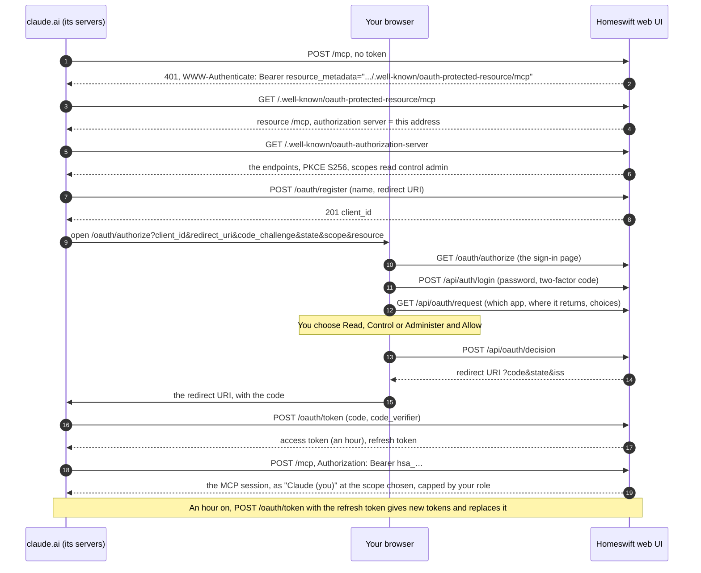

# The MCP server

Homeswift speaks the [Model Context Protocol](https://modelcontextprotocol.io), so Claude Desktop, Claude
Code, Cursor and other MCP clients can read and control the bridge: list and set accessories, read and
change `config.json`, read the log, with the scopes, confirmations and audit log of
[`homebridge-ai-kit`](https://github.com/mp-consulting/homebridge-ai-kit).

There is one server, over Streamable HTTP, inside the running bridge; `homeswift mcp` is a stdio
front for clients that only speak stdio, forwarding every message to it.

## Turning it on

In the `HomeswiftAiKit` block of config.json (the Assistant's provider settings are optional here):

```json
{
  "platform": "HomeswiftAiKit",
  "mcp": {
    "http": {
      "enabled": true,
      "host": "127.0.0.1",
      "port": 8582,
      "token": "<homeswift mcp --generate-token>",
      "readOnly": false,
      "clients": [{ "name": "Dashboard", "token": "<another token>", "scope": "read" }],
      "allowedOrigins": [],
      "auditLog": true,
      "auditLogPath": "~/.homeswift/homeswift-mcp-audit.jsonl",
      "maxSessions": 32,
      "sessionIdleMinutes": 30
    }
  }
}
```

| Key | Default | What it does |
|---|---|---|
| `enabled` | `false` | Run the server with the bridge |
| `host`, `port` | `127.0.0.1`, `8582` | Where it listens; it serves `/mcp` |
| `token` | | The main client token (`admin`). Required; `homeswift mcp --generate-token` makes one |
| `clients` | `[]` | More tokens, each with a `scope`: `read`, `control` or `admin` |
| `readOnly` | `false` | Caps every token at `read` |
| `allowedOrigins` | `[]` | Browser origins allowed besides localhost and the server's own address (`*` for any) |
| `auditLog`, `auditLogPath` | `true`, next to config.json | Every write tool call, one JSON line each; the web UI's changes too, and its Settings › Audit log shows them |
| `maxSessions` | `32` | Sessions at once: a new one ends the least recently used idle session, or gets 503 when all are busy |
| `sessionIdleMinutes` | `30` | A session idle this long ends |

The environment overrides the block, under `homebridge-ai-kit`'s names or Homeswift's (which win):

| Variable | What it sets |
|---|---|
| `HOMESWIFT_MCP_MAX_SESSIONS`, `HOMEBRIDGE_AI_MCP_MAX_SESSIONS` | `maxSessions` |
| `HOMESWIFT_MCP_SESSION_IDLE_MINUTES`, `HOMEBRIDGE_AI_MCP_SESSION_IDLE_MINUTES` | `sessionIdleMinutes` |
| `HOMESWIFT_READ_ONLY`, `HOMEBRIDGE_READ_ONLY` | `readOnly` (`true`/`false`, `1`/`0`, `yes`/`no`, `on`/`off`); the web UI's chat follows it |
| `HOMESWIFT_MCP_TOKENS`, `HOMEBRIDGE_AI_MCP_TOKENS` | More tokens as `scope:token` pairs separated by commas (`read:abc,control:def`), added to `clients` |
| `HOMESWIFT_MCP_ALLOWED_ORIGINS`, `HOMEBRIDGE_AI_MCP_ALLOWED_ORIGINS` | `allowedOrigins`, separated by commas |
| `HOMESWIFT_MCP_AUDIT_LOG`, `HOMEBRIDGE_AI_AUDIT_LOG` | `auditLogPath` (and turns the audit log on) |

Restart the bridge; it prints the URL. Then connect a client:

```bash
homeswift mcp --snippets        # ready-to-paste configs for Claude Desktop, Claude Code and Cursor
```

A stdio client runs `homeswift mcp`, which needs the URL and the token: from config.json when it runs on
the same machine with the same `-U` directory, or from `HOMESWIFT_MCP_URL` and `HOMESWIFT_MCP_TOKEN`
(or `--url` and `--token`). A client that speaks Streamable HTTP connects to `http://127.0.0.1:8582/mcp`
with `Authorization: Bearer <token>`.

## claude.ai and the Claude apps

claude.ai, and the Claude apps on iPhone, Android and the desktop, add a remote MCP server as a custom
connector and sign in to it with OAuth. Homeswift serves that through the web UI: `/mcp` on the UI's own
address, with the sign-in done by the UI's accounts. It needs:

- the MCP server turned on (`mcp.http.enabled`, as above: its own listener can stay on `127.0.0.1`);
- the web UI with sign-in (`auth: form`), reachable from the internet over HTTPS at a name, since claude.ai
  connects from Anthropic's servers: a tunnel (Cloudflare Tunnel, Tailscale Funnel) or a reverse proxy in front
  of the UI, the name in `allowedHosts`, and the proxy in `trustProxy` so the UI knows the browser came over
  HTTPS (the addresses in the metadata are `https://` only then, or with the UI's own `https`).

```json
{ "platform": "HomeswiftUI", "port": 8581, "allowedHosts": ["home.example.com"], "trustProxy": ["loopback"] }
```

(`loopback` for a tunnel that runs on the same machine, such as `cloudflared`.) Then, in claude.ai, **Settings ›
Connectors › Add custom connector**, with the URL `https://home.example.com/mcp` and no OAuth client ID or
secret: claude.ai registers itself. **Connect** opens Homeswift's sign-in page: sign in (with the two-factor
code when it is on), check which app asks and where approving sends you back (claude.ai), choose what it may
do, and **Allow**. The connector is then there in the Claude apps signed in to the same account too.

What it may do is one of the scopes below, chosen on that page up to the user's role: an administrator may
give `admin`, any other user `control` at most, and the page never picks `admin` in advance, whatever the app
asks. As in the web UI, an app of a user who is not an administrator controls accessories and runs scenes but
does not see the log, config.json, the pairings or the child bridges' health (those tools, resources and
prompts are not listed for it), nor writes the daily digest again. The user's role is read again at every
request, so demoting a user narrows the apps they connected, and `readOnly` caps them all at `read`. Sessions show in the audit log as the app and its user,
`Claude (rosaly)`. **Account › Connected apps** lists a user's apps, with what each may do and when it last
came, and disconnects one at once.

### On a path of a shared host name

Several MCP servers can sit behind one tunnel on one host name, each on its own path: Homeswift at
`https://mcp.example.com/homeswift`, other servers at `/me/mail` or `/me/calendar`. Set `publicURL` in the
HomeswiftUI block to that address (the settings page has it under **Behind a reverse proxy**):

```json
{ "platform": "HomeswiftUI", "port": 8581, "allowedHosts": ["home.example.com"], "publicURL": "https://mcp.example.com/homeswift" }
```

The option is off without it, and the UI's own address keeps working as above. With it, requests for that host
name are mapped onto the UI's routes: `/homeswift` is `/mcp`, `/homeswift/oauth/…` the OAuth endpoints, and the
discovery documents RFC 9728 and RFC 8414 put at the root with the path appended
(`/.well-known/oauth-protected-resource/homeswift`, `/.well-known/oauth-authorization-server/homeswift`) are the
UI's own. The metadata then names `https://mcp.example.com/homeswift` as the resource and the issuer, and the
sign-in page loads its files and calls the API under the path too. The host name is allowed without an
`allowedHosts` entry. In cloudflared, the route is that host name with the path pattern
`^/(\.well-known/[^/]+/)?homeswift(/.*)?$`, to the UI's address. The connector URL in claude.ai is
`https://mcp.example.com/homeswift`. Only the connector lives there: the rest of the web UI stays at its own address.

### How the sign-in goes



1. **Discovery.** claude.ai calls `/mcp` without a token. The 401's `WWW-Authenticate` names the protected
   resource metadata, which names this same address as the authorization server; its metadata lists the
   endpoints. Every address in them is built from the `Host` the request came with, `https` when the UI serves
   HTTPS or a `trustProxy` proxy says the client came over it.
2. **Registration.** claude.ai registers itself at `/oauth/register` with its name and redirect URI, and gets a
   `client_id` (a public client: no secret, PKCE proves it).
3. **Sign-in and consent.** Your browser opens `/oauth/authorize`, a page of the UI. Signed out, it asks for your
   username, password and two-factor code (the UI's own login, throttle included); signed in already, it goes on.
   It shows the app's name, where approving sends you (claude.ai), and the scopes your role allows, with
   Control picked. Nothing is focused, and Allow and Deny wait a moment, so a keypress meant for the sign-in never
   approves. Deny sends `access_denied` back; a client or redirect URI the bridge does not know is shown on the
   page and never redirected to.
4. **Code for tokens.** Allow redirects the browser to claude.ai with a code good for five minutes, bound to the
   app, the redirect URI, your username, the scope and the PKCE challenge. claude.ai's servers trade it at
   `/oauth/token` with the verifier for an access token (an hour) and a refresh token.
5. **Using it.** claude.ai sends `Authorization: Bearer hsa_…` to `/mcp`. Each request reads your account
   again: the scope is the one you chose, at most what your role allows now, `read` with `readOnly`. The audit
   log names the session after the app and you.
6. **Refreshing.** Before or after the hour, claude.ai trades the refresh token for new tokens; the old one
   is replaced. Unused for 90 days, the grant ends and the app signs in again.
7. **Ending it.** **Account › Connected apps › Disconnect**, removing the user, a new password or turning
   two-factor authentication on or off (which sign the user's other browsers out too), or the app's own revocation
   (`/oauth/revoke`) ends the grant: the next request gets a 401 and open streams close.

What the UI serves for it:

| Path | What it is |
|---|---|
| `/mcp` | The MCP server, for its OAuth tokens only: the `token` and `clients` tokens above stay on the server's own listener |
| `/.well-known/oauth-protected-resource`, `…/mcp` | Where to sign in (RFC 9728); a 401 from `/mcp` points there |
| `/.well-known/oauth-authorization-server` | The endpoints below (RFC 8414) |
| `/oauth/register` | Dynamic client registration (RFC 7591), open, as claude.ai needs it |
| `/oauth/authorize` | The sign-in page |
| `/oauth/token`, `/oauth/revoke` | Codes and refresh tokens for tokens (RFC 6749), and revocation (RFC 7009) |

The authorization code grant with PKCE (S256 only), as OAuth 2.1 and the MCP specification have it. An access
token (`hsa_…`) lasts an hour and reaches `/mcp` only, never `/api`; a refresh token (`hsr_…`) is replaced at
each use (the replaced one is taken again for a minute, for a client that lost the answer; later, it ends the
grant as a stolen copy), and a grant unused for 90 days ends. `ui-oauth.json` next to config.json (owner-only)
keeps the clients and grants with the SHA-256 of each token and secret; codes stay in memory for five minutes,
and a second use of one ends what the first got. Registration is open: at most 100 clients are kept, those
that got no grant going after a day or to make room. Anyone can so register an app and send you a link to
the sign-in page under a name of their choosing: approve only a connection you started, and check where it
sends you back.

## Scopes

| Scope | Tools |
|---|---|
| `read` | `get_server_status`, `list_accessories`, `get_accessory`, `get_accessory_history`, `list_plugins`, `get_config`, `list_config_backups`, `list_vault`, `get_recent_logs`, `search_logs`, `get_system_info`, `list_child_bridges`, `get_child_bridge_health`, `get_cached_accessories`, `get_pairing_info`, `get_matter_status`, `list_backups`, `get_accessory_layout`, `get_wall_layout`, `list_scenes`, `list_scene_templates`, `get_assistant_usage`, `get_daily_digest` |
| `control` | Plus `set_accessory`, `set_accessories` (with `dryRun`), `set_security_accessory`, `identify_accessory`, `run_scene` (a saved scene, a hub's, or a `plan`), `stop_scene` |
| `admin` | Plus `update_config`, `patch_config`, `restore_config`, `migrate_to_vault` (with `dryRun`), `put_list_entry`, `restart_bridge`, `restart_child_bridge`, `stop_child_bridge`, `start_child_bridge`, `remove_cached_accessory`, `reset_cached_accessories`, `reset_pairings`, `open_matter_commissioning_window`, `remove_matter_fabric`, `set_matter_device`, `set_homekit_visibility`, `rename_accessory`, `create_backup`, `get_audit_log`, `update_bridge_settings`, `set_accessory_layout`, `set_wall_layout`, `save_scene` (with `dryRun`), `update_hub_scene` (with `dryRun`), `delete_hub_scene`, `send_test_notification`, `truncate_logs`, `test_assistant_connection` |

A token sees only the tools its scope allows. Locks, garage doors and alarms (Lock Target State, Target
Door State, Security System Target State, Lock Control Point) change only through `set_security_accessory`;
`set_accessory` and `set_accessories` refuse them. So do the characteristics a plugin marks as security
controls (`isSecurityControl`, such as UniFi Access's Lock Trigger switches, whose On unlocks a door):
`get_accessory` lists them with `"security": true`. Values that carry keys (Setup Endpoints holds a live
stream's SRTP keys) are listed as null with `"confidential": true`, and left out of `list_accessories`.
What only HomeKit uses is `"internal": true`: a camera's RTP stream, recording and data stream services and
its snapshot settings. TLV8 and data values mean nothing as text: they are null with their size in `bytes`.

### What the tools do

- **Accessories.** `list_accessories` takes filters, all of which must match: `platform`, `type` (a category
  such as `lightbulb`, or a service type such as `Switch`), `name` (part of the accessory's or a service's
  name), `manufacturer`, `excludeManufacturer` and `room`, a room of the web UI's layout, case aside (an unknown
  room is an error that lists them). `set_accessories` takes a
  list of `changes`, or one `characteristic` and `value` for the accessories that `ids` or `filter` (the same
  filters) pick; it refuses when more than `maxTargets` (25 by default, at most 200) would change, and skips
  and reports accessories without the characteristic and security controls.
- **config.json.** `update_config`, `patch_config` and `put_list_entry` check what they change in a plugin's block
  against its `config.schema.json` (and the runtime's own blocks against theirs): a setting added or changed, a
  required one removed, a new block whole. What they leave as it was is not checked, so an old mistake in a
  block never stops a change to another setting. A refusal names each problem with its place
  (`ElgatoKeyLights: pollingRate must be >= 250`), the dry run's too. `ignoreSchema: true` saves anyway, for a
  value the plugin accepts that its schema does not list; `restore_config` puts a backup back unchecked.
- **Setup** ([plugins.md](plugins.md#setup)). `discover_devices` lists what a plugin finds, each device with its
  `deviceID`, the Authorization it needs and its `status` (`setUp`, `needsAuthorization`, `discovered`, `excluded`), and
  whether the account is set up. `start_setup` (a `deviceID`, or none for the account) answers the first prompt: a
  message for the person, the fields to answer, a page to open or a wait; `continue_setup` answers it, and
  `cancel_setup` ends it. `start_setup` for a platform with no block of that name adds the plugin once its account's
  Setup is done. A secret field takes only a `vault:` reference: the person adds the entry on the Vault page, or finishes
  in the web UI. What a device or a plugin says is wrapped in `<untrusted-data>`. `set_device_excluded` excludes a device
  or includes it again (destructive: it asks first), and `set_device_part` includes or leaves out one of its parts (a
  gate's side door, a door sensor, a camera's occupancy sensor).
- **Rooms.** The Home app's rooms never reach a bridge; these are the web UI's (Glass UI's accessory layout,
  `accessory-layout.json`). `get_accessory_layout` lists the rooms with their accessories (and `displayName`,
  `hidden`, `favourite`) and those in no room; `set_accessory_layout` puts accessories in rooms (a new name adds
  the room), hides them, names them for the web UI or makes them Quick Controls, and orders (`rooms`), renames
  (`renameRoom`) or removes (`removeRooms`) rooms. HomeKit is not changed. `syncRoomNames: true` (kept with the layout,
  off by default) makes a later `renameRoom` rename the rooms of the same name on the plugins' hubs too (Philips Hue,
  IKEA DIRIGERA, eWeLink; case and accents aside); `hubRooms` in the answer says what each hub did.
- **The wall.** `get_wall_layout` answers the Accessories page's wall as it is drawn (`ui-layout.json`): its grouping,
  the sections in order with their accessories in order and the sizes chosen, the default size of each kind of
  widget, and the accessory groups where they stand. `set_wall_layout` arranges it: `groups` makes accessories that
  go together one widget that drives them all (a room's lights, its blinds; an id changes an existing group, and an
  accessory joining one leaves any other), `ungroup` dissolves groups; `order` puts the ids it lists (accessories and
  groups) in that order in the places they hold together, so one room's ids sort that room and leave the rest;
  `sizes` by accessory or group, `defaults` by kind of widget (null goes back to the kind's own), `grouping` `none`,
  `room` or `plugin`; `positions` puts widgets on cells of their own (`[column, row]` from 1 for the top-left corner,
  null to let one flow, for the wall's grouping; `clearPositions` lets the whole wall flow), so a layout can leave gaps
  between widgets; `get_wall_layout` gives each widget's `position`. The tool's description tells the model the
  grid: as many 176-px columns as fit, rows of about 64 px, and each size's span. A group needs a control its members share (on and off, or a position) and never takes a
  security control. With `set_accessory_layout`'s rooms,
  that is what the Assistant needs to compose a wall ("arrange my wall by room"). An open Accessories page draws
  the wall again when it or the rooms change, whoever changed them (a `layout` event on the web UI's event stream).
- **Scenes.** `list_scenes` lists the web UI's scenes with their room, whether they are active now, their actions,
  triggers, conditions and last run, and `"security": true` on one that changes a lock, a garage door or an alarm;
  and `pluginScenes`, the scenes plugins' hubs keep (a Hue Bridge's, a DIRIGERA hub's, a Govee light's picks), with
  their room, source and whether the hub says they are on. `run_scene` (an id or a name) runs either kind, or a
  `plan` the client composes (values to set and hubs' scenes to recall, `{"recall": id}`), which runs at once and is
  not saved; it answers the plan and its `run`. Whatever a run changed can be put back for 12 hours with `stop_scene`
  (a scene, a hub scene's id, or a plan's run); a value changed since is left alone. A saved scene can recall a hub's
  scene among its values. A scene or a plan can animate lights after its actions (`animation`: `lights` and an `effect`
  such as fire, candle, sunrise or music with a colour, speed and brightness, or timed `steps`): each brand plays its own
  lights natively where it can (a Hue light's effect, a Govee light's library scene, an IKEA fade, an Ambilight TV
  following the music), Homeswift's player the rest, and `stop_scene` puts them all back. `list_scene_templates` lists ready-made ambiances (values set
  once, effects, timed sequences, the gallery's palettes); `run_scene` and `save_scene` take a `template`, or a
  `description` the bridge's Assistant turns into a plan, with the `room` (or `ids`) whose lights it sets. A Homeswift
  scene answers per action; it refuses a scene with a security action, as homebridge-mcp-server's does: those
  go through `set_security_accessory`, which asks, or the web UI, where the signed-in user confirms. `save_scene`
  keeps a `plan`, or makes a scene from the current values of `ids` (only `characteristics`, when given), never capturing a security
  control; `dryRun` lists the actions and `hubs`, the hubs that could keep it instead. With `hub` (a Hue Bridge's or an
  IKEA hub's), the scene is kept on that hub: lights' On, Brightness, colour and white only, no triggers or animation.
  `update_hub_scene` renames a hub's scene or replaces its lights (from a `plan`, or `fromCurrent`: as they are now), and
  `delete_hub_scene` removes it from its hub, after the user confirms. The `scene-builder` prompt ends with it.
- **How scenes change lights.** Only lightbulbs move in an animation, never a security control. Homeswift's player
  writes every light of a step at the same time, at least a quarter of a second a step since many lights fade; a scene
  started on lights another plays on takes them over and puts them back as they were before the first; one that takes
  only some of another's lights leaves it the others; a light that fails three writes in a row leaves the show. A
  plugin action marked `changesLights` (`<platform>_<action>`: Hue's `recall_scene`, DIRIGERA's `run_scene`) is held the
  same way: the bridge reads the plugin's lights before it, follows their changes until they are quiet (4 seconds at
  most), and holds the lights that changed under a run given in its answer, which `stop_scene` undoes for 12 hours.
  What held lights were is kept in `held-lights.json` next to config.json (owner-only), so the undo survives a restart
  for what is left of its 12 hours; a light the bridge does not have at start is kept in the file until the run ends.
- **Notifications.** `send_test_notification` sends a test through the channels that are on (`channel` for one:
  `webhook`, `ntfy`, `pushover`, `telegram`, `browser`) and answers per channel, 5 a minute at most. The channels
  are set up on the web UI's Notifications page, in a file of their own that no tool reads.
- **History.** `get_accessory_history` reads the Eve history a plugin keeps for an accessory (`EveHistory`:
  temperature, humidity, air quality, power, light level, contact, motion; ten-minute averages for four
  weeks): per characteristic the min and max with when, the time-weighted average, the last value and the
  points averaged down to `maxPoints`, over `hours` (24 by default). Accessories without such a history
  answer with a note.
- **The log.** `search_logs` filters by `since` and `until` (an ISO time, local without a zone, or `30m`,
  `1h`, `2d` back from now; with either, the log archive on disk is searched, else the lines kept in memory),
  minimum `level`, `plugin` (part of a line's label: the plugin instance or bridge) and `pattern` (plain
  text, `caseSensitive` or not, or a regular expression for an admin token, stopped after 5 seconds), with
  `context` lines around each match. `pattern` may be left out when a filter is given.
- **Child bridges.** `list_child_bridges` and `get_child_bridge_health` show each child bridge's status (`ok`,
  `degraded` when a plugin on it did not start, `stopped`), uptime, restarts and the plugins that failed
  with why. Child bridges run inside the homeswift process, so there are no crashes to count.
  `stop_child_bridge` stops the bridge, its plugins and their external accessories until `start_child_bridge`
  (a configuration save leaves it stopped; a restart of homeswift starts it); `restart_child_bridge` starts
  its plugins afresh on the same accessories and pairings.
- **Accessory caches.** `get_cached_accessories` lists what each instance's cache file holds:
  `restoredOnly` marks an accessory back from the cache that its plugin has not added again (a device it
  has not reached, or no longer has), `orphaned` the file of a block no longer configured.
  `remove_cached_accessory` takes one out of the cache and HomeKit (a plugin that still has the device adds
  it again); `reset_cached_accessories` empties every cache and starts the plugins again, which add the
  devices they reach with the aids and iids they had.
- **Pairings.** `get_pairing_info` tells, for the bridge, each child bridge and each external accessory,
  whether it is paired and with how many controllers. It never gives the setup code or the setup URI (which
  encodes the code): the user reads them where homeswift prints them, or in the web UI. `reset_pairings`
  forgets every controller of one of them (the main bridge by default); the Home app must add it again.
- **Backups.** `list_backups` lists the whole-instance backups in the backup folder (the daily ones the web
  UI makes, and those `create_backup` or the web UI's Back up now made), newest first; `create_backup` makes
  one there, before a risky change say: config.json, each bridge's HomeKit identity and pairings, the
  accessory caches, the plugins' files, the web UI's users (docs/ui.md, Backups). They are downloaded and
  restored from the web UI.
- **The bridge block.** `update_bridge_settings` changes config.json's `bridge` block (`name`, `port`, `pin`,
  `manufacturer`, `model`, `firmwareRevision`; null removes one, an automatic port) and restarts homeswift to
  apply it. The device ID is not one of them: a new one is a new bridge to the Home app.
- **The audit log.** `get_audit_log` reads it back, newest first, filtered by `tool`, `client` (or the
  principal), `outcome` (`ok`, `failed`, `notConfirmed`) and `since`; the web UI's own changes are there too,
  as client `web UI`.
- **The Assistant.** The bridge's own Assistant (its HomeswiftAiKit block): `get_assistant_usage` gives its
  requests, tokens and cost today, this month and in total, by model and by user, and the budgets;
  `test_assistant_connection` sends a one-word request with the saved block (it counts as one);
  `get_daily_digest` answers the day's digest, written once a day and kept in `ai-digest.json` (the web UI's
  Status page shows the same), `refresh` writing it again for a control or admin token. The digest is text
  the model wrote from log lines and device names, so it comes as `<untrusted-data>`.
- **Emptying the log.** `truncate_logs` removes the lines in memory and the files under `logs/`, then logs who
  did it; it asks first.
- **The machine.** `get_system_info` adds the load average (`cpuLoadPercent` is the last minute's over the
  CPUs), this process's CPU and memory from the Status page's samples, and each interface's bytes and
  throughput, since the previous call or over a second.

Tools whose answers have a fixed shape declare it as `outputSchema` (MCP 2025-06-18), and every answer of
theirs carries `structuredContent`; a client on an older protocol version gets the tools without it.

## Confirmations

`set_security_accessory`, `update_config`, `patch_config`, `restore_config`, `put_list_entry`,
`restart_bridge`, `restart_child_bridge`, `stop_child_bridge`, `remove_cached_accessory`,
`reset_cached_accessories`, `reset_pairings`, `remove_matter_fabric`, `update_bridge_settings`, `migrate_to_vault` and `truncate_logs` ask the user before running, as do plugin actions marked
to confirm. When the client supports MCP elicitation, the server asks
through it. A tool with a dry run is run as one first: the question lists what would change, each setting
with its new value, and carries the dry run's answer in `_meta` (`homeswift/preview`) for a client that
shows it; a call the dry run says would fail comes back with that error, not as a question. Other tools show
their arguments (secrets redacted). A declined question means the tool does not run. When the client cannot ask, the
tool refuses and the bridge writes a six-digit confirmation code to its log (the terminal and the web UI's
Logs page; the MCP log tools and notifications hide it). The user passes the code to the assistant, which
calls again with `confirmationCode`. A code is for that tool and those arguments, lasts five minutes and
works once; three wrong codes lock the call until it expires, and ten wrong codes in five minutes, over
any calls, lock them all for that long. `dryRun` previews skip the question for the tools that offer one. `HOMESWIFT_ELICITATION=false` turns elicitation off.

## Resources and prompts

Resources: `homeswift://status`, `homeswift://accessories`, `homeswift://logs/recent`, and the templates
`homeswift://accessory/{id}`, `homeswift://child-bridge/{id}` (a child bridge by device ID or name, with
its health) and `homeswift://plugin/{platform}` (with completion of their variables). A client that subscribes gets `notifications/resources/updated` when an accessory changes or
the log grows. Log lines also arrive as `notifications/message`, warnings and errors unless the client
asks for more with `logging/setLevel`.

Prompts: `diagnose-logs` (`focus?`), `troubleshoot-device` (`device`, `symptom?`), `audit-config`,
`nightly-health-check` (`hours?`) and `scene-builder` (`description`, `area?`). `scene-builder` finds
the accessories (by room when the area is one), proposes values, sets them with `set_accessories` (a dry run
first) and saves them as a Homeswift scene with `save_scene`, which the web UI can then schedule.
`homebridge-ai-kit`'s `plan-upgrade` is not ported: it plans npm upgrades of plugins, and Homeswift's
plugins are compiled into the binary.

## Security

- **A token is required** on every request, compared in constant time; three bad tokens from an address
  slow its next attempts. The server binds to `127.0.0.1` unless `host` says otherwise.
- **Origins** other than localhost and the server's own address are refused unless listed, so a web page
  cannot reach the server from the user's browser.
- **On the web UI's address**, for claude.ai, the UI's protections apply first (its `allowedHosts`, body
  limits and idle timeouts), then the same token checks and origins. Exposing the UI to the internet exposes
  its sign-in too: use a strong password and turn on two-factor authentication.
- **References stay as they are.** A secret config.json keeps in the vault, an environment variable or a file
  (`vault:<name>`, `env:<VARIABLE>`, `file:/path`, docs/vault-design.md) is shown as its reference. A client can name
  a vault entry a person made, but not add an `env:` or `file:` reference, and is told only that a reference does
  not resolve, not why.
- **Secrets stay out.** `get_config` and the plugin actions (a TV's password after pairing) give each secret
  as a handle of the session's vault, `__SECRET_…__`, which becomes the secret again when the same session
  passes it back under a secret's key (password, token, key, pin); a handle anywhere else, or from another
  session, is refused. A client can so move a secret into config.json without reading it. MCP tokens and
  dry-run previews show `__REDACTED__`, which `update_config` also restores. `includeSecrets` exists only
  when the bridge runs with `HOMESWIFT_ALLOW_SECRETS=true`.
- **Log lines, accessory data and what devices answer are data.** They come back wrapped in `<untrusted-data>` tags, and the
  server's instructions tell the model never to follow instructions found in them.
- **An audit trail.** Every write tool call is appended to the audit log with its arguments (redacted),
  the session, the token's name and scope, `dryRun` and `notConfirmed`; the file rotates at 5 MB.
- **Sessions** belong to the token that opened them and expire after `sessionIdleMinutes` (30) idle
  minutes; there are at most `maxSessions` (32), the least recently used idle one making room for a new one.
  A session answering a request or holding a stream is busy; a client that disconnects ends its standing
  stream, while the requests it sent run to the end (a disconnection does not cancel them). A request body
  over 4 MB is refused with 413.

Configuration changes apply at once, plugin blocks reloading in place; the answer lists what still needs a
restart (the bridge block, the runtime's own blocks, child bridges). The tools back up the previous
file under `backups/` next to config.json (the last 20 are kept).
