# The web UI

A `HomeswiftUI` block gives the bridge a web interface, inside the same process: its status and pairing codes, the
accessories with live control, each plugin's settings and own page, the raw `config.json`, the log as it happens, and
the Assistant's chat. It is the Config UI of a Homebridge, in Swift, in Apricot frost: frosted glass over an apricot
backdrop (Ember, a warm charcoal, in dark mode), white for what is current, and one dark card for what needs attention
([The look](#the-look)). It follows the system's light or dark appearance and its reduced-motion, reduced-transparency
and increased-contrast settings. The pages are
plain HTML, CSS and JavaScript compiled into the binary: nothing to install beside it.

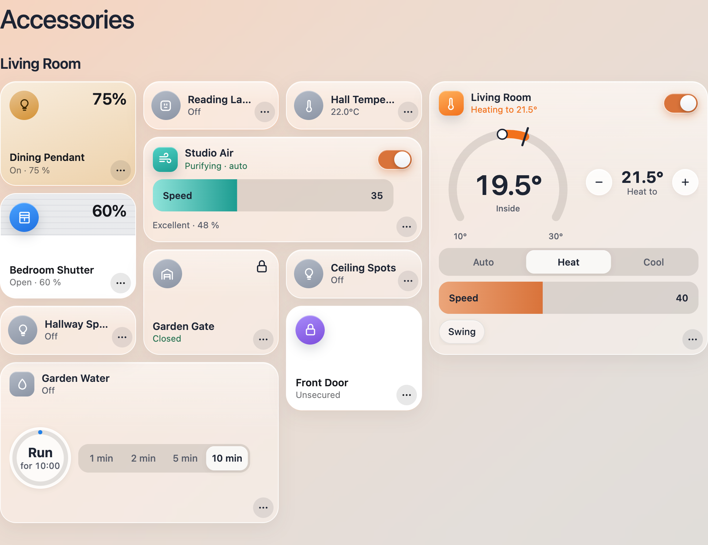

## Setting it up

```json
{ "platform": "HomeswiftUI", "port": 8581, "host": "0.0.0.0", "auth": "form" }
```

| Key | Default | What it does |
|---|---|---|
| `port` | `8581` | Where the UI listens |
| `host` | `0.0.0.0` | Every interface, so phones on the network can open it; `127.0.0.1` keeps it on the machine |
| `allowedHosts` | `[]` | Names the UI answers to, besides IP addresses, localhost and this machine's name: a DNS name, a reverse proxy's host |
| `auth` | `form` | A username and password, the first account made with the set-up code from the bridge's output. `none` for a trusted network or localhost only |
| `sessionDays` | `7` | How long a sign-in lasts without activity |
| `https` | `false` | Serve HTTPS, with your certificate (`certificate`, `privateKey`) or one the bridge makes (see [Security](#security)) |
| `trustProxy` | none | Reverse proxies (addresses, CIDR ranges, or `loopback`, `linklocal`, `uniquelocal`) whose `X-Forwarded-For` and `X-Forwarded-Proto` count |
| `checkForUpdates` | `true` | Ask GitHub twice a day for a newer release and say so on the Status page |
| `scheduledRestartCron` | none | Restart homeswift on a schedule: a cron expression of five fields, `0 4 * * 1` for Mondays at 4:00; the settings form sets it as a time and days |
| `scheduledBackupDisable` | `false` | Turns off the daily backup of the instance |
| `scheduledBackupPath` | `instance-backups` next to config.json | Where backups are kept: a folder that exists, a network share for a copy off the machine |
| `scheduledBackupDays` | `7` | How many days daily backups are kept |

Restart the bridge: its banner prints the UI's address and, until an account exists, a set-up code. The first visit
asks for that code, a username and a password, and creates the administrator account. Users live in `ui-users.json`
next to config.json as salted PBKDF2 hashes; delete the file and restart to start over, with a new code. More users are
added on the **Users** page ([Users, roles and API tokens](#users-roles-and-api-tokens)).

## The pages

The header has the sections (Status, Accessories, Scenes, Plugins, Logs, Settings), the Assistant's sparkle
when it is on, and the account menu behind your initial: **Account**, **Appearance**, **Users** (administrators),
**Language**, then apart and in orange **Restart homeswift…** (administrators), and **Sign out**. In a window 1180 px
wide or more the app sits in one frame of glass and the header becomes the menu down its
left: the sections under **Home**; under **You** the account menu's entries (**Account**, **Appearance**, **Users** for
administrators, **Language**, **Sign out**), each with its icon, in place of the account button; and at its foot
**Homeswift** and its version, folded, which opens upward over the menu (a click outside closes it) into its health, the machine, the update button, **Send feedback**
and **Restart homeswift…** (administrators). Narrower, the account menu has them; on a phone, the ☰ panel, under
Account. The Status page keeps only **Customise this page…**, floating at the window's bottom right. Every view is an address ([Addresses](#addresses)), so Back and Forward work and a view can be kept or
shared.

### Status

The start page: a summary (accessories, plugins, Home app controllers, uptime), then sections you arrange.

- **Bridges**: each bridge with its device ID, port, plugins and pairing state. A bridge the Home app has not paired
  yet shows its setup code and a QR code for the Home app's camera. Accessories and Matter devices of their own (a
  television, a camera, an accessory made a Matter device) are one line each in **Devices of their own**: its name,
  where it was added and its state, unfolding to its port, its ecosystems, its pairing code and its actions. A Matter
  device's icon carries Matter's tag. Those waiting to be added come first (open when there are one or two); past
  eight devices a search (by name or ecosystem), a filter (Matter, HomeKit, waiting to be added) and an order (waiting
  first, name, most ecosystems) narrow the list, kept in the address (`/status?show=matter&devices=name`), so a home of
  a hundred stays one screen to scan.

  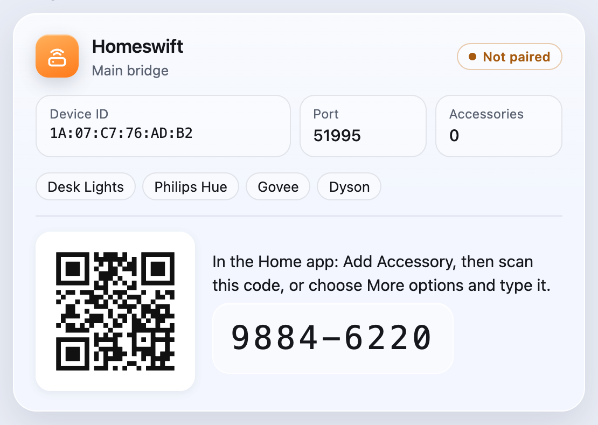

- **Activity** charts the homeswift process's memory and CPU, how long the bridge takes to answer the Home app's reads
  and writes, and how long plugins take to reach their devices (average and longest), for every server, one bridge or
  one accessory. The time range is a segmented control (1 hour, 6 hours, 24 hours, today, yesterday, 7 days) with
  **Custom…**, a pop-over with a month to pick the first and last day and the From and To times. A range that ends now
  refreshes every minute; a gap is a time homeswift was not running; **Show as a table** lists the values. The bridge
  samples memory and CPU every 10 seconds and keeps a record per minute under `metrics/` next to config.json (a file per
  day, 8 days), so the charts survive a restart. The view is `/status?since=24h&bridge=<bridge>&accessory=<accessory>`.
- **Daily digest**, with the Assistant on: what needs attention today, from the day's warnings and errors and the
  accessories. **Write today's digest** streams it; the bridge keeps it for the day (`ai-digest.json`, owner-only) and
  the card's **⋯** writes it again. Any user reads today's digest; an administrator writes it.
- **Vault**, for administrators, once the vault has an entry or config.json a secret to move: how many entries the vault keeps, how many config.json uses and how many secrets
  config.json still holds, then what needs attention, most pressing first (a reference to an entry that is gone, one
  that cannot read its entry, an entry expired or expiring within 30 days), and **Open the vault**.
- **Energy**, once a plugin records readings with an energy role (`EnergyTag`, docs/plugins.md). See [Energy](#energy) below.
- **System**: the version, uptime, machine and configuration file, and, for administrators, **Restart homeswift…**,
  Settings and Notifications.

When GitHub has a newer release, a card under the summary says so, with its notes and how to upgrade this install: the
`.spk` to download on a Synology NAS, the image tag to pull in Docker, `brew upgrade` or the tag to check out. The
bridge asks GitHub's API a minute after it starts and then twice a day, sending only its version (`ReleaseWatcher`);
`"checkForUpdates": false` turns it off. On a Homebrew install an administrator's **Install and relaunch** runs
`brew upgrade homeswift` and restarts into the new binary (Homebrew's `opt/homeswift` link); the update button (the
side menu's, or the footer's) follows it (**Install update**, **Installing…**, then **Relaunch to update** when the new version is on disk, from here
or a `brew upgrade` run by hand). A Synology package, a container and a checkout cannot upgrade themselves: their card
says how. Settings › Updates has the same card.

**Customise this page**, at the bottom, opens a menu with a switch per section (overview, digest, activity, energy,
bridges, system) and drag handles to reorder them. Changes apply at once; the layout is each user's own, on every
browser. The Quick Controls ([below](#quick-controls)) sit at the top of the page.

#### Energy

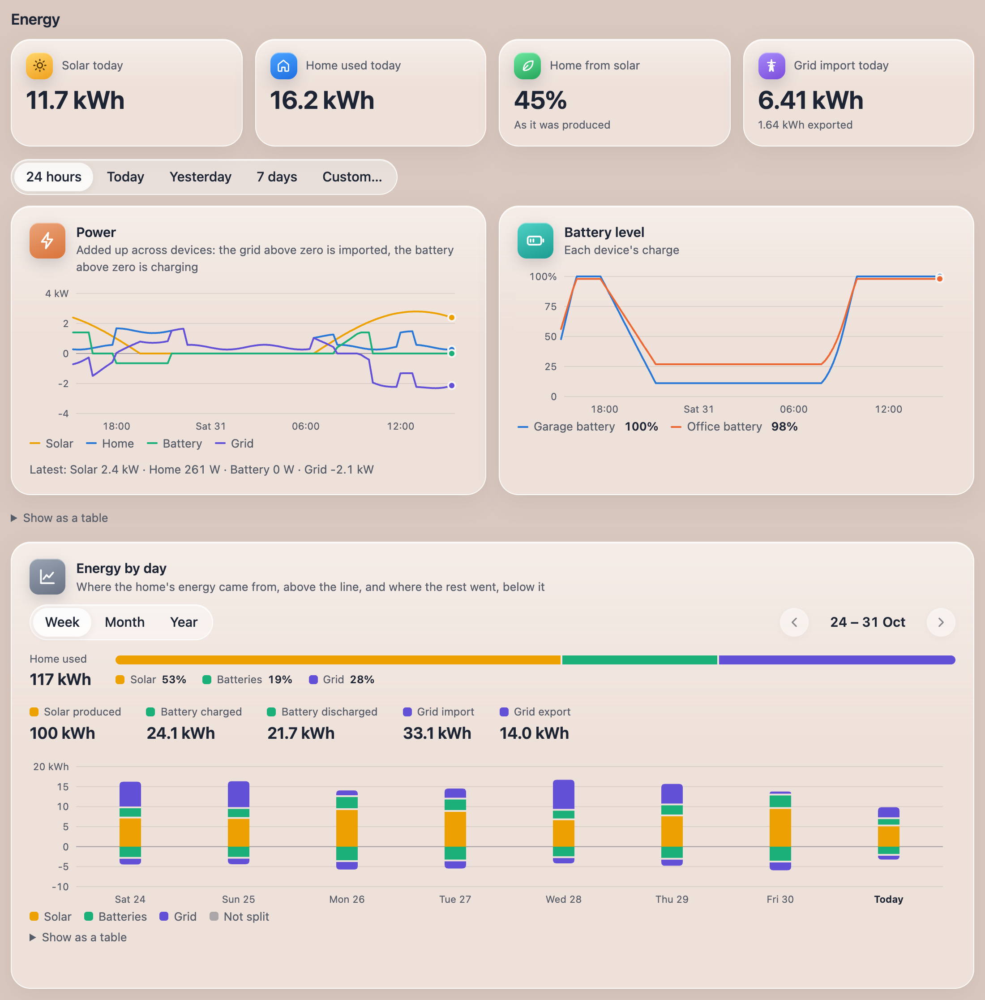

- **Today**: solar produced, home use, the share of it solar covered, and grid import, as figures.
- **Power**: solar, the home, the grid (importing above zero, exporting below) and the batteries (charging above
  zero), each added up across devices, and each device's battery level. Its own range: 24 hours (the default), today,
  yesterday or 7 days (`?energy=7d`). Where the bridge recorded nothing (before it ran, while it was stopped), the power
  lines show what a plugin imported for those hours, each hour at its average, and the line under the chart says so.
- **History**: the energy in kWh as stacked bars, a **Week**, **Month** (a bar per day) or **Year** (a bar per month)
  at a time, with the periods before and after (`?energy-view=month&energy-date=2026-05-01`). Above the line is where
  the home's energy came from (solar as it was produced, the batteries, the grid), below it where the rest went (into
  the batteries, out to the grid). Over the bars, the period's home use with a strip of the share each source covered
  (its percentage written beside each colour), then the flows: solar produced, battery charged and discharged, grid
  import and export. The axis writes its unit once, on the top tick.

The history is the bridge's long-term archive (`metrics/energy-hours.json`, kept for years): each hour of what it
recorded, and what plugins import, such as a device cloud's solar, home use, battery and grid since a system was set
up. An hour the bridge recorded most of keeps its own figures; an imported hour without grid or battery figures has the
rest of its home use shown as **Not split**, in grey, and the card says so. While a plugin imports, the card shows its progress (**Importing the …
history**, 4 of 10) and the bars fill in as each part arrives; once done, a line says what the history covers and when
it last ran, and a failed import says why.

Each entity keeps one colour in every chart (solar yellow, the home blue, the batteries aqua, the grid violet), from a
palette checked for colour blindness in both modes. **Show as a table** lists the points and the days (solar produced,
home used, grid import and export, battery charged and discharged, the share solar covered). Days are counted from each
minute's average power, midnight to midnight in the browser's time zone. `/api/metrics/energy?from=…&to=…&timeZone=…`
answers the power in one request and `/api/metrics/energy/history?period=week|month|year&date=…&timeZone=…` the
history, for any signed-in user.

### Accessories

A wall of widgets (`widgets.js`), each accessory drawn by the widget of its kind in a box of the size chosen for it:
small (1×1, a tile a tap acts on), medium (2×1) or large (2×2). [widgets.md](widgets.md) has every widget, with
screenshots, and what a plugin does to get good ones.

- **Controls**: a change shows at once and goes to the device; a refusal puts the value back and says why. Opening,
  unlocking and disarming are held; a shutter's tile slides; a light with Adaptive Lighting has a sun swatch that turns
  it off or resumes the Home app's schedule. Temperatures show in the unit chosen on [Appearance](#appearance). Values
  that carry keys (a camera's Setup Endpoints) are not shown, nor what only HomeKit uses.
- **A widget's ⋯ menu** (a right click on a tile): its size or its kind's, **All controls** (every control in a sheet,
  the rest under More), Identify, its log, ask the Assistant about it, its plugin's settings (administrators), resume a
  paused plugin, a room, a name for these pages, add to the Quick Controls or hide it, and **History** for an accessory
  whose plugin records an Eve history (temperature, humidity, power…): a day, a week or four weeks.
- **Full screen** (the toolbar's last button, or `/accessories?full=1` for a wall tablet's bookmark): the widgets alone,
  in the browser's own full screen where it has one. Grouped by room or by plugin, one group fills the screen at a time
  and the next is a swipe away (the arrow keys, the dots, the side arrows with a mouse); one button opens the toolbar
  (search, grouping, filters, Leave full screen) as a panel from the right edge, and Esc leaves.
- **Visible in Home app** (a widget's ⋯ menu, administrators): off, the accessory leaves the Home app, with its room,
  scenes and automations, while Homeswift and Matter keep it (`_hiddenFromHomeKit` in its plugin's block).
- **Edit** shows grid guides, size controls and corner handles, and lets tiles be dragged onto any cell of the grid,
  gaps included: the others make way, and the wall keeps every widget's cell until **Pack the widgets together** (the
  wall's menu) lets them flow again ([widgets.md](widgets.md)). The wall is
  **One wall** (the default), **By room** (once there are rooms) or **By plugin**. The bridge keeps the layout in
  `ui-layout.json` next to config.json (`/api/layout`), the same for every user.
- **States**: a paused plugin's accessories are drawn striped, their controls out of reach; an accessory whose device
  does not answer says No Response.
- **Cameras** get a card of their own: the picture in 16:9 with the name, motion, the doorbell's last ring and recording
  over it, buttons to unmute, refresh and go full screen, and the camera's controls under it. While the card is on
  screen and the page visible, it plays the live feed muted (`GET /api/cameras/<id>/live`, fMP4 through Media Source
  Extensions, ManagedMediaSource on iOS Safari) when the plugin has one, otherwise a snapshot every 3 seconds
  (`/api/cameras/<id>/snapshot?width=&height=`). Off screen it fetches nothing. A camera has four live viewers at most;
  one turned off in the Home app, or whose plugin is paused, shows nothing; one that sends no picture shows television
  snow behind its message (a still frame under reduced motion).
- **Rooms** (Glass UI's accessory layout): a card's **⋯** puts the accessory in a room (a new name adds the room), gives
  it a name for these pages (the Home app keeps its own), adds it to the Quick Controls, or hides it; hidden accessories
  stay out unless **Show hidden** (`?hidden=1`). Accessories mirrored from another controller (the Home app's, through
  the Wingman plugin) carry a small house badge, sit in that controller's room until given one here, and have a filter
  of their own, the **Apple Home** switch (`?from=Apple%20Home`). The layout is the bridge's, shared by every user, in
  `accessory-layout.json` next to config.json (owner-only; `/api/rooms`). The Home app never sees it; the MCP tools do:
  `list_accessories` and `set_accessories` filter by these rooms.
- **Rooms on the hubs**: in **Edit**, with the wall **By room**, each room's heading is a field: type a new name, then
  Enter (or click away) renames the room, Escape keeps it. A tile dragged into another room's wall moves the accessory to
  that room, or out of any into **No room**; every room shows there, empty ones too, to take a drop. The **Rooms** menu orders the rooms (drag them) and renames
  one too (choose it). Its **Rename on the hubs too** switch, off until turned on (`syncRoomNames` in
  `accessory-layout.json`), makes a renamed room's new name reach the plugins' hubs: every room of a Philips Hue Bridge,
  an IKEA DIRIGERA hub or an eWeLink home named as the room was, case and accents aside, is renamed with it, and the
  log says so (`Room "Salon" renamed "Lounge" on Hue`). It goes one way: a room renamed in the Hue app stays as Homeswift
  has it. Govee keeps no rooms its API can reach. A hub that refuses says why under the page; the room is renamed in
  Homeswift all the same.
- **Suggest rooms**, with the Assistant on, asks it for rooms and clearer names for every accessory
  (`AssistantService.suggestOrganization`; the ids reach the model as aliases) and shows them to review: untick what you
  do not want, then **Apply** saves the rooms and the names as display names. Accessories it finds odd are listed as
  advice.
- **Groups**: **Create group** opens a two-column picker (available accessories on the left, the members on the right,
  with search and device-type filters); in Edit, holding a compatible tile over another's centre and dropping it starts
  one. A group shows its members' shared writable controls; it is not a HomeKit accessory. Its menu edits the members
  or ungroups them, and **No Response** shows the members that do not answer. [widgets.md](widgets.md#accessory-groups)
  describes the devices and the storage.
- **Adaptive Lighting**: the sun swatch of a light with Adaptive Lighting turns it off, or on again with the schedule the
  Home app last sent, started now as the Home app starts it ([widgets.md](widgets.md)). Wingman reports an Apple Home
  light's white temperature in kelvin; it cannot confirm or turn on Apple's Adaptive Lighting.

**Graph** (`/accessories/graph`; the page's tabs are **Wall** and **Graph**): a radial graph with homeswift at the
centre, each bridge an icon on the first ring, its plugins on the second, each device type on the third, and each
accessory a disc on the outer ring, each plugin's branch in a colour of its own. Names are in the tooltips and cards,
and the icons of a ring never overlap. Click a bridge or plugin to zoom into its branch; Ctrl-scroll, a trackpad or
touch pinch, dragging and the zoom buttons move the view. Click any node for a card with its facts and readings
(grouped by service, each with a tooltip saying what it is) and its accessories, each a click from its own card; on a
phone the card sits under the graph. An accessory's card holds its widget, live as on the wall (a tap toggles it, its main
control in reach), then **All controls** (the widget's sheet) and **Identify** when the accessory can. A search field and a Filters menu
(unavailable, bridges, device types) redraw the graph with what matches, and a table shows the same rows. **Full
screen** (the toolbar's last button, or `/accessories/graph?full=1`): the graph alone filling the window, its zoom at
the bottom right as a map's and one button in the top corner for the search, the filters and Leave full screen, both
fading while nothing happens; the cards and their actions work as on the page, a sheet from the bottom on a phone, and Esc leaves.

### Quick controls

The favourite accessories, by room, and a button per scene: at the top of the Status page, and on their own at `/quick`,
a page to keep on a phone's home screen.

### Scenes and templates

**Scenes** (`/scenes`, Glass UI's scenes): accessory values set together, by hand or by a trigger.

- **Triggers**: a time of day on chosen days, sunrise or sunset with an offset (-12 to +12 hours), a characteristic
  change (the motion sensor turns on), or a cron expression (`30 7 * * 1-5`; five fields, or six with seconds, which are
  ignored). Automations run on the minute; a characteristic trigger runs a scene at most once per 5 seconds.
- **Conditions** hold an automatic run back: a time window (`sunset` to `23:00`, across midnight too) or a
  characteristic's value. A run by hand ignores them. Sunrise and sunset come from Glass UI's equation for the location
  set on the page (typed, or this device's position).
- **Add an accessory as it is now** fills the actions from its current values.
- **Locks, garage doors and alarms** keep Homeswift's rule that a person confirms them: the page asks before running a
  scene that has them, the MCP server's `run_scene` refuses such a scene (as homebridge-mcp-server's does), and
  automations, with nobody to ask, leave those actions out and say so in the scene's last run. Glass UI sets them like
  any value.

Scenes are kept in `scenes.json` next to config.json (owner-only), with each one's last run. The editor's **A switch
in the Home app** makes the scene a switch of one **Homeswift Scenes** accessory on the bridge: turning it on runs the
scene, leaving out its locks, doors and alarms; turning it off puts the lights back, and it shows whether the scene is
on.

 A scene's card says its
room when its accessories share one, and **Scene active** while every value it sets is what its accessories show.
Its ⋯ menu gives it a picture of your own (**Choose a picture…**, shrunk to 640 pixels; JPEG, PNG or WebP up to 1 MB)
or takes it away; a hub's scene has the same menu, and its picture is the one the Hue or IKEA page shows. The bridge
keeps them in `scene-pictures/` next to config.json. A hub's scene's menu also renames it on its hub, keeps its lights
as they are now, or deletes it from the hub (after asking: it goes from the hub's own app too). A new scene of lights
only, without triggers or an animation, can be saved to the Hue room or zone, or the IKEA hub, that has all its lights:
the editor's save bar offers it beside **Create the scene**.

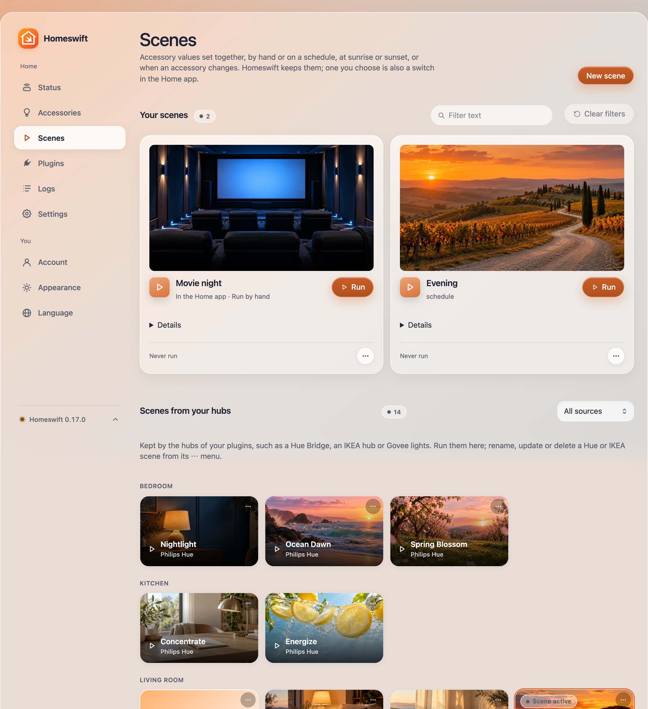

**Scenes from your hubs**, under them: the scenes plugins' hubs keep (a Hue Bridge's rooms and zones, a DIRIGERA hub,
the scenes picked for Govee lights), by room, with their pictures or colours and a source filter when there are
several. A tap recalls one on its hub; Hue's say **Scene active** while the bridge says so. **Stop** puts back the
lights it changed, for 12 hours, as for any scene. **Automate** makes a Homeswift scene that recalls it, to give it
triggers and conditions; the editor's **Add a hub scene…** adds one to any scene. The editor's **Animation** step
makes the chosen lights move after the actions: a style (candle, fire, sparkle, prism, underwater, a sunrise, moving
colours, following the music…) with its speed, brightness and colour. Each brand plays it the way its own app does where
its lights have it (Hue's effects, Govee's library scenes, an IKEA fade for a sunrise, a SONOFF L2 strip's scenes, an
Ambilight TV for music);
Homeswift plays it on the others. An animated scene is active while it plays, and **Stop** puts the lights back. They are changed in their own app.

**Templates**, on the same page: the rooms that have lights as chips, and the collection by kind, each drawn with
photographic thumbnails. A tap tries one on the room's lights at once, without saving it: calm ones set the lights,
effects (a fireplace, a candle flicker, an ocean, a sunrise) play each brand's own way where its lights have it, and
signals and party ones are timed sequences. The pill stays lit while it plays, and what was tried shows under the rooms
with **Stop** (or **Undo**, for 12 hours, for one that set the lights once) and **Save as a scene**, which keeps it as a
scene for that room, animated or not. With the Assistant on, **Describe a scene…** writes one from a description ("a
jazz bar") and tries it the same way. The **Scene gallery** adds 143 named photographic tiles in 28 theme categories, including Get cozy, Movie night, Reading, Wanderlust, Vibrant and Party vibes. Each theme has two horizontally scrolling rows on desktop and one row on mobile. Search by scene or theme name, or select a theme to show just that shelf. Sort each shelf by gallery order, name A–Z or name Z–A. These
set a palette once across the room's lights; they do not reproduce Hue animations or brightness. Saving one as a
scene preserves its artwork. In the scene editor, expand **Scene image** to choose another picture or **No image**.
Existing scenes without artwork keep their usual icon. The original gallery titles stay the same in all languages.
On a phone each photographic theme is a single row that swipes sideways; Calm, Slow animations, Party and Signals also use single horizontal rows. Hue and IKEA scene collections share this mobile layout. Trying a template is
controlling accessories, as running a scene is. `SceneTemplateLibrary` is the collection; MCP clients use `list_scene_templates`,
and `run_scene` or `save_scene` with `template` (or `description`) and `room`.

Scene cards keep accessory actions collapsed under **Details**. Expand it to see every action.

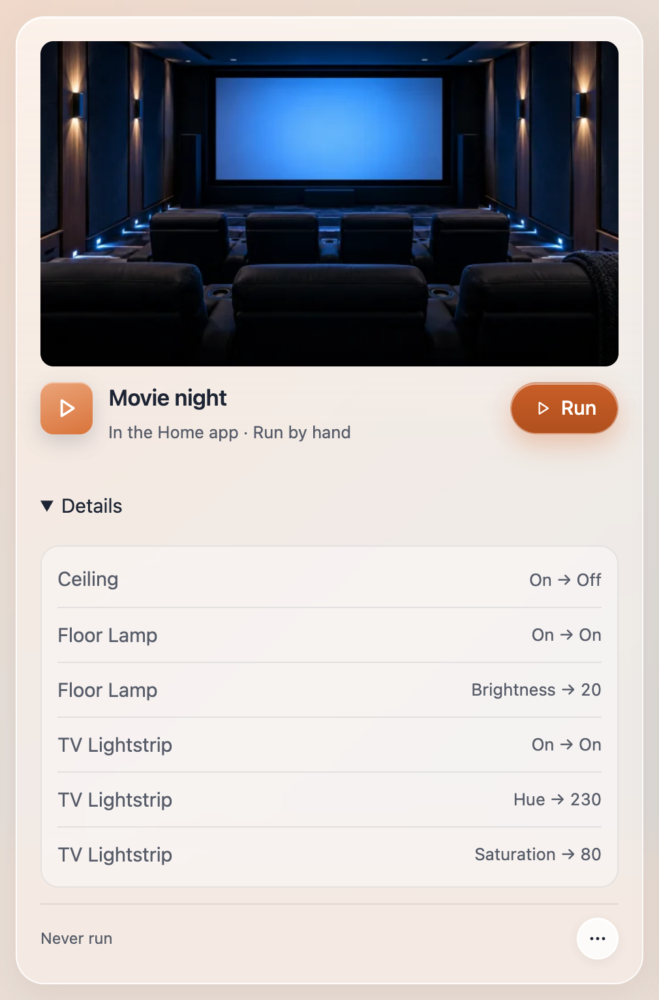

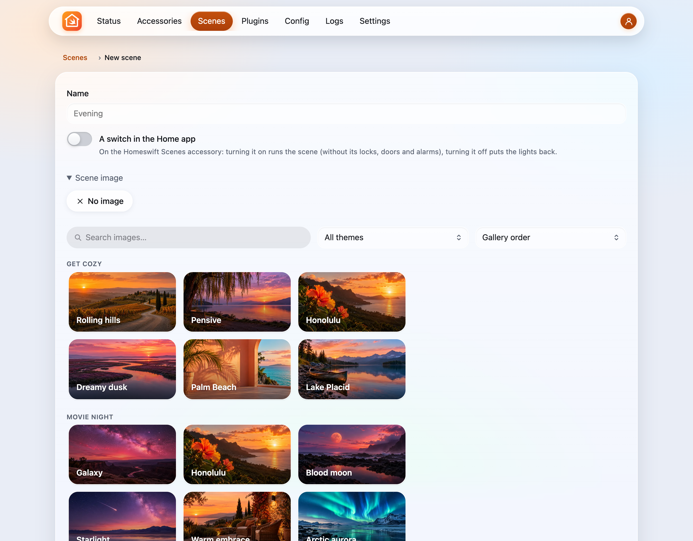

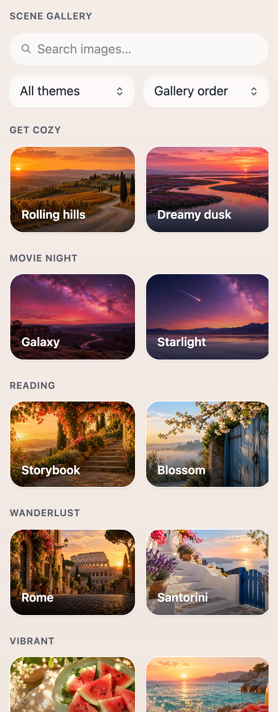

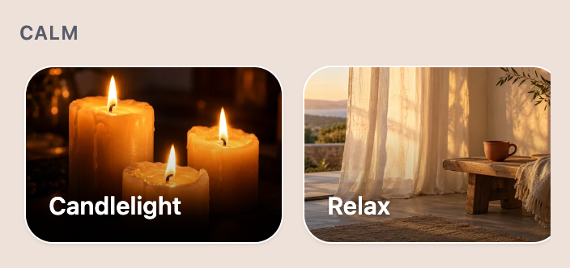

Template tiles that play show a centred square Stop icon; idle tiles show their image and name. Winter holidays and Christmas have separate scene selections.

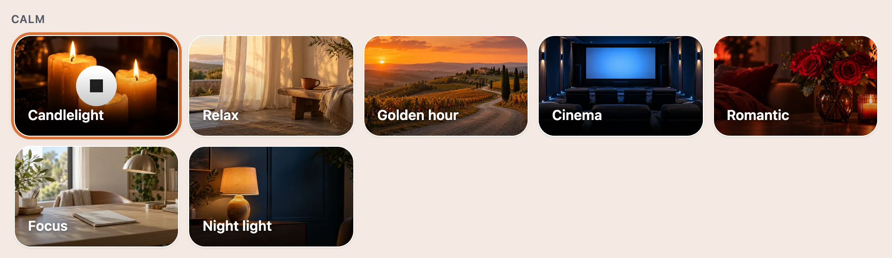

The theme menu is alphabetised in the selected language. Template photographs depict their subjects directly, including candles, a fireplace, a home cinema, a disco ball and a police lightbar.

Template tiles that play show **Stop**. Saved scenes also offer **Stop** after running. This restores captured light power, brightness, colour and Adaptive Lighting; other scene controls restore their captured values unless they have changed since. Locks, doors and alarms require confirmation before restoration. Undo state lasts 12 hours and is kept across bridge restarts for every run that set lights. Failed or skipped actions on a repeated run retain valid earlier restoration state. A light action that fails does not take ownership away from an earlier run.

The workflow action editor offers a combined **Light color** picker for colour-capable lights, brightness and colour-temperature sliders, power switches, device mode menus, and sliders for fan speed, position, volume and target temperatures. The colour picker saves ordinary hue and saturation actions, so the runtime and existing scenes remain compatible. Editing does not send device commands.

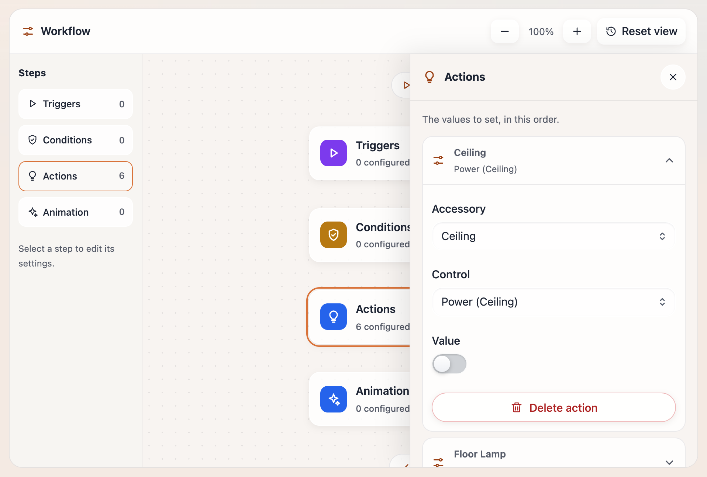

On narrow screens, the workflow editor replaces the canvas with a full-width form. Step navigation and Save stay within reach, and action summaries expand individually to keep long scenes scannable. The page handles scrolling, without a second scrolling inspector.

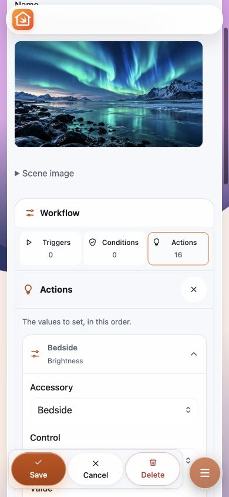

Trigger fields stack within the inspector on phones, with wrapping weekday controls.

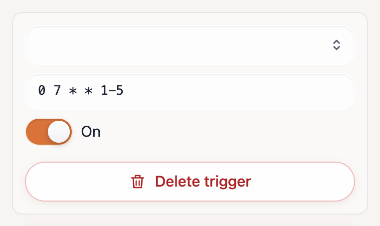

Conditions use labeled start/end groups and full-width accessory controls on small phones.

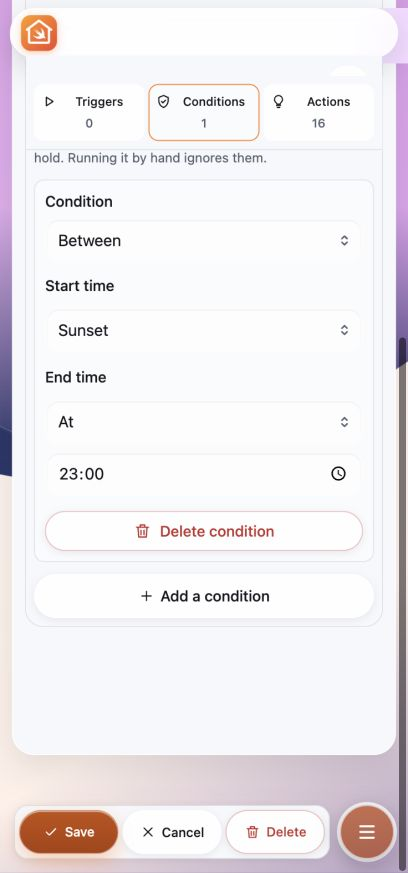

Deleting a scene opens a confirmation in the UI’s design system. Cancel is focused first; Escape dismisses it without deleting.

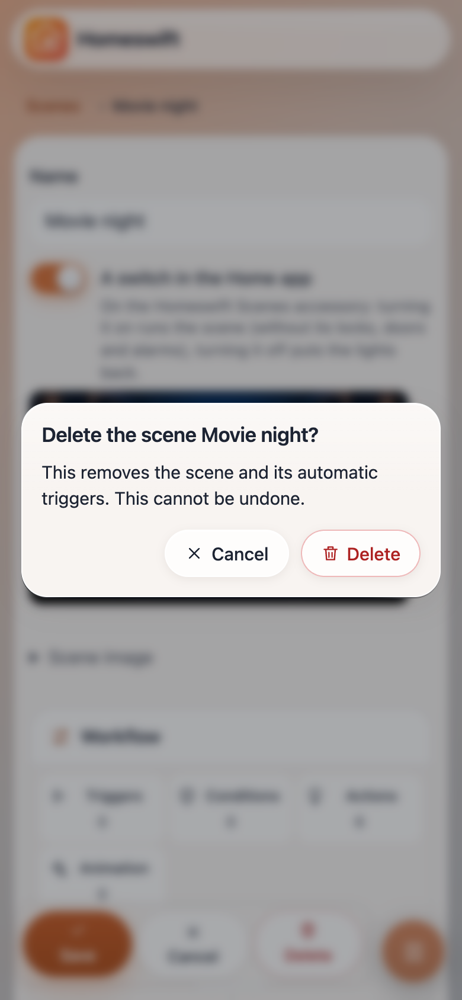

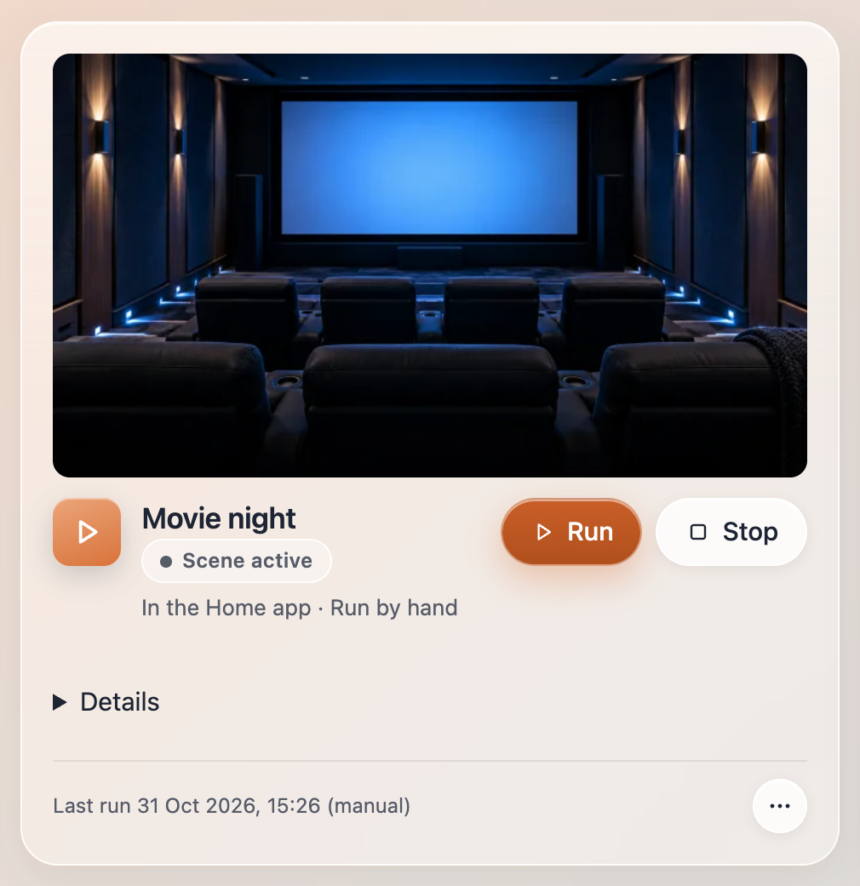


The sunrise/sunset location includes a map: click a point or finish dragging to place the pin and save coordinates immediately. Arrow keys can also position the pin for review.
**Use this device's location** asks the browser for permission and centres the map; **Save** keeps the reviewed
position. Coordinates remain editable. Visible map tiles are requested directly from OpenStreetMap when the
location section is open; manual coordinates still work without the map service.

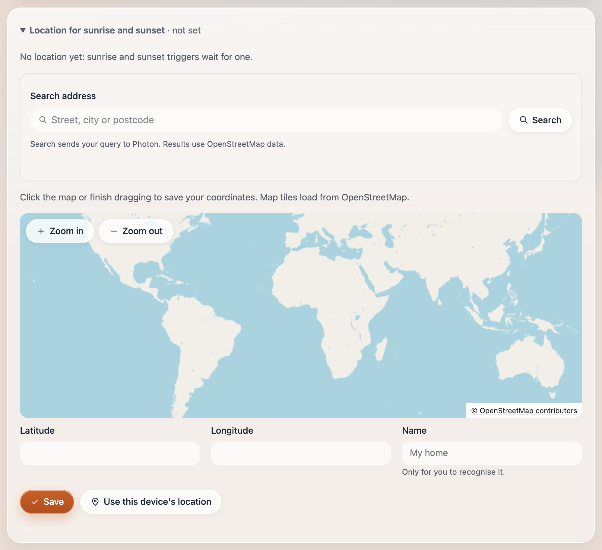

Address suggestions appear after three characters, with a short typing delay and a loading spinner. Select a result to centre the map and save its coordinates. Search queries go directly to [Photon](https://github.com/komoot/photon); the existing home name stays unchanged. Repeated searches are cached for this page, and map/manual entry remain available if search is unavailable.

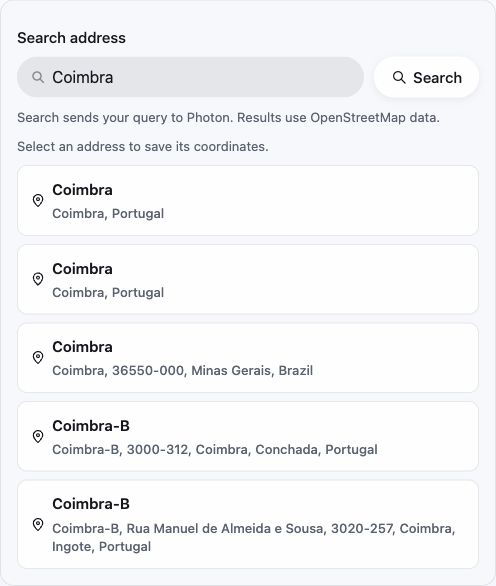

### Notifications

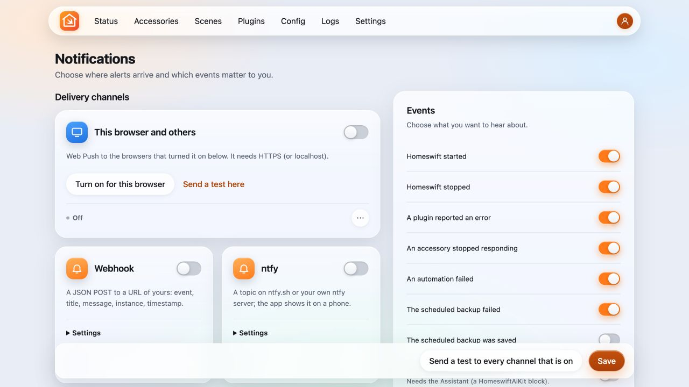

`/notifications`, from the Status page (Glass UI's notifications). Each channel is a card with its settings, its event
switches and a **Send a test**, under a Save bar.

- **Channels**: a webhook (a JSON POST with the event, title, message, instance and time), ntfy (ntfy.sh or your own
  server, with an access token), Pushover, Telegram, and Web Push to the browsers that turn it on. A webhook takes a
  **Bearer token** or **Basic authentication** and custom headers; headers that would change the transport, or a second
  Authorization, are refused.
- **Events**: homeswift started (not after a restart it made itself) and stopped, a plugin logged an error, an accessory
  answered No Response for 5 minutes while its plugin is not paused, an automation failed, the daily backup failed or
  (off until turned on) was saved, and the Assistant's daily digest at a time of your choice (off until turned on: it
  uses the provider's quota). Glass UI's update and rollback events have no counterpart here: plugins are compiled in.
- **Limits**: the same event about the same thing goes once per 15 minutes, 12 notifications an hour at most, 5 tests
  a minute.

The settings live in `notifications.json` next to config.json (owner-only), not in config.json. Tokens, keys, header
values and the webhook URL come back to the page as `********`: sent back unchanged they keep the stored value, and a
removed header row deletes it. Neither `get_config` nor the Assistant ever reads them. For Web Push the bridge makes its
VAPID key pair the first time a browser asks and keeps it in that file; the page registers `/sw.js`, a service worker
that only shows notifications and opens the page one is about. Browsers allow it over HTTPS or on localhost only; iOS
needs the page added to the home screen.

### Plugins

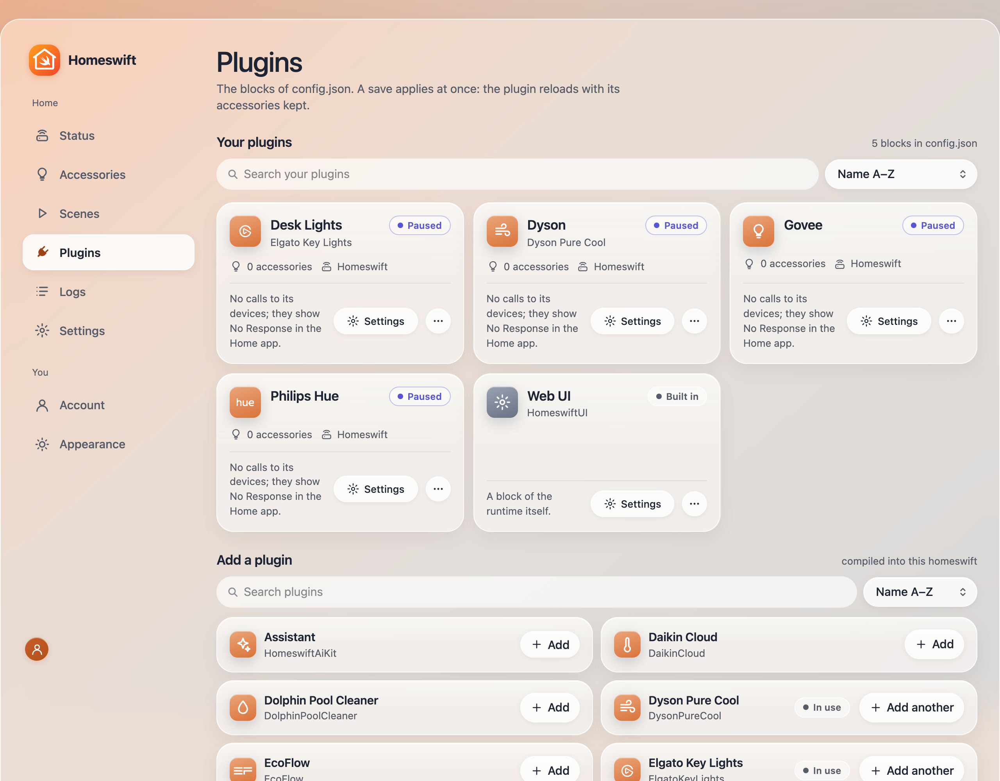

Every platform block of config.json, with whether it runs, is paused, and on which bridge; then **Add a plugin**, the
plugins compiled into this homeswift, with a search and a sort.

- **A card's ⋯** opens the plugin's page, its Expert form or JSON, pauses or resumes it, and removes it; its name opens
  its page.
- **Pause** (also at the top right of a plugin's page) stops the plugin's calls to its devices, for when an app sharing
  the account would be signed out by them. Its accessories stay in the Home app, showing No Response, and the page
  offers **Resume**.
- **A plugin's page**: a running plugin with a page of its own (pairing a TV, finding lights; [For plugin
  authors](#for-plugin-authors)) does its everyday work there, at `/plugins/<slug>` (the block's name in lower case,
  dashes for spaces: `/plugins/dyson-pure-cool`), from the list or an accessory's menu. **Add** on such a plugin writes
  an empty block and opens its page, as Homebridge's custom UIs do.
- **Expert**, last on the page and in the card's menu, is the whole block as a form built from the plugin's schema (the
  same `config.schema.json` the Homebridge version ships), or as JSON: `/plugins/<slug>/expert` and `/expert/json`. A
  plugin that does not run, or has no page, shows the form at its own address, and so do the runtime's own blocks,
  `HomeswiftUI` and `HomeswiftAiKit` (the Assistant and the MCP server).

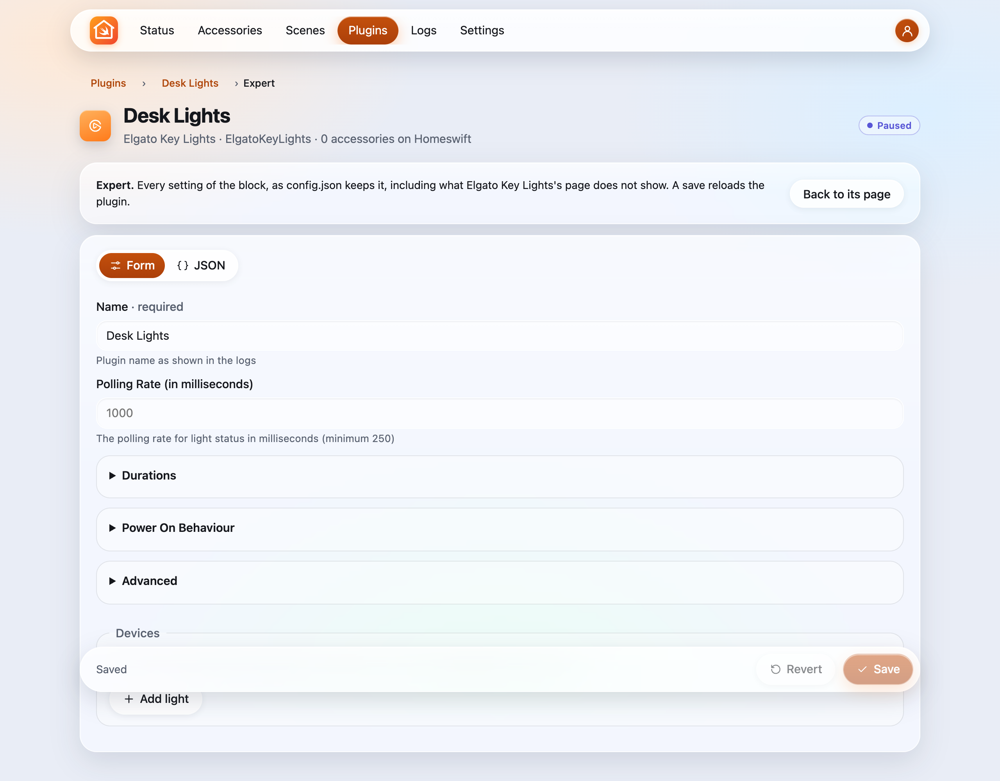

The form follows the schema's `condition`s (`functionBody` or an expression, as Homebridge's form reads them): a field
shows only when its condition holds for the block or, in a list, for its entry (`arrayIndices`). The page runs no code
from the schema: it reads the part of JavaScript conditions use (`model.a.b`, `[arrayIndices]`, literals,
`.includes()`, `!`, comparisons, `&&`, `||`) and shows a field whose condition it cannot read. A field with
`"x-schema-form": { "requiredWhen": "model.route === 'app'" }` is marked required, and its input `required`, only while
that condition holds and the field is on screen: settings that depend on another (an account or keys, by the route
chosen). A boolean with
`"x-schema-form": { "invert": true }` shows its switch on while the value is false, for a key that turns something off
under a title that turns it on (the web UI's daily backup). A certificate or key field takes a dropped PEM file, which
the bridge checks and keeps owner-only under `files/` next to config.json.

The JSON view is coloured as you type, like Settings › Config, and Save takes the view on screen. With the Assistant on,
**Describe your setup** above the form writes the block from a sentence and the plugin's schema; the change shows as a
diff, and **Use it** puts it in the form to review and save. Passwords and tokens never reach the provider.

**Saving** validates the block, backs up the previous file and applies it at once ([Applying changes](#applying-changes-and-restarts)).
The JSON view marks the line of a syntax error as you type, and Save waits until it is fixed. A save also checks what it
changes against the plugin's schema (a type, a bound, a choice outside the list, a required setting): the problems
show under the editor with their lines marked, **Line 12** puts the caret there, and **Save anyway** keeps a value the
plugin accepts that its schema does not list. Settings left as they were are not checked, so an old mistake never stops
another change; a plugin's own page and **Pause** write without the check.

### Logs

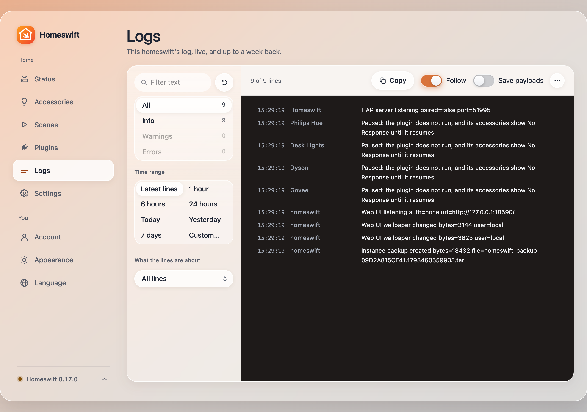

The live log, filtered by the following; in a window 1180 px wide or more they sit in a column down the log's left, the
levels and time ranges as lists, and the log takes the window's height:

- **Level**: All; Info (info and above); Warnings or Errors alone, each with how many lines it has.
- **Text**, which looks inside a line's JSON payload too.
- **Time**: the latest lines, the last hour, 6 or 24 hours, today, yesterday, the last 7 days, or **Custom…** (the
  Status page's time range control).
- **What the lines are about**, one menu: every line; the bridges' own lines (their servers' connections, pairings and
  controllers), every bridge's or one's; a plugin's own lines (its pairing, devices, clouds and errors); or an
  accessory's (those of its own server and those that name it, its id or its address), grouped by plugin.

**Copy** puts the lines shown on the clipboard as text. **Diagnose** (Log Doctor, with the Assistant on) sends the lines
shown, the latest 3,000, to the Assistant, which groups the issues with their causes and fixes as it writes; secrets and
addresses are masked first. The **⋯** menu downloads the range shown, or the whole log for the latest lines, as a text
file, and **Empty the log** removes every line, in memory and on disk, after asking (the MCP server's `truncate_logs`,
admin-only, does the same).

A line that carries JSON of 160 bytes or more (a device's state, a cloud's message) shows a marker such as `{…} 1.4 KB`
instead, in the terminal too; its **JSON** button shows the payload under it, formatted. The payload is kept with the
line, its secrets masked (values of keys such as `password`, `token` or `apiKey`, and bearer tokens, JWTs and setup
codes anywhere). The latest lines keep their payloads in memory; **Save payloads** also writes them to the log on disk,
so you or the Assistant (`search_logs` with `hours`) can read them after the lines moved on or the bridge restarted. It
is off until turned on, and the choice is kept in `logs/settings.json`.

The bridge keeps its log on disk under `logs/` next to config.json: segments of 8 MB at most, a new one each day, the
oldest removed past 64 MB or 7 days, written in batches once a second so logging never waits for the disk.

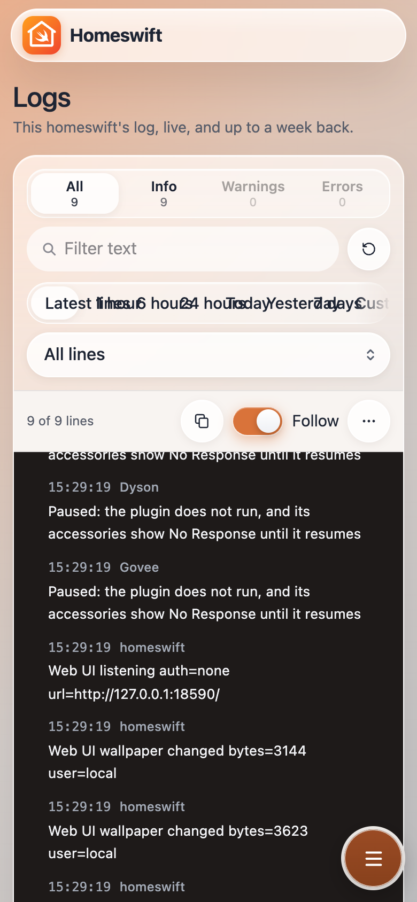

On a phone the filters take three short rows: the levels with each count under its name, the search with Clear filters
as an icon (shown when there is something to clear), and the time range and the menu. **Save payloads** moves into the
**⋯** menu.

### Settings

For administrators, after the Homebridge UI's settings, child bridges, backups and restart pages. Its tabs:

- **Bridge** (`/settings/bridge`, where `/settings` opens): config.json's `bridge` block as a form (name, port, setup
  code, manufacturer, model, firmware; saving restarts homeswift; the device ID stays). The setup code shows as the
  bridge runs with it, whether config.json keeps it sealed or in the vault, with a copy button and the pairing QR code;
  it is written back only when it changes. Then the network (the addresses, the
  advertiser), each server's HomeKit pairing with **Reset pairings…** in its ⋯ menu, the cached accessories (stale ones
  first, ten in view and the rest scrolling in their card) with **Remove from the cache…** and **Reset every cache…**, and a link to the schedules and proxy settings of
  the HomeswiftUI block. A HomeKit port is checked before it is saved; an empty one picks a free port. Homeswift listens
  and advertises on every interface with the system's mDNS (Bonjour, or Avahi on Linux): there is no interface to bind
  or advertiser to choose, as Homebridge's `bind` and `advertiser` settings do, and no Node-specific setting
  (environment, debug mode, keep orphans).
- **Config** (`/settings/config`): the whole config.json in an editor; see [Config](#config) below.
- **Child bridges**: each with its status, uptime, restarts, the plugins that did not start and why, and, until the Home
  app has it, its setup code and QR code. Its ⋯ menu restarts, stops or starts it, shows its log, and resets its
  pairings.
- **Backups**:

  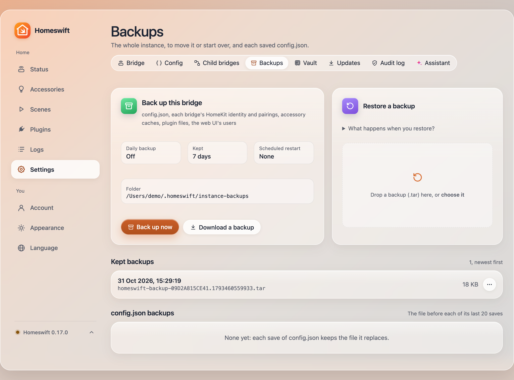

  - **Download a backup** makes an archive of the instance (a tar: config.json, each bridge's HomeKit identity and
    pairings, the accessory caches, the plugins' files under `plugins/`, `files/`, the web UI's users and certificate,
    the MCP audit log). Left out, at any depth, as upstream does: the backups, `logs/`, `metrics/`, the web UI's
    sessions, what other systems put there (`node_modules`, `.git`, `@eaDir`…), and files over 10 MB.
  - **Back up now** keeps one in the backup folder, as the daily backup does at a random time before 7:00 (unless
    `scheduledBackupDisable`), removing this bridge's older than `scheduledBackupDays`. Each kept one downloads,
    restores or goes.
  - **Restore a backup** takes one, dropped or chosen (64 MB at most). The bridge checks it whole (its `info.json`, a
    config.json that runs, only plain files under relative paths: links, devices, absolute paths and `..` are refused),
    stages it in `.restore-pending/` and restarts; the new process puts the files in place before it reads anything,
    keeping this machine's bridge and web UI ports. Files the backup does not have stay.
  - **config.json backups**: the file before each of its last 20 saves, each compared with the file as it is (a diff)
    or restored.
- **Vault** (docs/vault-design.md), for administrators:

  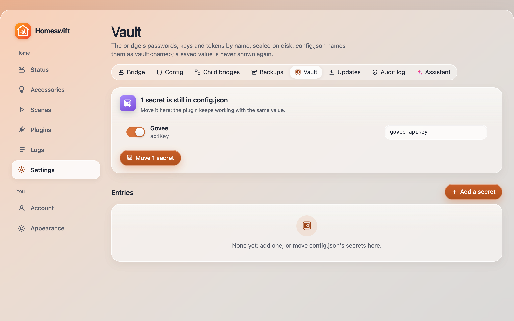

  - The secrets still in config.json, each with the entry it would become (identical values share one): untick one to
    leave it, rename an entry, then **Move to the vault**, which backs config.json up and writes it with `vault:`
    references.
  - The entries: kind, field names, who uses them (settings that name them, or the plugin that keeps a token), when
    they were last used (a reference resolved or the plugin read its token; noted once an hour at most) and when they
    expire. **Add a secret** and **Replace the value…** take values that are never shown again; an entry config.json
    still names cannot be deleted.
  - What needs attention is listed on top, each with the step that fixes it: references to entries that are gone (the
    bridge does not start with them, **Add it…**), references that cannot read their entry (a field it does not have,
    or another plugin's entry), and entries expired or expiring within 30 days (**Replace the value…**). The Status
    page's Vault widget and the daily digest say so too.
  - In a settings form, a secret's field has a key button: its menu searches the vault's entries and puts the one
    chosen as `vault:<name>`, shown as it is.
- **Updates** (`/settings/updates`): this version, how it was installed, when GitHub was last asked, a switch for the
  checks twice a day (the HomeswiftUI block's `checkForUpdates`, written at once: `PUT /api/updates/automatic`),
  **Check now** and **Restart homeswift…**. When a newer
  release is out, its card: **Install and relaunch** on a Homebrew install (`POST /api/updates/install`, then
  `GET /api/updates` while it installs; an upgrade that leaves the old version in place, as when the tap has not caught
  up yet, is an error), **Relaunch now** once it is on disk, how to upgrade elsewhere.
- **Audit log**: the MCP audit log (`homeswift-mcp-audit.jsonl`): every write of MCP clients and of the Assistant's chat,
  and every change made in this UI (client `web UI`, the user, the route, a small body with its secrets masked), newest
  first, filtered by time, outcome, tool and client (`/settings/audit?since=7d&outcome=failed&tool=…&client=…`).
  `auditLog: false` in the MCP block turns it off.
- **Assistant** (`/settings/assistant`): **Test connection** (a one-word request with the saved HomeswiftAiKit block),
  what the Assistant used today and this month against its budgets, by model and by user, and **Edit the budgets**,
  written to the block. The block's own page has the same card above its form, where the test takes the form's settings,
  saved or not, and the budgets are saved with the form.

The pages' changes that cannot be undone (pairings, caches, a restore) ask first, some with a word to type.

#### Config

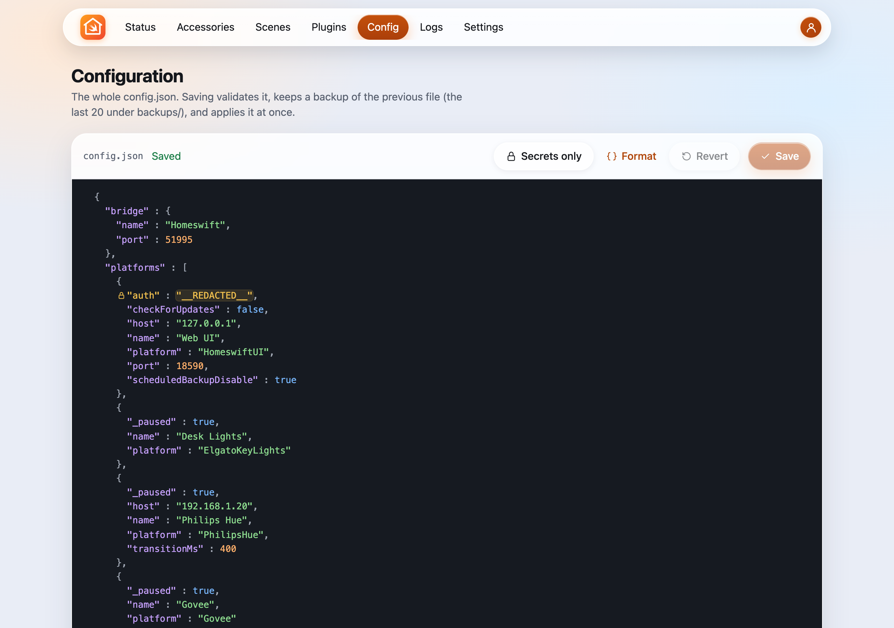

A tab of Settings (`/settings/config`; `/config`, its address before, leads there). The whole file in an editor. Saving validates it, checks each plugin block's changes against its schema as the Expert
view does, keeps a backup under `backups/` (the last 20), sorts the keys and applies it. A syntax error's line is
marked as you type.

- **Folding**: a block that spans lines folds from the chevron beside its first line (Option-click folds or opens every
  block at that indentation; ⌘⌥[ and ⌘⌥] at the caret), and a click on its ⋯ opens it. What is saved, copied or
  formatted is always the whole text. A plugin's JSON view folds the same way.
- **Secrets**: a key that holds one (the bridge's redaction rule: passwords, tokens, keys, the setup code, `auth`) is
  gold with a lock before it, in both editors, and its value shows as `__REDACTED__`. A save that keeps the placeholder
  keeps the stored value, so the page never needs to show a secret to edit the rest. **Secrets only** (the lock in the
  bar) folds everything else, leaving the secrets and the way down to each; while it holds, the button is gold and a
  strip above the text says how many show, with **Show all**. Opening a fold, Format or Revert end it.

### Appearance

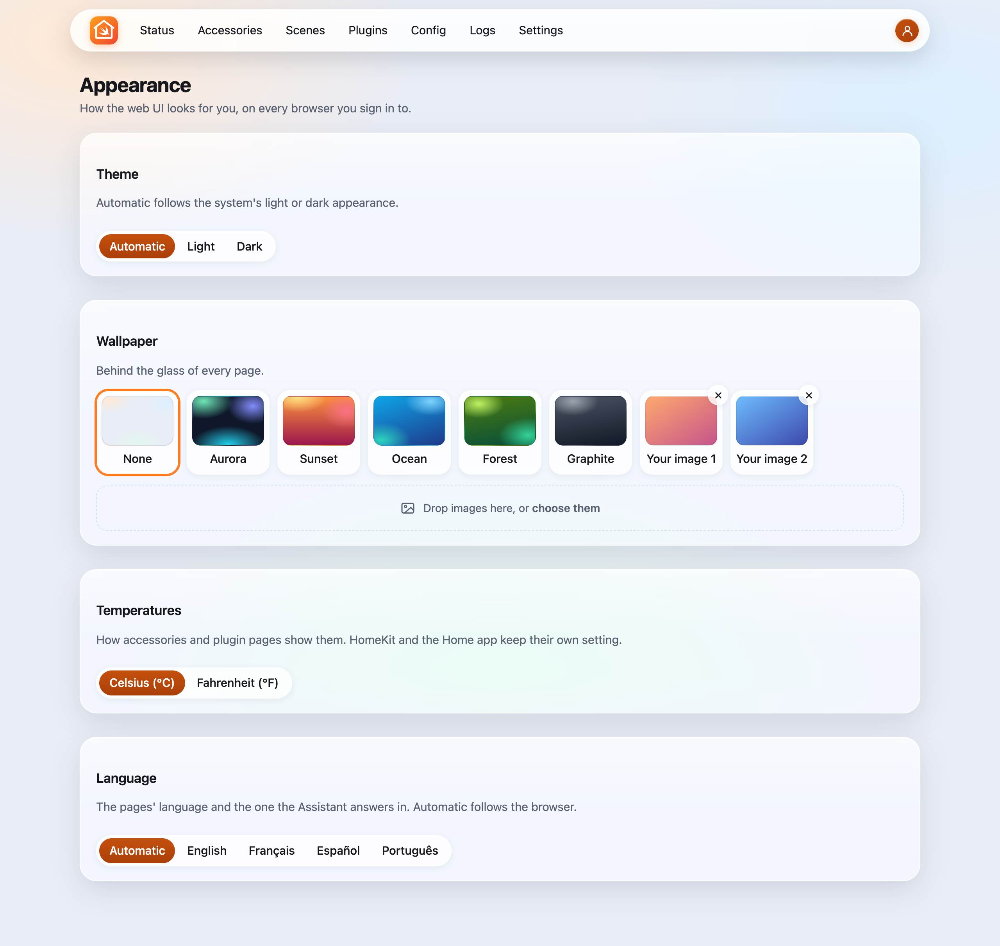

`/appearance`, from the account menu. Each user's own, kept in `ui-preferences.json` (owner-only) and applied on every
browser they sign in to; a browser remembers the last ones it saw, so a page opens in them at once.

- **Theme**: Automatic (the system's light or dark appearance), Light or Dark.
- **Wallpaper**, behind the glass of every page: photographic Aurora, Sunset, Ocean, Forest and Graphite presets; original abstract Silk, Prism, Ribbon, Lagoon, Ember and Midnight designs; or one of up to 12 images of your own. Drop images on
  the card's zone or choose them, several at once: each is scaled down to 2,560 pixels, kept under
  `ui-wallpapers/<user>/` (JPEG, PNG or WebP, checked by its bytes) and shown as it is added. A tap on its tile shows it
  again; the ✕ on its corner removes it, and removing the one shown leaves no wallpaper.
- **Temperatures** in °C or °F, on accessory cards and plugin pages. HomeKit and the Home app keep their own setting.
- **Language**: English, French, Spanish or Portuguese, or Automatic, the browser's ([translations.md](translations.md)).
  The Assistant answers in it. The selector uses the same flag icons as sign-in; Automatic uses a globe.

### Addresses

Every view is a path: `/status`, `/accessories` (and `/accessories/graph`), `/quick`, `/scenes` (and `/scenes/<id>`,
`/scenes/new`), `/notifications`, `/plugins`, `/plugins/<slug>` and its `/expert`, `/plugins/add/<platform>`,
`/account`, `/appearance`, `/users`, and `/settings` with `/bridge`, `/config` (`/config` alone leads there),
`/child-bridges`, `/backups`, `/vault`, `/updates`, `/audit` and `/assistant`. A view's choices go into its address: the web UI block's page with `?section=proxy` or
`?section=schedules` (`/plugins/web-ui?section=proxy`) opens and scrolls to that part of its settings, and the Logs view is
`/logs/<accessory>?bridge=<bridge or all>&plugin=<plugin>&since=24h&level=warning&q=text`: the accessory by its name's
slug or its id, the plugin by its slug (and `/logs/<platform>` from a plugin's page), `bridge` and `plugin` not both
(400), and `since` one of `1h`, `6h`, `24h`, `today`, `yesterday`, `7d` or `custom` with `from` and `to`. A link
changes the view in place.

## Applying changes and restarts

Saving a plugin's block applies it at once: the plugin stops and starts again with the new settings on the same
accessories (their aids, iids and pairings stay), a new block starts, and a removed one leaves HomeKit. A few changes
need a restart: the `bridge` block, the runtime's own blocks (`HomeswiftUI`, `HomeswiftAiKit`) and child bridges
(`_bridge`). The page says which, and its **Restart now** does it; the HomeswiftUI form checks its address and port
first (a check of the moment: another process can still take the port before the restart).

A restart, from that button or **Restart homeswift…**, asks first, then shows a modal over a blurred page while the
bridge comes back. The process replaces itself with a fresh copy (`execv`: the same binary, arguments and PID), so
launchd, systemd and `brew services` see nothing happen; it marks its descriptors close-on-exec first, so the new
process starts with none of the old one's connections. The page polls `/api/status` until a younger process answers,
usually within two seconds, then fades the modal and reconnects its event stream without reloading: what you had open,
scrolled or typed stays. Should the bridge not come back within 90 seconds, the modal says so and offers **Try again**.

A shutdown that stalls (a plugin that never stops) is cut short after 30 seconds and the process replaced anyway; a
failed `execv` exits with status 1, so a service manager can start it again. Sign-ins survive a restart: sessions are
kept in `ui-sessions.json` next to config.json.

## Users, roles and API tokens

As in Glass UI, a user is an **administrator** or not. An administrator does everything. Any other user sees **Status**
(without the pairing codes and the restart button) and **Accessories**, controls accessories (locks, garage doors and
alarms included, asking first as for everyone), uses the Assistant's chat with its read-only tools, and changes their
own password and two-factor authentication. The plugins, their pages and settings, config.json, the log, pairing codes,
restarts, users and tokens are refused with a 403, whatever the page shows. The role is read at every request, so a
change applies at once. The first account is an administrator, and so is the account of a `ui-users.json` from before
roles.

**Users** (`/users`, in the account menu for administrators, and from **Account**) shows a card per user: their name,
username, role, whether two-factor authentication is on, and a **⋯** menu to edit them (the name shown, the role, a new
password, which signs them out everywhere) or remove them (signed out at once). **Add user** asks for a username, a
name and a password ([Passwords](#passwords)). The last administrator can be neither removed nor demoted.

**Two-factor authentication**, under **Account**: **Set up** shows a QR code and the key for an authenticator app
(Passwords on iPhone and Mac, Google Authenticator, 1Password…; TOTP after RFC 6238: SHA-1, 6 digits, 30 seconds), and
the app's first code turns it on; the user's other browsers are then signed out. Signing in then asks for the app's code
after the password; each code works once, and one step of clock drift either way is allowed. **Turn off** takes the
password. The secret is kept with the user in `ui-users.json` (owner-only) and never logged. As in Glass UI, only its
user turns it off: someone who lost the app is removed and added again by an administrator, and the last administrator
deletes `ui-users.json` and restarts.

**API tokens**, on the Users page, are for scripts: a name, a scope and an expiry (never, 30 or 90 days, a year). The
token (`hst_…`) is shown once; the bridge keeps its SHA-256 in `ui-api-tokens.json` (owner-only), with when it was made,
by whom and when it was last used. Send it as `Authorization: Bearer hst_…` to `/api/*`:

```sh
curl -H "Authorization: Bearer $HOMESWIFT_TOKEN" http://bridge.local:8581/api/accessories
```

A `read` token reads what any user may (status, accessories, the plugins list, metrics, cameras, events); an `admin`
token does what an administrator does, except managing accounts: a token names no account, so it cannot change
passwords, two-factor authentication, users or tokens. Requests with a token need no `Origin` (no cookie rides along,
so no other site can make them), but bodies are still JSON. **⋯ › Revoke** refuses the token at once. User management is
not an MCP tool: a model never creates accounts or tokens.

**Connected apps**, under **Account**: with the MCP server on, the UI also serves it at `/mcp` for clients that sign in
with OAuth, claude.ai and the Claude apps first ([mcp.md](mcp.md#claudeai-and-the-claude-apps)). They send the user to
`/oauth/authorize`, which signs in with the UI's sign-in (two-factor code included) and asks what the app may do, up to
the user's role. The card gives the address to add as a custom connector, lists the apps the user allowed, what each may
do and when it last came, and **⋯ › Disconnect** ends one at once.

## The Assistant's chat

With a `HomeswiftAiKit` block that names a provider, a sparkle button opens a chat on every page, plugin pages included:
in the header, or floating at the bottom right of a window 1180 px wide or more, where the chat opens above it. Its head
has Copy, Earlier chats, New chat and a cog whose menu opens Settings › Assistant (the provider, for an administrator)
and sets the voice's language (A to Z, the browser's first); the field is at the very bottom, under the provider's
note. With a mouse, drag the head to move the panel anywhere in the window (the browser remembers where; a double click
puts it back); **Cmd+K** (Ctrl+K elsewhere) opens and closes it. Ask it what the bridge runs or why an accessory does
not answer, or tell it what to do: "add the Elgato light at 192.168.1.50", "pair my Philips TV", "turn off every light".
It looks at the setup and acts through the MCP server's tools, the plugins' own actions included (find TVs, pair one,
check a light's address, recall a Hue scene; [plugins.md](plugins.md)).

- **Every change asks first.** A tool that changes configuration or unlocks something shows a card with what would
  change (a dry run's settings and their new values) and waits for **Allow**; **Don't allow** leaves everything as it
  was, and a change that would fail anyway is never put to you. Writes are in the audit log as the client
  `web UI chat`.
- **Secrets stay home.** A password a device hands out while pairing reaches config.json as a handle (`__SECRET_1__`)
  the model passes on without reading it; configuration it reads has `__REDACTED__` values, which a write restores.
- **Voice.** The mic dictates a message (tap, or hold while speaking), and the answer to a spoken message is read out,
  in the language chosen under the field (the browser's unless you pick one; each browser keeps its choice). Browsers
  allow the microphone only on `localhost` or over HTTPS: turn on `https` to use it from a phone or another computer.
  Safari sends the audio to Apple and Chrome to Google for recognition.
- **Conversations are kept**, per user, in `ui-chats.json` (owner-only): the open one, which a reload, another browser
  or a restart finds, and the ten before it. **New chat** files the open one away; **Earlier chats** (the clock) lists
  them and opens one again where it was, the Assistant remembering it, or forgets one. The copy button puts the
  conversation on the clipboard as Markdown (the messages, the steps and the changes asked for, not the tools' arguments
  or answers), to paste in a report. Each answer's cost shows under the field for priced models.
- **Limits.** The Assistant's requests from pages (Explain, Describe your setup, the chat) take 20 a minute per user, as
  Glass UI's limit (then 429 with `Retry-After`), stop at the HomeswiftAiKit block's budget, and count in its usage
  (`ai-usage.json`, `homeswift usage`) for the signed-in user.

On a wide window the chat is a panel beside the page; on a phone, a sheet you drag down to close.

## Security

- **Sessions and mutations.** Every API call needs the session cookie (`HttpOnly`, `SameSite=Strict`) or an API token.
  Mutations must be JSON and, with the cookie, come from the page: a request whose `Origin` names another site, or whose
  `Sec-Fetch-Site` is not the page's own, is refused.
- **Headers.** Pages carry a content security policy (scripts, styles, media and the web app manifest from the UI
  itself; `blob:` for the camera cards' Media Source; no `<base>`, forms posting only to the UI), no-store, no framing,
  `nosniff`, no referrer, and a permissions policy that leaves the UI the microphone (dictation) and full screen (a
  camera) and nothing else. Search engines are asked to keep away (`X-Robots-Tag: noindex, nofollow` on every reply and
  a `/robots.txt` that disallows everything), for a UI published through a tunnel or a proxy.
- **Caching.** Pages are never stored. The files a page uses are asked for at an address of their bytes
  (`/app.js?v=<its ETag>`), which a browser keeps for a year (`immutable`); any other address of a file is revalidated
  (`no-cache` and its ETag). The page knows its build (`<meta name="homeswift-build">`, `build` in `/api/status`) and
  loads again when the bridge's differs: after a restart, when it comes back in view (a web app on a phone stays open
  for days) and when its event stream reconnects, but not while it holds unsaved changes.
- **The first account** needs the set-up code, so nobody else on the network can claim the bridge before its owner
  does. The code is printed at startup and never logged: the MCP log tools cannot see it.
- **Passwords** are hashed with PBKDF2-HMAC-SHA256 (210,000 iterations, a random salt) and verified in constant time.
  Five failed sign-ins, two-factor codes, current passwords or set-up codes from an address slow the next attempts
  down; being asked for the code is not a failure.
- **Host names.** Requests are answered only when their `Host` is an IP address, localhost, this machine's name or an
  `allowedHosts` entry (421 otherwise), so a page that rebinds its own name to this address gets nothing, with
  `auth: none` too.
- **Behind a reverse proxy**, `trustProxy` names it: only a request from one of those addresses may say who the client
  is (`X-Forwarded-For`, the right-most address that is not a trusted proxy: for the sign-in throttle and the log) and
  that the browser came over HTTPS (`X-Forwarded-Proto`, for a `Secure` cookie and `Strict-Transport-Security` for a
  year: the proxy holds a real certificate). Never every address: a client could pick its own and step around the
  throttle. Add the proxy's host name to `allowedHosts`. The event streams (the live log, accessory values, the
  Assistant's answers, `/mcp`) say `Cache-Control: no-store, no-transform` and `X-Accel-Buffering: no`, so a proxy that
  compresses (Cloudflare) or buffers (nginx, DSM's reverse proxy) passes each event on as it comes.
- **HTTPS.** With `"https": true` the UI serves HTTPS and the cookie carries `Secure`. Name a certificate and its key
  (`certificate`, `privateKey`, PEM files), or let the bridge make a self-signed one, kept next to config.json
  (`ui-certificate.pem`, `ui-key.pem`, owner-only): it names this machine, its `.local` name, `localhost`,
  `allowedHosts` and the LAN addresses, lasts 397 days and is made again before it expires or when an address changes.
  The banner prints its SHA-256 fingerprint, which the browser's warning shows. To trust it once and for all, download
  `/homeswift-ui.crt` and add it to the keychain (macOS: Always Trust), or install it on an iPhone and turn it on under
  Settings › General › About › Certificate Trust Settings. The UI's own HTTPS never sends `Strict-Transport-Security`:
  under it a browser offers no way past a certificate warning, which a self-signed certificate gets until it is trusted.
  Without `https`, keep the UI on the home network or behind a reverse proxy with TLS; with `auth: none`, set `host` to
  `127.0.0.1`.
- **Secrets on the pages.** Config and a plugin's JSON show secrets as `__REDACTED__` ([Config](#config)), for
  administrators too; notification tokens as `********`. Other users never get config.json.
- **OAuth.** `/mcp`, `/oauth/*` and `/.well-known/oauth-*` answer only with the MCP server on. Their tokens reach `/mcp`
  and nothing else, an API token cannot approve an app, and the sign-in page cannot be framed and never approves on the
  keypress that signed in.
- **Irreversible changes** (pairings, caches, a restore) ask first, some with a word to type; the pairing and cache
  resets refuse without `"confirm": true` in their body. They are an administrator's; an accessory's History is anyone's
  to read.

## Passwords

The first account and every password change follow the ANSSI's recommendations (*Recommandations relatives à
l'authentification multifacteur et aux mots de passe*, PG-078, 2021): at least 12 characters and about 85 bits of
estimated entropy, the guide's "moyen à fort" level for a 90-character set (table 3), with no maximum short of 1024
bytes. The estimate is the guide's length × log₂(character set); since the guide warns it only holds for random
characters, repeated or sequential characters, common words and the username earn nothing. The server checks
(`PasswordPolicy`); the pages show a gauge with the guide's bands (65, 85, 100 bits) as you type. A passphrase of several
random words is the easy way over the bar. **Account** changes your password; your other browsers are then signed out.

## On a phone

On a phone a floating menu button at the bottom right opens the sections, Settings and Account included; the current one
is highlighted. Save bars sit beside the button, toolbars keep their glyphs where a wide window also shows the words (the
Accessories page's grouping, the Assistant's sparkle, Revert, Copy), and a card's ⋯ menu opens as a sheet from the
bottom of the screen that a swipe down puts away.

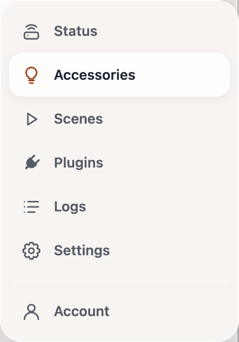

The UI is an installable web app: `manifest.webmanifest` (standalone, starting on Status), PNG icons (192, 512 and a
maskable 512) and an `apple-touch-icon.png`, all served without a session like the other static files. Over HTTPS the
page carries the touch icon inline: iOS fetches a home screen icon without the exception accepted for a self-signed
certificate, and would show a letter instead. In Safari, Share › Add to Home Screen; in Chrome, Install app. It opens full
screen; `/quick` makes a good first page to keep there (a manifest shortcut opens it). The service worker (`/sw.js`) only
shows notifications and keeps nothing offline: the bridge must be reachable.

## The look

Apricot frost, the design system of `style.css` ([design-system.md](design-system.md#tokens) lists the tokens):

- **Backdrop.** A 140° gradient from apricot to stone (`--backdrop`); in dark mode, Ember: warm charcoal with an apricot
  glow in the top left corner. A wallpaper chosen on Appearance replaces it.
- **Glass.** Cards are frosted glass (`--material`); a wide window's frame is a thinner one (`--material-frame`). Details
  set on a card (figures, rows) take white (`--surface`).
- **What is current is white.** The current section, a segmented control's choice and the Settings tab are a white pill
  (`--control`) with their icon in the accent, not an orange fill. Orange stays for the one primary action of a view
  (Save, Open the vault, Add a secret), switches and focus rings.
- **One dark card.** `.card.attention` (`--attention`, its apricot glow `--attention-glow`) is for what needs attention or
  an important action: the Vault's entries that expired or expire soon, and the Status page's Vault summary while one
  does. It redefines the text, state and control tokens for its children, so rows and buttons inside need no rules of
  their own.
- **Charts.** A chart of one series (the Status page's memory and CPU) draws it in the accent; charts of several keep
  the palette's series colours.
- **Type.** A page's title is large and light (`--text-display`, medium weight, tight tracking); the rest keeps the
  system font and the type ramp.

## For plugin authors

**A settings form.** Ship a `config.schema.json` in the plugin's directory and run `swift Scripts/embed-assets.swift
plugin Plugins/<Name> <Type>` to embed it (a test checks it is current); the Plugins page then shows a form. The form
understands the Homebridge dialect: `properties` in order, `required: true` on a property, `oneOf` with `enum` and
`title` for menus, `placeholder`, `default`, `description`, arrays of objects or of values, nested objects, the
top-level `layout` with `fieldset` groups, and `condition`s ([Plugins](#plugins)). Keys the schema does not know
(`_bridge` for one) are kept as they are.

**A page of its own.** A plugin that has more to show than settings (the devices it sees, a scan, a diagnostic) ships
a `Web/` directory with an `index.html` and whatever files it needs, embedded by `swift Scripts/embed-assets.swift web
Plugins/<Name>/Web Plugins/<Name>/Sources/WebFiles.swift <Type>` (a test checks it is current).
[Philips Hue's](../Plugins/PhilipsHue/README.md) and [IKEA DIRIGERA's](../Plugins/Dirigera/README.md) are full examples,
`Plugins/ElgatoKeyLights/Web` a small one (the lights, their state, an Identify button).

- **Serving.** The UI serves each instance's page at `/plugins/<slug>` and its files beside it, to signed-in users only
  (anyone else gets the sign-in page, then this one). The page gets a `<base>` for its relative files and a
  `<meta name="homeswift-plugin">` naming its platform and instance, which `plugin.js` reads.
- **The document.** A full page: link `/style.css` for the look of the rest of the UI, then load `/common.js` and
  `/plugin.js` for the helpers. The content security policy allows scripts and styles from files only, no inline
  script. A page that asks for a time range uses `HomeswiftCommon.rangeControl(params, { presets, fallback, changed })`,
  the UI's own control, never an `<input type=datetime-local>`.
- **Its instance.** `homeswift.request(path, { method, body })` sends `/api/plugins/<platform>/<name>/<path>` with the
  session cookie and parses the JSON answer; the plugin answers in `handleWebRequest(_:)` with a `PluginWebResponse`
  (JSON and a status). Mutations must be JSON, like the rest of the API. `homeswift.platform`, `homeswift.name` and
  `homeswift.home` (the Plugins page) are there too.
- **Building.** `homeswift.el(tag, attributes, ...children)` and `homeswift.$(selector)` build and find elements the
  way the UI's own pages do; `homeswift.tile(icon, tone)` draws an icon on a colour and `homeswift.fact(label, value)` a
  labelled value of a `.facts` grid. `homeswift.act(button, work, report)` runs `work` with the button disabled and a
  spinner and hands an error's message to `report` (`alert` by default; with `report` null the error is thrown).
- **Its block.** `homeswift.readBlock()` and `homeswift.updateBlock(change)` read and write the instance's block of
  config.json (`GET`/`PUT /api/config/block/<platform>/<name>`): a write applies at once and the plugin reloads. For a
  block with a `devices` list keyed by MAC address there are `updateDevices`, `updateDevice`, `putDevice` and
  `findDevice`; `poll(refresh)` refreshes while the page is visible, and `renderKeyed` redraws only the cards whose item
  changed.
- **Accessories as the Accessories page draws them.** Load `/remote.js`, `/camera.js` and `/widgets.js` after
  `/common.js`, take the accessory from `/api/accessories`, add `HomeswiftWidgets.card(accessory, { size })` (`small`,
  `medium` or `large`; the kind's own size when left out) to a `.wall`, open every control with
  `HomeswiftWidgets.open(accessory)`, and call `HomeswiftWidgets.listen()` once for live values. A camera's view is
  `HomeswiftCamera.view({ id, name })` from `/camera.js`.
- **The Assistant.** `homeswift.assistant()` says whether it is on. `homeswift.explain({ error, context, device })` is
  an Explain button whose answer streams into a card; `homeswift.ask(prompt, { context, onChunk, signal })` asks a
  question and resolves to `{ text, model }`, with `onChunk(text)` for each piece as it is written and an
  `AbortController`'s signal to stop it. Both carry the plugin's `assistantBackground` (`POST /api/assistant/explain`
  and `/ask`; with a `requestId` in the body the answer comes as server-sent events, `start`, `chunk`, then `done` or
  `error`, and `POST /api/assistant/cancel` with that `requestId` stops it: homebridge-ai-kit's `/ai/*` routes and
  `ai:chunk` events).
- **Units.** `homeswift.formatTemperature(celsius)` shows a temperature in the user's unit
  (`homeswift.temperature(celsius)` gives `{ value, unit }`).

## Working on the pages

The UI's own pages are under `Sources/HomeswiftUI/Web`, compiled into the binary as
`Sources/HomeswiftUI/WebAssets.swift` (and each plugin's as its `Sources/WebFiles.swift`) by `Scripts/embed-assets.swift`,
so a Homebrew install carries them and no build step needs Node. To work on them without a rebuild, point
`HOMESWIFT_WEB_ROOT` at the checkout:

```sh
HOMESWIFT_WEB_ROOT=$PWD swift run --scratch-path ~/Library/Caches/homeswift-build homeswift
```

The UI then reads `Sources/HomeswiftUI/Web` and `Plugins/<platform>/Web` from disk on every request, and open pages
follow the files: a saved stylesheet swaps in place (what is open on the page stays), a saved script or page reloads
it. Embed the files again before committing; a test fails while they differ:

```sh
swift Scripts/embed-assets.swift web Sources/HomeswiftUI/Web Sources/HomeswiftUI/WebAssets.swift
```

### Screenshots

This page's images in `images/ui/` come from a throwaway bridge, retaken with:

```sh
node Scripts/ui-screenshots.mjs
```

It runs the bridge built at `~/Library/Caches/homeswift-build/debug/homeswift` (or the binary given) from a temporary
folder with a new identity: the web UI on `127.0.0.1` without sign-in, plugin blocks with demonstration names, all
paused, so nothing reaches a device or a cloud, and two generated images as wallpapers. It renders in headless Chrome in
light mode at 2x, replaces this machine's name and the folder's paths in what the API answers, and removes the folder
when it ends. The Accessories page's images are [widgets.md](widgets.md#screenshots)'s. The Scenes page's shots that need lights (hubs' scenes,
the templates, a scene card and its Stop) come from `node Scripts/plugin-screenshots.mjs`, against its fake Hue Bridge
and DIRIGERA hub.

### Quick controls on phones

Quick controls groups its heading, page link and shortcuts in one card. Saved scenes use photographic tiles
with readable names; the row scrolls horizontally on a phone. Scenes without artwork keep a plain tile.

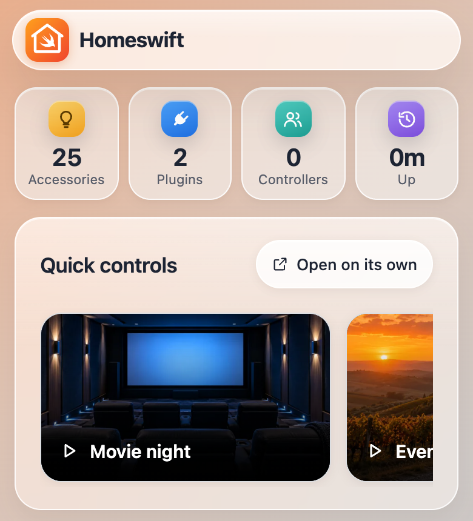
