# The web UI

A `HomeswiftUI` block gives the bridge a web interface, inside the same process: its status and pairing codes, the
accessories with live control, each plugin's settings and own page, the raw `config.json`, the log as it happens, and
the Assistant's chat. It is the Config UI of a Homebridge, in Swift, in Apricot frost: frosted glass over an apricot
backdrop (Ember, a warm charcoal, in dark mode), white for what is current, and one dark card for what needs attention
([The look](#the-look)). It follows the system's light or dark appearance and its reduced-motion, reduced-transparency
and increased-contrast settings. The pages are
plain HTML, CSS and JavaScript compiled into the binary: nothing to install beside it.

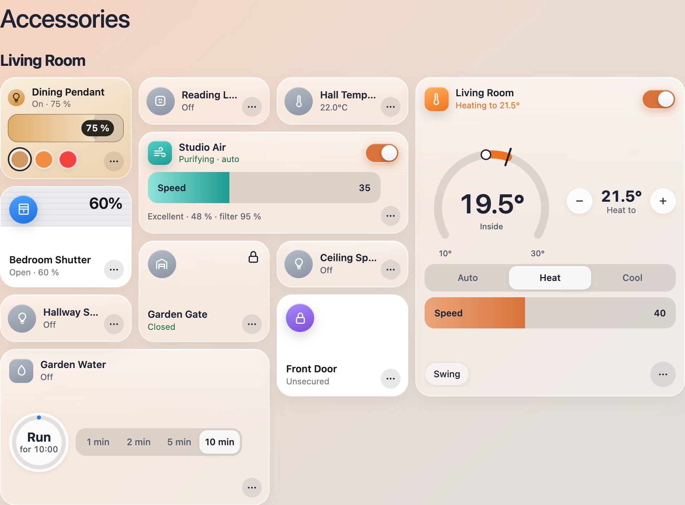

## Setting it up

```json
{ "platform": "HomeswiftUI", "port": 8581, "host": "0.0.0.0", "auth": "form" }
```

| Key | Default | What it does |
|---|---|---|
| `port` | `8581` | Where the UI listens |
| `host` | `0.0.0.0` | Every interface, so phones on the network can open it; `127.0.0.1` keeps it on the machine |
| `allowedHosts` | `[]` | Names the UI answers to, besides IP addresses, localhost and this machine's name: a DNS name, a reverse proxy's host |
| `auth` | `form` | A username and password, the first account made with the set-up code from the bridge's output. `none` for a trusted network or localhost only |
| `sessionDays` | `7` | How long a sign-in lasts without activity |
| `https` | `false` | Serve HTTPS, with your certificate (`certificate`, `privateKey`) or one the bridge makes (see [Security](#security)) |
| `trustProxy` | none | Reverse proxies (addresses, CIDR ranges, or `loopback`, `linklocal`, `uniquelocal`) whose `X-Forwarded-For` and `X-Forwarded-Proto` count |
| `checkForUpdates` | `true` | Ask GitHub twice a day for a newer release and say so on the Status page |
| `scheduledRestartCron` | none | Restart homeswift on a schedule: a cron expression of five fields, `0 4 * * 1` for Mondays at 4:00; the settings form sets it as a time and days |
| `scheduledBackupDisable` | `false` | Turns off the daily backup of the instance |
| `scheduledBackupPath` | `instance-backups` next to config.json | Where backups are kept: a folder that exists, a network share for a copy off the machine |
| `scheduledBackupDays` | `7` | How many days daily backups are kept |

Restart the bridge: its banner prints the UI's address and, until an account exists, a set-up code. The first visit
asks for that code, a username and a password, and creates the administrator account. Users live in `ui-users.json`
next to config.json as salted PBKDF2 hashes; delete the file and restart to start over, with a new code. More users are
added on the **Users** page ([Users, roles and API tokens](#users-roles-and-api-tokens)).

## The pages

The header has the sections (Status, Accessories, Scenes, Logbook, Plugins, Logs, Settings), the Assistant's sparkle
when it is on, and the account menu behind your initial: **Account**, **Appearance**, **Users** (administrators),
**Language**, then apart and in orange **Restart homeswift…** (administrators), and **Sign out**. In a window 1180 px
wide or more the app sits in one frame of glass and the header becomes the menu down its
left: the sections under **Home**; under **You** the account menu's entries (**Account**, **Appearance**, **Users** for
administrators, **Language**, **Sign out**), each with its icon, in place of the account button; and at its foot
**Homeswift** and its version, folded, which opens upward over the menu (a click outside closes it) into its health, the machine, the update button, **Send feedback**
and **Restart homeswift…** (administrators). Narrower, the account menu has them; on a phone, the ☰ panel, under
Account. The Status page keeps only **Edit**, floating at the window's bottom right. Every view is an address ([Addresses](#addresses)), so Back and Forward work and a view can be kept or
shared.

### Status

The start page: a summary (accessories, plugins, Home app controllers, uptime), then sections you arrange.

- **Bridges**: each bridge with its device ID, port, plugins and pairing state. A bridge the Home app has not paired
  yet shows its setup code and a QR code for the Home app's camera. Accessories and Matter devices of their own (a
  television, a camera, an accessory made a Matter device) are one line each in **Devices of their own**: its name,
  where it was added and its state, unfolding to its port, its ecosystems, its pairing code and its actions. A Matter
  device's icon carries Matter's tag. Those waiting to be added come first, open with their code; the others are folded, and a row you open or fold stays so while the page shows; past
  eight devices a search (by name or ecosystem), a filter (Matter, HomeKit, waiting to be added) and an order (waiting
  first, name, most ecosystems) narrow the list, kept in the address (`/status?show=matter&devices=name`), so a home of
  a hundred stays one screen to scan.

  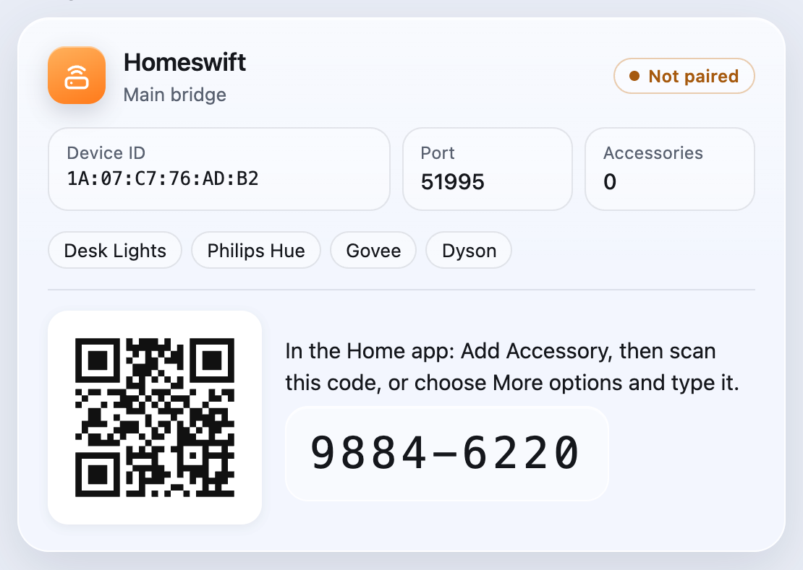

- **Activity** charts the homeswift process's memory and CPU, how long the bridge takes to answer the Home app's reads
  and writes, and how long plugins take to reach their devices (average and longest), for every server, one bridge or
  one accessory. The time range is a segmented control (1 hour, 6 hours, 24 hours, today, yesterday, 7 days) with
  **Custom…**, a pop-over with a month to pick the first and last day and the From and To times. A range that ends now
  refreshes every minute; a gap is a time homeswift was not running; **Show as a table** lists the values. The bridge
  samples memory and CPU every 10 seconds and keeps a record per minute under `metrics/` next to config.json (a file per
  day, 8 days), so the charts survive a restart. The view is `/status?since=24h&bridge=<bridge>&accessory=<accessory>`.
- **Daily digest**, with the Assistant on: what needs attention today, from the day's warnings and errors and the
  accessories. **Write today's digest** streams it; the bridge keeps it for the day (`ai-digest.json`, owner-only) and
  the card's **⋯** writes it again. Any user reads today's digest; an administrator writes it.
- **Vault**, for administrators, once the vault has an entry or config.json a secret to move: how many entries the vault keeps, how many config.json uses and how many secrets
  config.json still holds, then what needs attention, most pressing first (a reference to an entry that is gone, one
  that cannot read its entry, an entry expired or expiring within 30 days), and **Open the vault**.
- **Energy**, once a plugin records readings with an energy role (`EnergyTag`, docs/plugins.md) or some Meter has a
  history, in units the edit mode moves, removes and adds back one by one: Energy flow, The big picture, Energy by day,
  Where it goes, Worth knowing, Energy log, Consumption by device, Gas and water, Power and battery levels. On a wide
  screen Energy by day and Where it goes, then Worth knowing and the Energy log, sit two to a row. A layout saved before
  keeps them where its Energy section was. See [Energy](#energy) below. **Activity** is in units too: its title with the
  range and the server, then Memory, CPU, Home app requests and Plugin device calls, two to a row on a wide screen.
- **System**: the version, uptime, machine and configuration file, and, for administrators, **Restart homeswift…**,
  Settings and Notifications.

When GitHub has a newer release, a card under the summary says so, with its notes and how to upgrade this install: the
`.spk` to download on a Synology NAS, the image tag to pull in Docker, `brew upgrade` or the tag to check out. The
bridge asks GitHub's API a minute after it starts and then twice a day, sending only its version (`ReleaseWatcher`);
`"checkForUpdates": false` turns it off. On a Homebrew install an administrator's **Install and relaunch** runs
`brew upgrade homeswift` and restarts into the new binary (Homebrew's `opt/homeswift` link); the update button (the
side menu's, or the footer's) follows it (**Install update**, **Installing…**, then **Relaunch to update** when the new version is on disk, from here
or a `brew upgrade` run by hand). A Synology package, a container and a checkout cannot upgrade themselves: their card
says how. Settings › Updates has the same card.

**Edit**, at the bottom right, or a long press on a section away from its controls, turns the page into its edit mode,
as iOS's Control Center: the sections sway gently (with reduced motion, a dashed outline instead), each with a **−**
badge at its top left that removes it, its name beside it, and a handle at its top right. A section is dragged anywhere on it into place
(the others slide out of the way, the page scrolls at the window's edges), or moved with the arrow keys on its handle.
A floating bar has **Add a section**, the sheet **Sections and widgets**, by group (Home, Energy, Energy widgets,
Activity, Bridge and system), each folded under its title until opened (the choice kept in the browser) and saying how
many of its items are on the page: those not shown first, each
with a green **+**, then those on the page, ticked, each with a red **−**, every row with a thumbnail of what it draws and a line saying what it shows (the **Energy widgets** are Power now, Today
against usual, Self-powered today, Solar today, Batteries, Energy cost this month, Best hours today); **Back to the
usual layout**; and **Done** (or Escape). The widgets go to **At a glance**, a tile each with its figure, a line and a
thin meter, refreshed every minute. In the edit mode each widget has its own **−**, a button at its corner that makes it
wide or small (`<id>--wide` in `widgets`), and moves by dragging it among the others (or with the arrow keys on it); a
tile opens the Energy page. **Best hours today** draws the day as 24 hours: yellow where the panels usually cover the
home (the last week's hours, on average), blue and orange for the electricity Tariff's cheapest and dearest hours when
it has more than one price, and the best window of the best kind.
Changes apply at once; the layout (`dashboard`: `order`, `hidden` and `widgets` in `/api/preferences`) is each user's
own, on every browser. The Quick Controls ([below](#quick-controls)) sit at the top of the page.

#### Energy

The **Energy** page (`/energy`, in the side menu and the phone's sections once some plugin records energy or a Meter
has figures) has the whole story, where Status keeps a glance (its Energy title leads there):

- **Overview**: the Energy section's units below, in the user's order; **Edit**, at the bottom right, edits them as the
  Status page's edit mode does (the layout is `energyPage` in `/api/preferences`, apart from Status's).
- **By accessory** (`/energy/devices?period=day|week|month|year&sort=used|cost|name&device=…`): the home split between the
  devices measured on their own and Unmetered, then a row per device (a filled history sparkline, its kWh, share and
  cost), Unmetered and the Meters with no readings last, and the sources apart under the list. Sparklines preserve gaps in readings
  and remain visible on phones. A
  row opens its panel: its figures, when it used energy this week hour by hour (a cell per hour, a row per day), where
  most of its use falls, and **Full history**.
- **Energy log** (`/energy/log?days=2|7|14&q=…`): what stands out over the span, then what happened by day, searchable
  and by kind.

On Status, Energy flow and The big picture show by default; the other units are added from the edit mode.

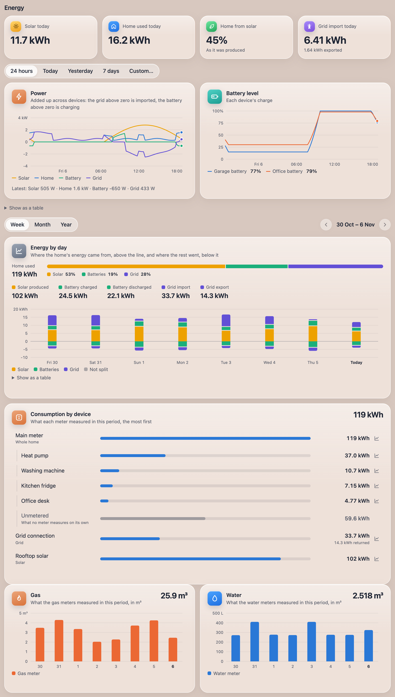

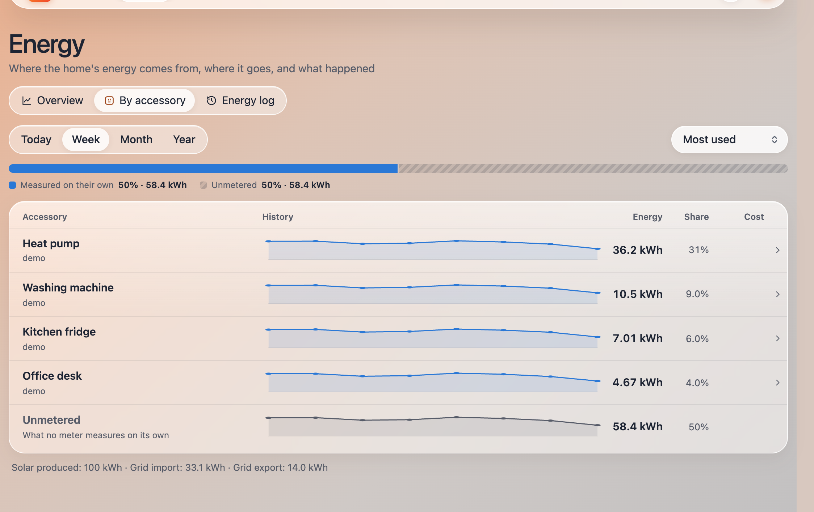

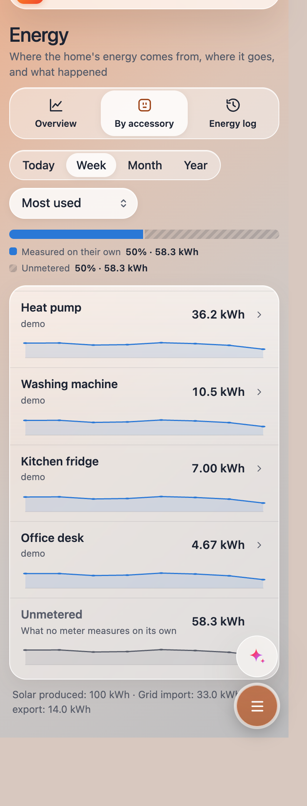

- **Energy flow**: where the power goes, followed live (the last minutes asked every ten seconds while the page is
  visible; the bridge counts the minute under way). On top, the **House**: a cutaway picture in the viewer's House
  style (Appearance: **Realistic** or **Simple**; `energy-house*.webp`, each with a layout file saying where its wiring
  lands), its wiring lit in the colour of the source feeding the home (solar yellow, the battery green, the grid
  purple, in proportion when they share), faster for more power. It is by day between the day's sunrise and sunset at
  the bridge's Location (the energy report's `sun`, the times alone) and at night after; without a Location, by the
  hour and solar. Or the **Diagram**: solar, the grid, the battery and the home as circles with dots running between
  them, **Now** (watts) or **Today** (the day's energy so far, split as the bridge splits it), framed to the parts the
  home has. Under it, a panel with the title and the House/Diagram switch, each part's reading (from or to the grid,
  charging or discharging and the battery's level) and **Powering the home**, each source's share. A home metered at
  the grid alone uses what the grid brings in. On the house, the battery shows its charge: five small pills on its front lit up to the level, glowing green (amber
  under 20 %, red under 10 %, the top one breathing while it charges), drawn in the battery's perspective (each picture's
  layout says where, `gauge`). **Values**, in the picture's corner, shows the figures on it: solar on the roof, the grid at
  the pole, the home in its rooms and the battery's charge beside it; the choice is kept in the browser. The card comes in two versions, each a section of its own: **Energy
  flow**, the house alone, and **Energy flow with details**, which adds today's biggest users (the devices measured
  on their own, up to six, each with its kWh and share of the home's) and **What powered the home today**, a band of
  the day coloured by the source that covered most of the home's use. Status shows the first and the Energy page the
  second until changed in the edit mode. The view and period are kept in the browser; with reduced motion nothing
  moves.

  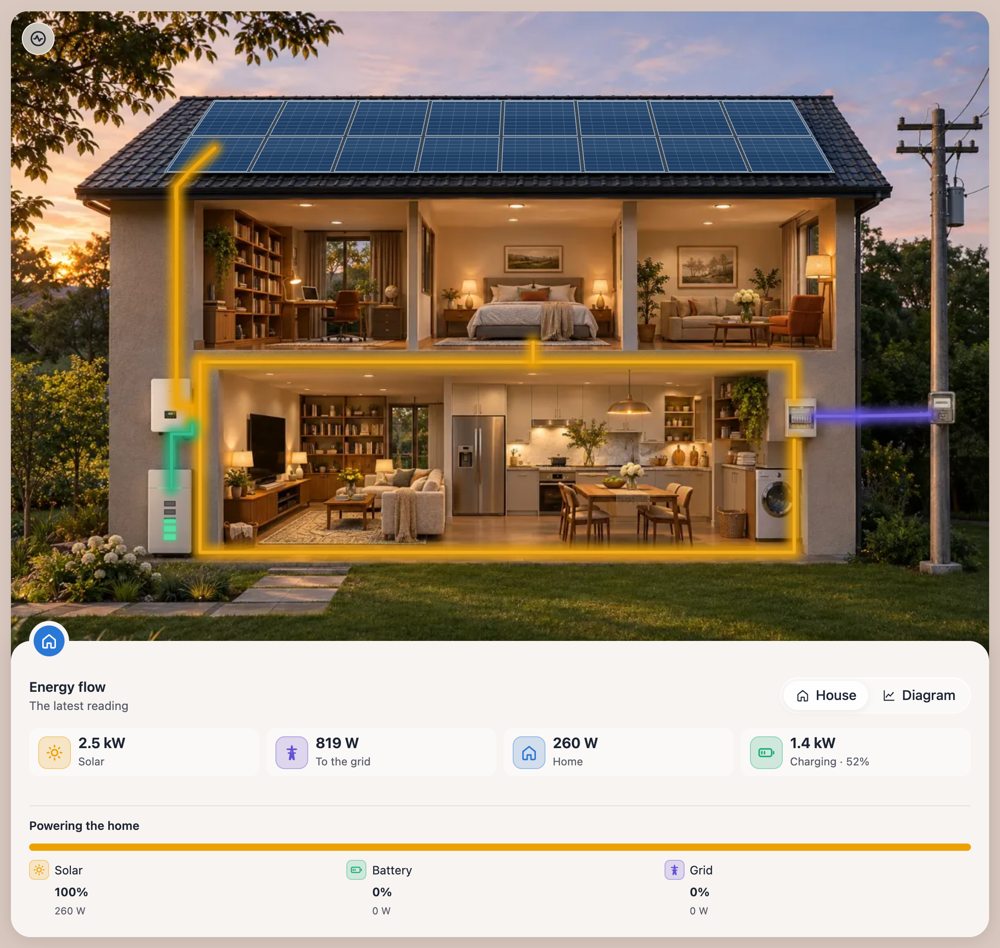

  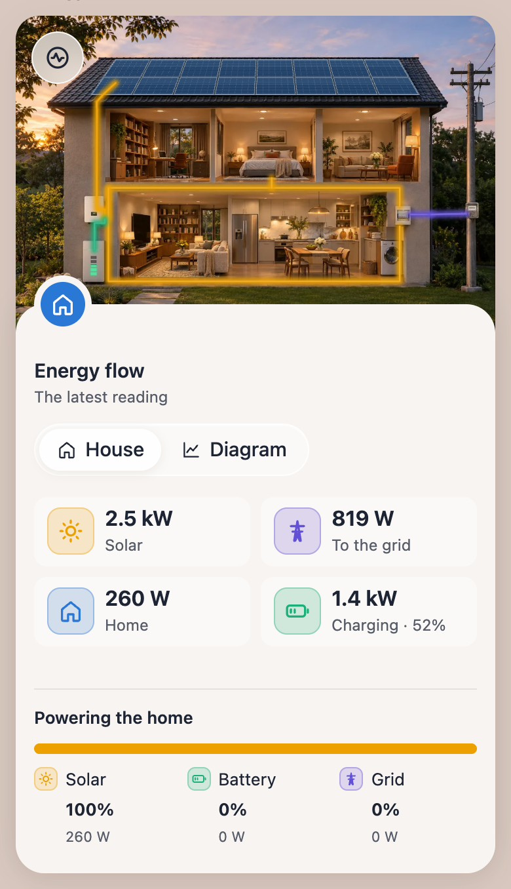
- **The big picture**: the period (**Week**, **Month** or **Year**, with the periods before and after) for everything
  under it, then a tile each: **Home used** (about how much a day), **Self-powered** (the share the roof and batteries
  covered, with each source's share), **Energy cost** and **Sent to the grid**.
- **Where it goes**: a bar of the home split between the devices measured on their own and **Unmetered** (striped),
  each with its share and kWh; then the measured devices as blocks, each as large as its share of what they used
  together (the most first, the strongest blue), or a row when one device is measured. When most of the home is not
  measured, a line says what would show where it goes. A device opens its History; the Meters with no readings in the
  period are named under it.
- **Worth knowing** and **Energy log**, from the last two days of each Meter's hours, the power, the batteries' charge
  and the Logbook, worked out in the page: the night floor (the least the home drew in a night hour, and what it costs
  in a year at the grid's price), a device that never switches off, Meters that say nothing, two units reporting the
  same figures (counted twice wherever both are added up), and a charging state or an outlet flipping six times or
  more in a quarter of an hour. The log lists, by day, the busiest hour from the grid, sunrise on the panels and the
  best solar hour, a battery full or nearly empty, the grid taking over from the batteries, each run of a device
  measured on its own (its hours, kWh and cost), and the flapping; **All**, **Devices**, **Sun**, **Battery and grid**,
  **Unusual** and **Bridge** filter it. The bridge works the same out (`EnergyStory`) for
  `/api/metrics/energy/story`, the MCP tool `get_energy_story` and the notifications: a new flapping or a new night
  floor goes out as the **Something stands out in the energy use** event, looked for every 15 minutes, once a day at
  most each.
- **Power and battery levels**, folded at the bottom: solar, the home, the grid (importing above zero, exporting below) and the batteries (charging above
  zero), each added up across devices, and each device's battery level. Its own range: 24 hours (the default), today,
  yesterday or 7 days (`?energy=7d`). Where the bridge recorded nothing (before it ran, while it was stopped), the power
  lines show what a plugin imported for those hours, each hour at its average, and the line under the chart says so.
- **Energy by day**: the energy in kWh as stacked bars for the big picture's period, a bar per day (per month over a
  year; `?energy-view=month&energy-date=2026-05-01`). Above the line is where the home's energy came from (solar as it
  was produced, the batteries, the grid), below it where the rest went (into the batteries, out to the grid). Behind the
  bars, a usual day shaded: the middle of the period's whole days, 10 % either side, so a day out of the ordinary stands
  out. Over the bars, the flows: solar produced, battery charged and discharged, grid import. The axis writes its unit
  once, on the top tick. With an energy Tariff ([Settings](#settings), Bridge), the big picture's **Energy cost** is
  what the grid's import cost hour by hour at its price, less what the export was paid, without fixed charges. Without
  a Meter of the home's use, the grid's import is drawn above the line.
- **Consumption by device**: what each Meter measured in the same period (GLOSSARY.md, "Energy"), the most first, a
  bar as long as its share and its kWh, with what it returned. The whole home (a Meter with the home's Energy Role,
  else the grid's when no Meter measures solar or a battery) heads the list, with the devices measured on their own
  nested under it and **Unmetered** last, what no Meter measures (the home less its devices, never below zero); the
  grid, solar (what it produced) and batteries are listed apart. Without a whole-home Meter, the devices alone. The first eight show, then **Show all**. A row opens the device's History. With a
  Tariff, each device's cost at the grid's price, hour by hour, and the card's total. Energy measured in less than a
  kWh is written in Wh.
- **Gas** and **Water**: once a plugin declares a gas or water Meter (HAP has no characteristics for them), a card of
  each kind for the same Week, Month or Year: the m³ its Meters measured, a bar per day (per month over a year), a
  colour per Meter, the period's total and, with a Tariff of that kind, its cost hour by hour at that Tariff, all in m³
  (two decimals at most). Gas stays in m³; it is never counted in kWh or in the home's energy. A Meter's
  History (its accessory's ⋯ menu) shows it in m³ too.

  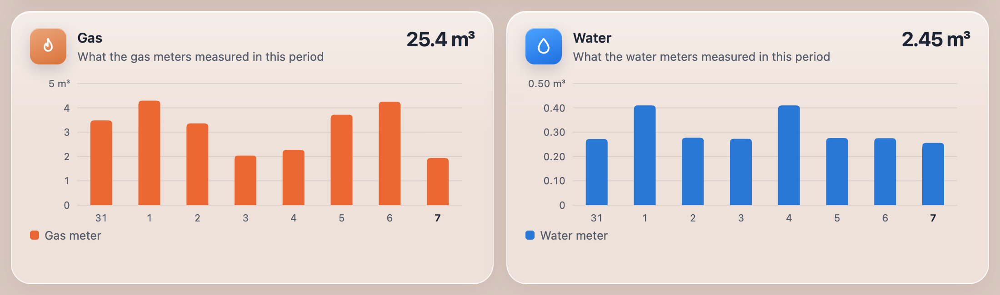

The history is the bridge's long-term archive (`metrics/energy-hours.json`, kept for years): each hour of what it
recorded, and what plugins import, such as a device cloud's solar, home use, battery and grid since a system was set
up. An hour the bridge recorded most of keeps its own figures; an imported hour without grid or battery figures has the
rest of its home use shown as **Not split**, in grey, and the card says so. While a plugin imports, the card shows its progress (**Importing the …
history**, 4 of 10) and the bars fill in as each part arrives; once done, a line says what the history covers and when
it last ran, and a failed import says why.

Each entity keeps one colour in every chart (solar yellow, the home blue, the batteries aqua, the grid violet), from a
palette checked for colour blindness in both modes. **Show as a table** lists the points and the days (solar produced,
home used, grid import and export, battery charged and discharged, the share solar covered). Days are counted from each
minute's average power, midnight to midnight in the browser's time zone. `/api/metrics/energy?from=…&to=…&timeZone=…`
answers the power in one request, `/api/metrics/energy/history?period=week|month|year&date=…&timeZone=…` the
history (with each bar's `cost` and the `currency` once there is a Tariff), and
`/api/metrics/consumption?period=…&date=…` (or `hours=…`, by the hour up to two days and with `step=hour` up to two weeks, and `accessory=…` for one accessory's Meters) each Meter's
Consumption, the same answer as the MCP tool `get_consumption` (docs/mcp.md), for any signed-in user.
`/api/metrics/energy/story?from=…&to=…&timeZone=…` (the start of yesterday to now without them, 31 days at most) answers
Worth knowing and the Energy log as codes and values for the page to word: `events`, each with `at` (ISO 8601), `kind`
(`device`, `sun`, `power`, `odd`, `bridge`), `code`, `values` and the `accessory` it is about, and `worth`, each with
`code`, `values`, `severity` (`info`, `warning`) and its `accessory`. The codes and their values: `busiestGridHour`
(`value` kWh, `cost`, `currency`), `sunUp` (`value`), `bestSolarHour` (`value`, `total`), `batteryFull` and
`batteryLow` (`name`), `gridTookOver` (`watts`), `deviceRan` (`name`, `n` hours, `value`, `cost`, `currency`),
`flapping` (`name`, `n` changes, `minutes`), `nightFloor` (`watts`, and `cost` a year with `currency`), `alwaysOn`
(`name`, `watts`, `cost` a year, `currency`), `silentMeters` (`names`, `n`) and `countedTwice` (`first`, `second`);
`cost` and `currency` only with a Tariff.

Each Meter's Consumption is the bridge's own record (`metrics/meters/`, by the hour, kept for years,
docs/adr/0004-meters-and-consumption-history.md): every accessory's Total Consumption and Current Consumption, whatever
its plugin, and the Meters plugins declare, with the hours they import from a device or its cloud.

### Accessories

A wall of widgets (`widgets.js`), each accessory drawn by the widget of its kind in a box of the size chosen for it:
small (1×1, a tile a tap acts on), medium (2×1) or large (2×2). [widgets.md](widgets.md) has every widget, with
screenshots, and what a plugin does to get good ones.

- **Controls**: a change shows at once and goes to the device; a refusal puts the value back and says why. Opening,
  unlocking and disarming are held; a shutter's tile slides; a light with Adaptive Lighting has a sun swatch that turns
  it off or resumes the Home app's schedule. Temperatures show in the unit chosen on [Appearance](#appearance). Values
  that carry keys (a camera's Setup Endpoints) are not shown, nor what only HomeKit uses.
- **A widget's ⋯ menu** (a right click on a tile): its size or its kind's, **All controls** (every control in a sheet,
  the rest under More), Identify, its log, ask the Assistant about it, add to the Quick Controls, **Settings…** and its
  plugin's Settings and **Download diagnostics** ([Diagnostics](#diagnostics); administrators), resume a paused plugin,
  and **History**, which opens the sheet on its History tab.
- **An accessory's sheet** has two tabs: **Controls** and **History** ([History and Logbook](#history-and-logbook)): a
  chart per characteristic over **24 hours**, a **Week** or a **Year**. A number (a temperature, a brightness, a
  power) is a line, each change held until the next over 24 hours, its hourly highest, average and lowest over a week,
  and its daily ones over a year; a state (on, open, locked, motion, a mode) is a band split where it changed, a
  colour per value. A Meter's **Consumption** comes first, a chart per Meter (named by its service on a device with
  several): bars of what it drew, and what it returned below the line, by hour over a day and by day beyond, with the
  range's kWh and, with a Tariff, its cost. **Logbook** opens the Logbook on that accessory.
- **Full screen** (the toolbar's last button, or `/accessories?full=1` for a wall tablet's bookmark): the widgets alone,
  in the browser's own full screen where it has one. Grouped by room or by plugin, one group fills the screen at a time
  and the next is a swipe away (the arrow keys, the dots, the side arrows with a mouse); one button opens the toolbar
  (search, grouping, filters, Leave full screen) as a panel from the right edge, and Esc leaves.
- **Settings…** (a widget's ⋯ menu, administrators; `settings.js`): the accessory's Accessory Settings in one sheet,
  drawn from `GET /api/settings/accessories/<id>`, each field saved on its own as it is changed (a quiet *Saved* or the
  error beside its title, and *reloads* when the plugin reloads with it):
  - **Name**, in the Home app too, its room, scenes and automations kept; empty gives it back the name its plugin gives
    it. An accessory mirrored from another controller (Wingman's) is named there: its Name is read-only here.
  - **Room**: one of the rooms, or a new name that adds it; the note under it says whether the Home app follows (Room
    Sync on, or a mirrored accessory) or only Homeswift's pages do.
  - **Hidden** (off the wall, still in the Home app) and **Not in Home** (out of the Home app, with its room, scenes and
    automations, while Homeswift and Matter keep it; it asks first).
  - **Energy**, for an accessory with Meters: **What it measures** (or one field per Meter, on a device with several),
    its Energy Role: solar production, the home's use, the grid connection, a battery, or this device alone. The
    plugin's suggestion comes first; chosen again, it stands once more. It applies at once without reloading the
    plugin, and counts from then on: the history it measured stays as it was (`energyRoles` in `_accessories`).
  - **Parts**, a switch each, from what the plugin's discovery says the device brings; a change reloads the plugin.
  - **Plugin settings**: the plugin's Plugin Accessory Settings (its schema's `accessorySchema`, the fields of the
    device's Device Kind), drawn by the same renderer as its Plugin Settings. A field with a plugin-wide default shows
    *Default (X)* while the accessory has no value of its own; cleared, it takes the default again.
  - **Exclude** (asks first): its plugin makes no accessory of it; it leaves the Home app, the wall and Matter until it is
    included again, here or from its plugin's Devices. **Forget** (asks first): its Authorization, Accessory Settings
    and Meters' energy history go (`DELETE /api/settings/accessories/<id>`), and it is only a Discovered Device again.

  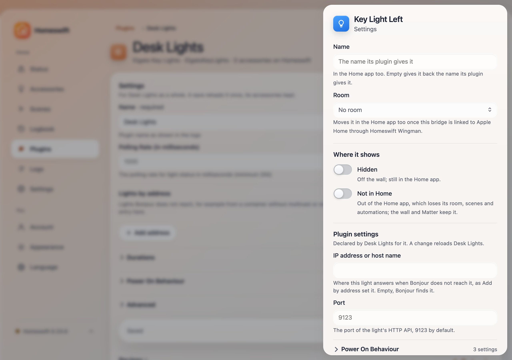

  Its room, Name, Hidden and Not in Home are Accessory Settings in its plugin's block (`_accessories`, keyed by Device Id);
  the bridge puts the Name on the accessory's Name and Configured Name, which the Home app follows, and a rename in the
  Home app is kept the same way.
- **Edit** shows grid guides, size controls and corner handles, and lets tiles be dragged onto any cell of the grid,
  gaps included: the others make way, and the wall keeps every widget's cell until **Pack the widgets together** (the
  wall's menu) lets them flow again ([widgets.md](widgets.md)). The wall is
  **One wall** (the default), **By room** (once there are rooms) or **By plugin**. The bridge keeps the layout in
  `ui-layout.json` next to config.json (`/api/layout`), the same for every user; the Groups are the Home's and live in
  `home.json` with the Zones (older versions' groups move there once), and `/api/layout` answers them with the wall.
- **States**: a paused plugin's accessories are drawn striped, their controls out of reach; an accessory whose device
  does not answer says No Response.
- **Cameras** get a card of their own: the picture in 16:9 with the name, motion, the doorbell's last ring and recording
  over it, buttons to unmute, refresh and go full screen, and the camera's controls under it. While the card is on
  screen and the page visible, it plays the live feed muted (`GET /api/cameras/<id>/live`, fMP4 through Media Source
  Extensions, ManagedMediaSource on iOS Safari) when the plugin has one, otherwise a snapshot every 3 seconds
  (`/api/cameras/<id>/snapshot?width=&height=`). Off screen it fetches nothing. A camera has four live viewers at most;
  one turned off in the Home app, or whose plugin is paused, shows nothing; one that sends no picture shows television
  snow behind its message (a still frame under reduced motion). A camera that pans and tilts (Reolink, a Tapo C675D's
  tele lens) gets a **Pan and tilt** button once its picture is live: a pad over the picture to press or drag like a
  joystick, or to steer with the arrow keys, which turns the camera a step at a time while held, with its presets and
  home position beside it (`GET /api/cameras/<id>/controls`, `POST /api/cameras/<id>/control` with `{"move": "left"}`,
  `{"preset": "<id>"}` or `{"home": true}`; both for users who may control accessories, not read-only tokens). On the
  wall, only a large camera tile has it.
- **Rooms**: an accessory's room and Hidden are in its Settings sheet (a new room name adds the room); hidden
  accessories stay out unless **Show hidden** (`?hidden=1`). Its room and Hidden are Accessory Settings
  (`room`, `hidden` in its plugin's block, `PATCH /api/settings/accessories/<id>`); the Quick Controls and the rooms'
  order are the Arrangement, the layout's. Accessories mirrored from another controller (the Home app's, through
  the Wingman plugin) carry a small house badge, sit in that controller's room until given one here, and have a filter
  of their own, the **Apple Home** switch (`?from=Apple%20Home`). The Filters menu also narrows the wall to bridges
  (`?bridge=<name>`) and device types (`?type=<category>`), each as often as chosen, as on the Graph, and to the
  accessories that answer, **Online** (`?online=1`: neither No Response nor paused), or those that do not, **No Response**
  (`?unavailable=1`); choosing one clears the other. The Arrangement is the bridge's, shared by every user, in
  `accessory-layout.json` next to config.json (owner-only; `/api/rooms`), where older versions also kept rooms, Hidden and
  display names: those are read until the accessory's settings are next written, which moves them there. The order of the
  Rooms is the bridge's own; the MCP tools filter by the Rooms (`list_accessories`, `set_accessories`), and by the Zones
  too (`?zone=<name>` on the wall, among the **Filters**).
- **Rooms and Apple Home**: in **Edit**, with the wall **By room**, each room's heading is a field: type a new name, then
  Enter (or click away) renames the room, Escape keeps it. The red bin beside it removes the room once confirmed: its
  accessories go to **No room**, and with the Home Link it is removed from Apple Home too. A tile dragged into another room's wall moves the accessory to
  that room, or out of any into **No room**; every room shows there, empty ones too, to take a drop. The **Rooms** menu
  orders the rooms (drag them), renames one (choose it), opens **Zones…** (Apple Home's sets of rooms, such as
  Upstairs: a name and its rooms each, a room in several at most) and says where the rooms stand with Apple Home. With
  Homeswift Wingman paired (the Home Link), the Rooms, Zones and Groups are Apple Home's: a room renamed, created or
  removed here, an accessory moved, a zone or a group changed is in the Home app too, and the other way round; while
  Wingman is not reachable the changes wait and reach Apple Home when it is back; while Wingman's owner does not let
  bridges edit, a change here is refused and says what to turn on. A bridge that has rooms of its own when it first
  meets its home shows a banner: **Review** lists what linking changes (the rooms made in Apple Home, those taken from
  it, the accessories that move: Apple Home's room wins, but one in no room there keeps the bridge's) and **Link**
  makes it so. A renamed room's new name also reaches the rooms of that name on a Philips Hue Bridge, an IKEA DIRIGERA
  hub and an eWeLink home, case and accents aside, and the log says so (`Room "Salon" renamed "Lounge" on Hue`); a room
  renamed in the Hue, IKEA or eWeLink app stays as Homeswift has it. Govee keeps no rooms its API can reach. A hub that
  refuses says why; the room is renamed in Homeswift all the same.
- **Grouping constraints**: the picker explains why an accessory cannot join the selection: it is not in Apple Home,
  has no unambiguous grouping Function, or is of a different kind. A primary light can group while its associated
  effects and other controls remain available through **Controls for …** in the Group menu. Group commands target only
  the lights. The picker explains that Apple Home may require **Show as Separate Tiles** on each device to display the
  Group; this does not change published accessory identities. Save requires at least two compatible accessories. Pending group
  edits survive a read-only reconnection and are checked again before reaching Apple Home. The wall shows pending
  changes and Apple Home's refusals; a refused new Group is removed locally too.
  [Desktop picker](images/ui/group-constraints.png), [phone picker](images/ui/group-constraints-phone.png),
  [pending changes](images/ui/home-link-pending.png), [pending changes on a phone](images/ui/home-link-pending-phone.png),
  [refused change](images/ui/home-link-refused.png).
- **Separate Functions**, in an accessory's settings (**Where it shows**), for one that does several things (a light with
  a motion sensor): each thing becomes an accessory of its own in Apple Home, with its own name, room and group, which
  the Home app needs to group it. It asks first: Apple Home's scenes and automations on what moves need redoing.
- **Suggest rooms**, with the Assistant on, asks it for rooms and clearer names for every accessory
  (`AssistantService.suggestOrganization`; the ids reach the model as aliases) and shows them to review: untick what you
  do not want, then **Apply** saves the rooms and the names as the accessories' settings (a name is its Name, in the
  Home app too; a mirrored accessory gets none). Accessories it finds odd are listed as advice.
- **Groups**: **Create group** opens a two-column picker (available accessories on the left, the members on the right,
  with search and device-type filters); in Edit, holding a compatible tile over another's centre and dropping it starts
  one. A group shows its members' shared writable controls; it is not a HomeKit accessory. Its menu edits the members
  or ungroups them, and **No Response** shows the members that do not answer. [widgets.md](widgets.md#accessory-groups)
  describes the devices and the storage.
- **Adaptive Lighting**: the sun swatch of a light with Adaptive Lighting turns it off, or on again with the schedule the
  Home app last sent, started now as the Home app starts it ([widgets.md](widgets.md)). Wingman reports an Apple Home
  light's white temperature in kelvin; it cannot confirm or turn on Apple's Adaptive Lighting.

**Graph** (`/accessories/graph`; the page's tabs are **Wall** and **Graph**): a radial graph with homeswift at the
centre, each bridge an icon on the first ring, its plugins on the second, each device type on the third, and each
accessory a disc on the outer ring, each plugin's branch in a colour of its own. Names are in the tooltips and cards,
and the icons of a ring never overlap. Click a bridge or plugin to zoom into its branch; Ctrl-scroll, a trackpad or
touch pinch, dragging and the zoom buttons move the view. Click any node for a card with its facts and readings
(grouped by service, each with a tooltip saying what it is) and its accessories, each a click from its own card; on a
phone the card sits under the graph. An accessory's card holds its widget, live as on the wall (a tap toggles it, its main
control in reach), then **All controls** (the widget's sheet) and **Identify** when the accessory can. A search field and a Filters menu
(Only from Apple Home, Online, No Response, bridges, device types: the same Online and No Response as the wall's, a paused plugin's accessories among those that do not answer) redraw the graph with what matches, and a table shows the same rows.
**By room** (the default once there are rooms) and **By bridge** (`?by=bridge`), beside the graph's title, arrange it: by room, the first ring holds the rooms in
the Arrangement's order, then No room, and each room's plugins, device types and accessories hang from it, each plugin
in the colour it has by bridge; a room's card lists its plugins, its device types and its accessories. **Full
screen** (the toolbar's last button, or `/accessories/graph?full=1`): the graph alone filling the window, its zoom at
the bottom right as a map's and one button in the top corner for the search, the filters and Leave full screen, both
fading while nothing happens; the cards and their actions work as on the page, a sheet from the bottom on a phone, and Esc leaves.

### History and Logbook

The bridge records every characteristic change of every accessory (GLOSSARY.md, "History"), under `history/` next to
config.json, owner-only:

- **History**: a state (a boolean, a mode, a string) at each change; a number at most every 10 seconds per
  characteristic, at once when it moved by more than its step (its `minStep`, or half a percent of its range), else
  once it settles, so the last value of a burst is always kept. Each change is kept for the bridge's **History kept
  (days)**, 14 by default; each number's hourly lowest, time-weighted average and highest for **Hourly history kept
  (years)**, 10 by default. Both are Bridge Settings ([Settings](#settings), `historyDays` and `historyYears` in the
  bridge block; a change restarts the bridge). There is no opt-out per accessory.
- **Logbook** (`/logbook`, in the menu): what changed in the home, newest first, by day: state changes (on and off,
  open and closed, locked, motion, contact, modes), targets set, and every write, even one that changed nothing, each
  with its **Change Source**: the Home app (by its pairing, the only thing HomeKit says of who wrote), a Homeswift user,
  an MCP client (by the name it gave), an Automation or a Scene (by name), or the device itself (changed at the device,
  by its hub, or by its plugin). Numeric readings (a temperature, a power) are left out: the History has them. Filter
  by room, accessory, Change Source and time; the filters are the address's (`/logbook?room=Kitchen&source=homeApp`).
  It is kept as long as the History's changes. Which user or MCP client made a change is shown to administrators;
  others see "a Homeswift user" or "an MCP client". An accessory answering No Response holds no value: its hourly
  figures stop until it reports again.

Unchanged states use compact rows. Names and identifiers are grouped under **Details**, where their history remains available.

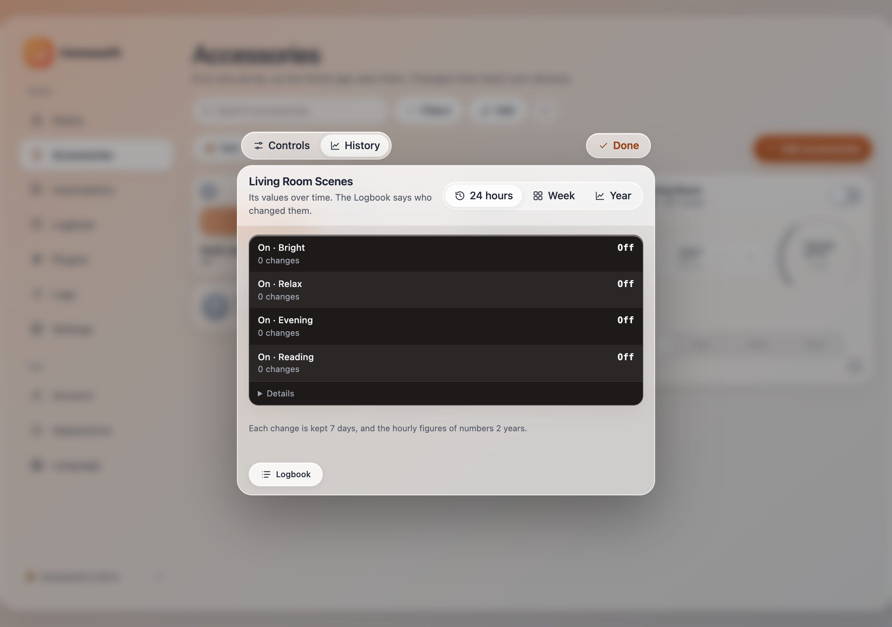

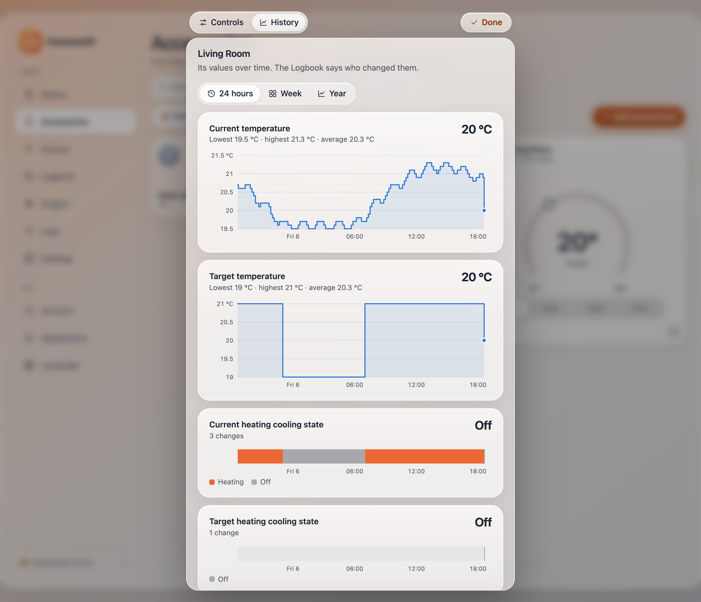

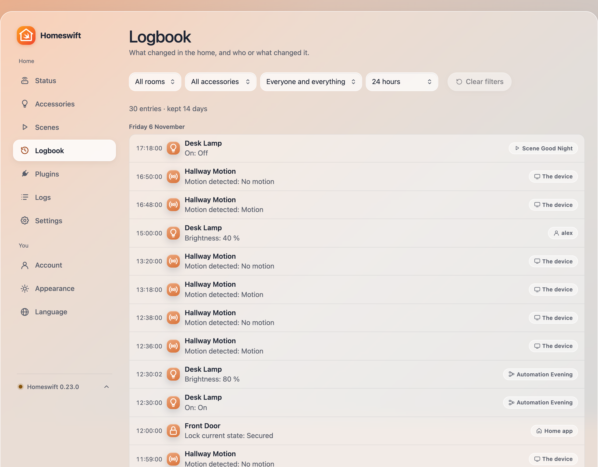

`GET /api/accessories/<id>/history?range=day|week|year&timeZone=…` answers the History tab and `GET /api/logbook`
(`room`, `accessory`, `source`, `sourceName`, `since`, `limit`) the Logbook, to anyone signed in, as the accessories
are. Over MCP, `get_accessory_history` and `get_logbook` ([docs/mcp.md](mcp.md)).

### Quick controls

The favourite accessories, by room, and a button per scene: at the top of the Status page, and on their own at `/quick`,
a page to keep on a phone's home screen.

### Scenes and templates

**Scenes** (`/scenes`, a tab beside Automations; Glass UI's scenes): accessory values set together, by hand, from the Home app or by an
Automation (docs/adr/0007-scenes-and-automations-are-separate.md). A Scene has no trigger of its own: what runs on its
own is an Automation, on the page's **Automations** tab ([Automations](#automations)).

- **Add an accessory as it is now** fills the actions from its current values.
- **Locks, garage doors and alarms** keep Homeswift's rule that a person confirms them: the page asks before running a
  scene that has them, the MCP server's `run_scene` refuses such a scene (as homebridge-mcp-server's does), and
  automations, with nobody to ask, leave those actions out and say so in their last run. Glass UI sets them like any
  value.

Scenes are kept in `scenes.json` next to config.json (owner-only), with each one's last run. The editor's **A switch
in the Home app** makes the scene a switch of one **Homeswift Scenes** accessory on the bridge: turning it on runs the
scene, leaving out its locks, doors and alarms; turning it off puts the lights back, and it shows whether the scene is
on. The switch has the scene's name in the Home app: renaming the scene renames it there, and renaming it in the Home
app renames the scene.

 A scene's tile says its
room and whether it is in the Home app, its Details its room when its accessories share one, and **Scene active** while every value it sets is what its accessories show.
Its ⋯ menu gives it a picture of your own (**Choose a picture…**, shrunk to 640 pixels; JPEG, PNG or WebP up to 1 MB)
or takes it away; a hub's scene has the same menu, and its picture is the one the Hue or IKEA page shows. The bridge
keeps them in `scene-pictures/` next to config.json. A hub's scene's menu also renames it on its hub, keeps its lights
as they are now, or deletes it from the hub (after asking: it goes from the hub's own app too). A new scene of lights
only, without an animation, can be saved to the Hue room or zone, or the IKEA hub, that has all its lights:
the editor's save bar offers it beside **Create the scene**.

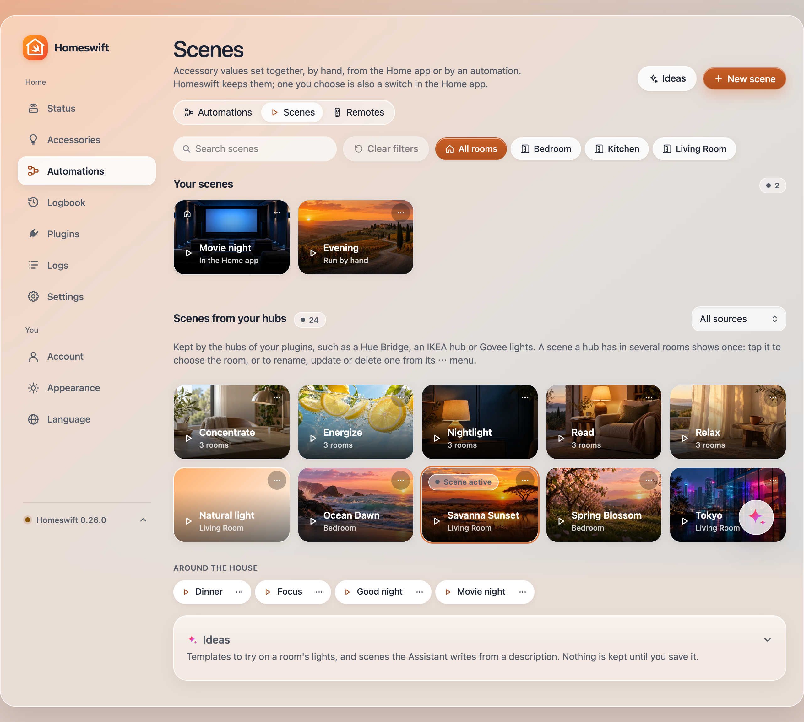

The page opens on a search and the rooms as chips (the rooms of your scenes and the hubs' rooms and zones): a room
narrows everything to its own scenes, and the page remembers it; **Clear filters** goes back to every scene. A source
filter beside **Scenes from your hubs** keeps one hub's scenes when there are several. **Your scenes** come first, then **Scenes from your
hubs**: the scenes plugins' hubs keep (a Hue Bridge's rooms and zones, a DIRIGERA hub, the scenes picked for Govee
lights, Apple Home's through Wingman), with their pictures or colours. A scene a hub has in several rooms shows once,
saying in how many: Hue makes Relax, Read or Concentrate in each room, so a home of fifteen rooms has a hundred of
them. The most widespread come first, a dozen until **Show all**. A tap opens a compact room list with inclusion toggles and ⋯ menus. **Select all** and **Deselect all**
choose the rooms for **Run selected rooms**; the selection lasts for the open sheet. The grouped tile’s ⋯ runs it in every room, stops it, or opens its rooms. A scene in one room
runs at once. The scenes in no room (Apple Home's) are small
buttons by name under **Around the house**, and several with one name show as one with their number (×3), which opens
each copy. A tap recalls one on its hub; Hue's say **Scene active** while the bridge says so. **Stop** puts back the
lights it changed, for 12 hours, as for any scene. **Automate** makes a Homeswift scene that recalls it and opens a new
Automation that applies it, for its triggers to be chosen; the editor's **Add a hub scene…** adds one to any scene. The editor's **Animation** step
makes the chosen lights move after the actions: a style (candle, fire, sparkle, prism, underwater, a sunrise, moving
colours, following the music…) with its speed, brightness and colour. Each brand plays it the way its own app does where
its lights have it (Hue's effects, Govee's library scenes, an IKEA fade for a sunrise, a SONOFF L2 strip's scenes, an
Ambilight TV for music);
Homeswift plays it on the others. An animated scene is active while it plays, and **Stop** puts the lights back. They are changed in their own app.

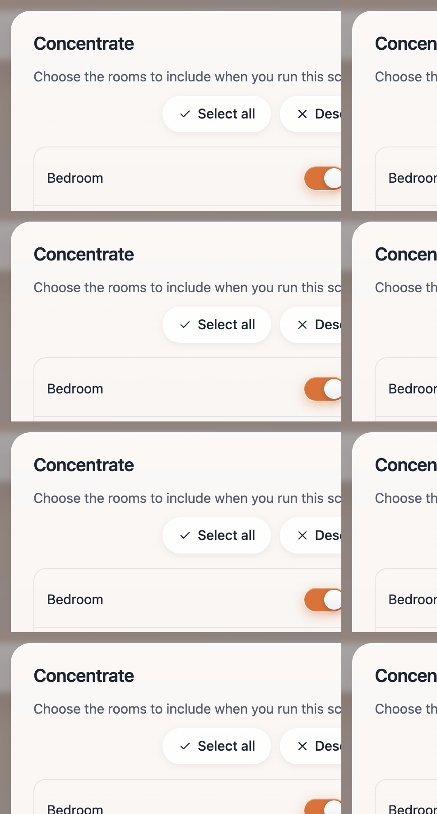

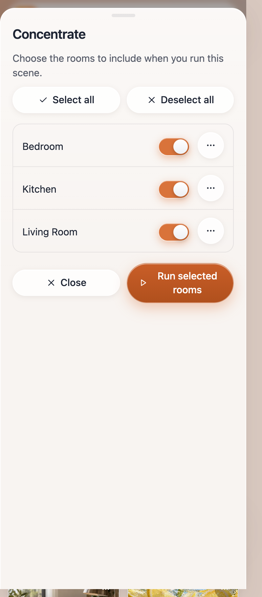


**Ideas**, folded at the foot of the page (the page head's **Ideas** opens it; it stays open while a template plays):
the templates, the rooms that have lights as chips, and the collection by kind, each drawn with photographic
thumbnails. A tap tries one on the room's lights at once, without saving it: calm ones set the lights,
effects (a fireplace, a candle flicker, an ocean, a sunrise) play each brand's own way where its lights have it, and
signals and party ones are timed sequences. The pill stays lit while it plays, and what was tried shows under the rooms
with **Stop** (or **Undo**, for 12 hours, for one that set the lights once) and **Save as a scene**, which keeps it as a
scene for that room, animated or not. With the Assistant on, **Describe a scene…** writes one from a description ("a
jazz bar") and tries it the same way. The **Scene gallery** adds 143 named photographic tiles in 28 theme categories, including Get cozy, Movie night, Reading, Wanderlust, Vibrant and Party vibes. Each theme has two horizontally scrolling rows on desktop and one row on mobile. Search by scene or theme name, or select a theme to show just that shelf. Sort each shelf by gallery order, name A–Z or name Z–A. These
set a palette once across the room's lights; they do not reproduce Hue animations or brightness. Saving one as a
scene preserves its artwork. In the scene editor, expand **Scene image** to choose another picture or **No image**.
Existing scenes without artwork keep their usual icon. The original gallery titles stay the same in all languages.
On a phone each photographic theme is a single row that swipes sideways; Calm, Slow animations, Party and Signals also use single horizontal rows. Hue and IKEA scene collections share this mobile layout. Trying a template is
controlling accessories, as running a scene is. `SceneTemplateLibrary` is the collection; MCP clients use `list_scene_templates`,
and `run_scene` or `save_scene` with `template` (or `description`) and `room`.

Your scenes are picture tiles, as the hubs' are: a tap runs one, the line under its name says what starts it, and small marks say it is in the Home app, starts on its own or changes a lock. Its ⋯ menu has **Details…** (a sheet with every action and its last run), **Edit**, its picture and **Delete**.

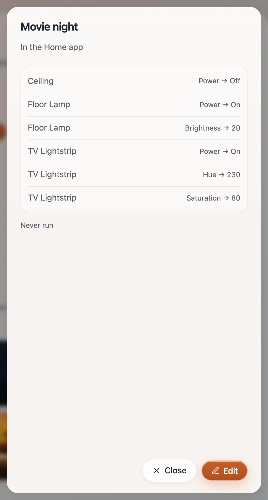

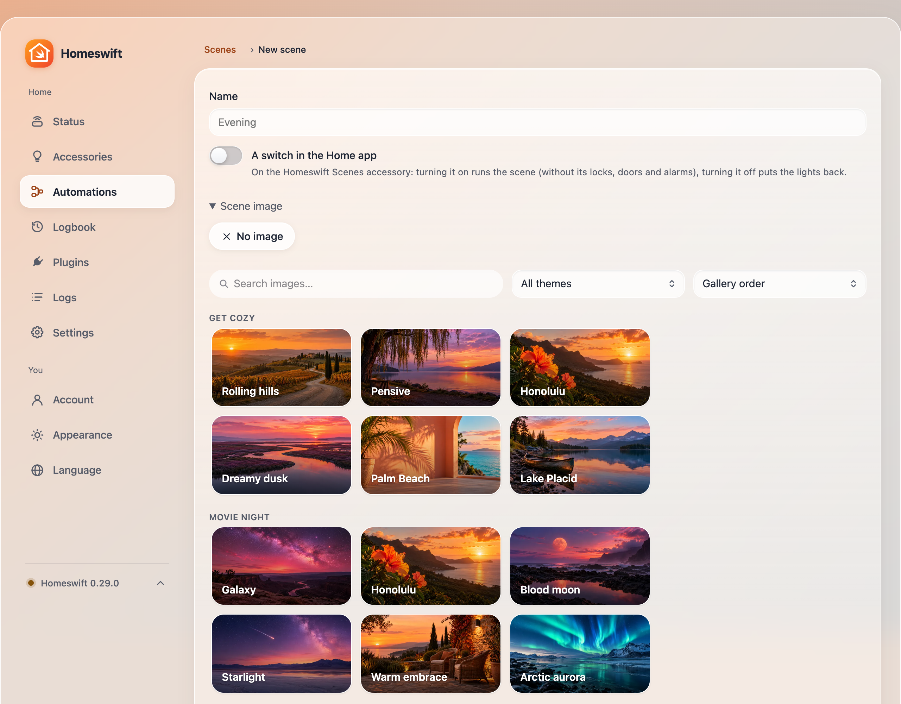

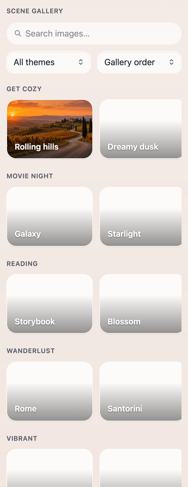

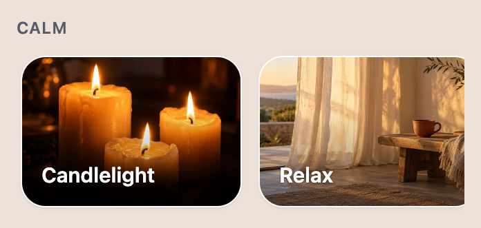

Template tiles that play show a centred square Stop icon; idle tiles show their image and name. Winter holidays and Christmas have separate scene selections.

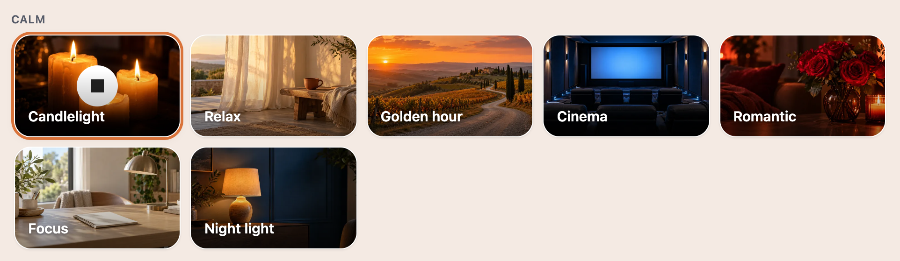

The theme menu is alphabetised in the selected language. Template photographs depict their subjects directly, including candles, a fireplace, a home cinema, a disco ball and a police lightbar.

Template tiles that play show **Stop**. Saved scenes also offer **Stop** after running. This restores captured light power, brightness, colour and Adaptive Lighting; other scene controls restore their captured values unless they have changed since. Locks, doors and alarms require confirmation before restoration. Undo state lasts 12 hours and is kept across bridge restarts for every run that set lights. Failed or skipped actions on a repeated run retain valid earlier restoration state. A light action that fails does not take ownership away from an earlier run.

The workflow action editor offers a combined **Light color** picker for colour-capable lights, brightness and colour-temperature sliders, power switches, device mode menus, and sliders for fan speed, position, volume and target temperatures. The colour picker saves ordinary hue and saturation actions, so the runtime and existing scenes remain compatible. Editing does not send device commands.

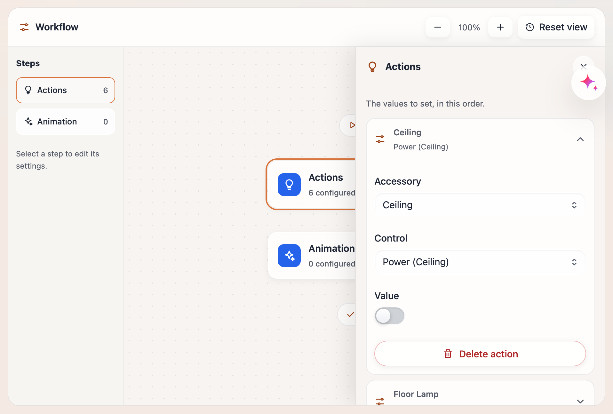

On narrow screens, the workflow editor replaces the canvas with a full-width form. Step navigation and Save stay within reach, and action summaries expand individually to keep long scenes scannable. The page handles scrolling, without a second scrolling inspector.

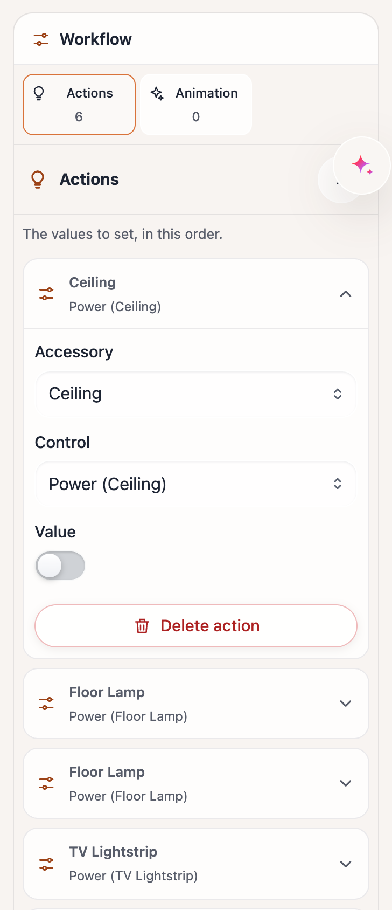

Deleting a scene opens a confirmation in the UI’s design system. Cancel is focused first; Escape dismisses it without deleting.

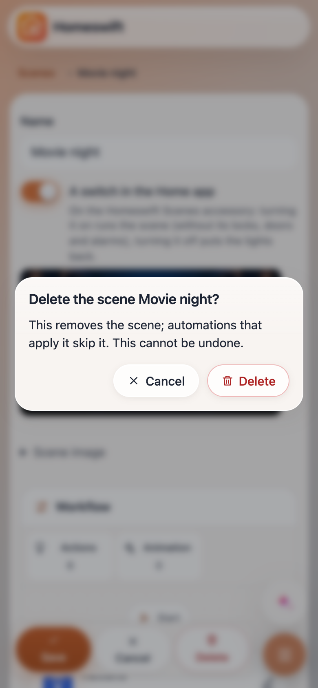

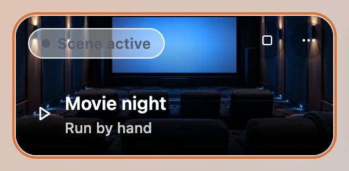

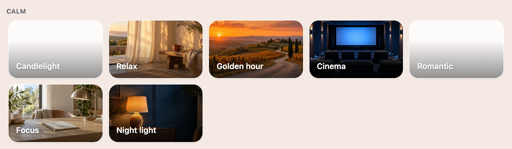

### Automations

**Automations** (`/automations`, in the menu, with Scenes and [Remotes](#remotes) as its other tabs; GLOSSARY.md): what the bridge does on its own. When any of its
**Triggers** fires and all its **Conditions** hold, its **Steps** run in order.

- **Triggers**: a time of day on chosen days; sunrise or sunset with an offset (-12 to +12 hours); a cron expression
  (`30 7 * * 1-5`; five fields, or six with seconds, which are ignored); an accessory's value that changes or starts to
  compare with a value (the motion sensor turns on); a value that **stays** so for a while (the door open for ten
  minutes); a number that **crosses a threshold** (the temperature rises above 26). Timed triggers run on the minute;
  one on a value fires at most once per 5 seconds. With the Presence plugin, a Person who **comes home** or **leaves**, or
  Anyone Home: the first Person coming home, the last one leaving. A **button pressed** (a remote's, a wall switch's: its
  single, double or long press) fires at every press, the same one twice in a row too.
- **Conditions**: a time window (`sunset` to `23:00`, across midnight too) or an accessory's value. **Run now** ignores
  them. Sunrise and sunset are for the Location, a Bridge Setting under [Settings](#settings); without one, the
  Triggers' help links to it.
- **Steps**: apply a Scene, set a value, wait, wait until a value (with the longest it waits, then it goes on), notify
  (through the channels of [Notifications](#notifications), as "A message from an automation"), or call a plugin's
  action: one its plugin offers to MCP clients and the Assistant without asking a person to confirm, its fields drawn
  from the action's input schema.
- **Mode**: **Restart** (the default): a trigger that fires during a run cancels it and starts again, as "turn the
  hall on, wait five minutes, turn it off" wants for each new motion. **Single**: a trigger during a run is ignored, and
  the last run says so.
- **Locks, garage doors and alarms** are never set by an Automation: a Step on one, or the part of a Scene that changes
  one, is left out and its last run says so. Over MCP, saving an Automation that names one (in a trigger, a condition
  or a Step) asks the person first.
- **A switch in the Home app** puts the Automation on the **Homeswift Scenes** accessory, beside the scenes' switches:
  the switch turns the Automation on and off; it never runs it.
- **Describe it**: a sentence for the Assistant, whose draft opens in the editor to review; nothing is saved before you
  save it. The Assistant sees the accessories by handles, with their names, rooms and characteristics, the scenes and
  the plugins' actions, never their ids.

Each card says what starts it, its steps and its last run (or why a trigger's run was skipped), with its on switch and
**Run now**. Automations are kept in `automations.json` next to config.json (owner-only), with each one's last run and
each Step's result. At its first start after the update, the bridge turns each Scene of `scenes.json` that had
triggers or conditions into an Automation of the same name whose single Step applies it; the Scene keeps its values,
its picture and its switch. Every change an Automation makes is its own in the [Logbook](#history-and-logbook).

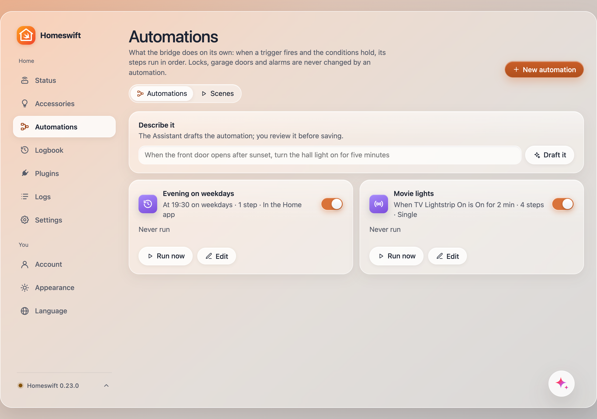

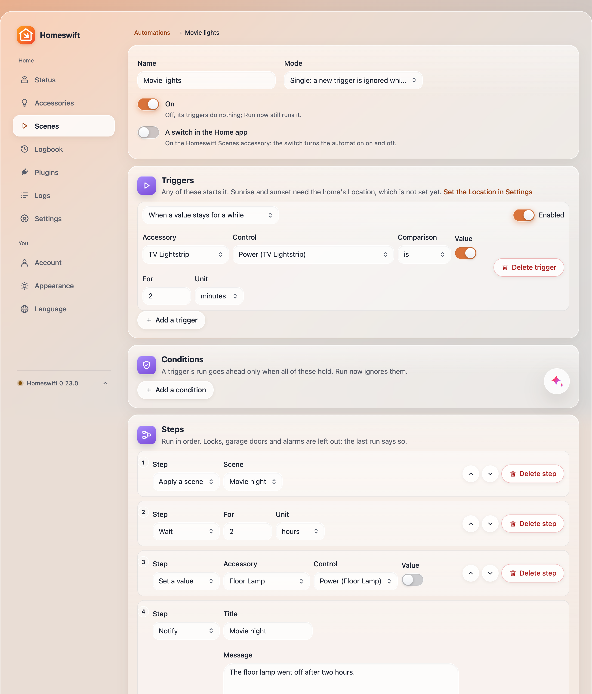

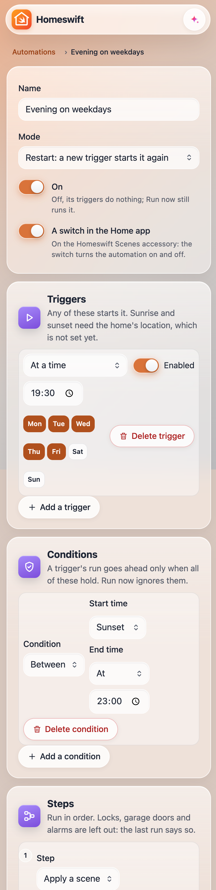

`/api/automations` (GET; POST, PUT and DELETE for administrators), `/api/automations/<id>/run` and
`/api/automations/draft` answer the page; over MCP, `list_automations`, `save_automation`, `run_automation` and
`delete_automation` ([docs/mcp.md](mcp.md)).

### Remotes

**Remotes** (`/remotes`, the third tab of Automations; GLOSSARY.md "Remotes"): every remote the bridge has, from any
plugin, in one list by room: a section per Remote with its Buttons and Wheels (by Channel where it has them), the Home
app's numbers for each, what each gesture does, and the Automations a Button starts. A chip says when its presses reach
Apple Home too (an automation there on the same button runs as well; Not in Home keeps the remote out of it), or come
through Apple Home (a remote mirrored by Wingman, a moment later). **Press a button** of a remote while the page is open:
its row lights up and its Controls open.

A part's sheet sets **What it drives** (lights and shutters, a searchable list) and **What each gesture does**: a press, a
double or a long press toggles them, turns them on or off, runs a Scene or stops moving shutters; a hold dims them (up,
down, or each hold the other way); a Wheel steps them per notch. The words follow what it drives (Opens rather than
Brightens for shutters). **More** has the step (1–25 %), the Wheel's direction, the **Power Switches** that power the
lights and the wait after they come on. A long press and a hold are the same press: one or the other. Controls are the
Remote's Accessory Settings (`controls`), saved without reloading its plugin; a change they make shows the Remote in the
Logbook. Locks, doors and alarms are never driven by a remote.

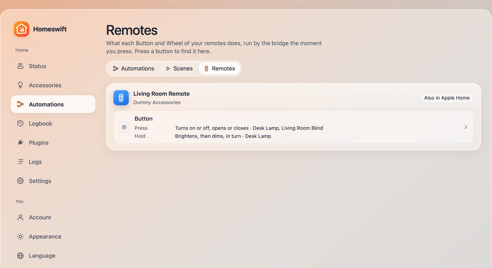

### Notifications

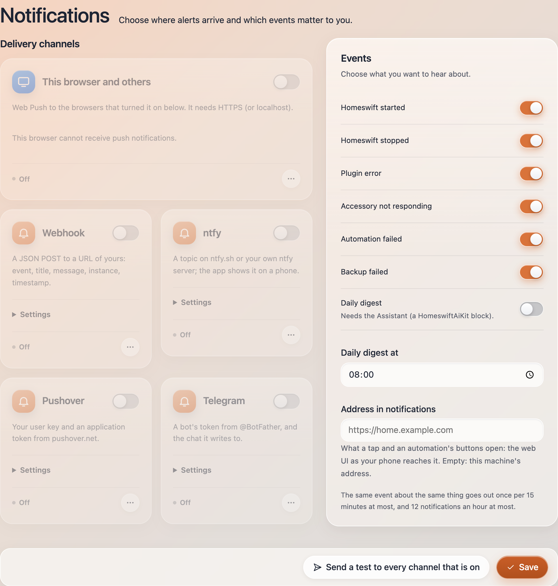

`/notifications`, from the Status page (Glass UI's notifications). Each channel is a card with its settings, its event
switches and a **Send a test**, under a Save bar.

- **Channels**: a webhook (a JSON POST with the event, title, message, instance and time), ntfy (ntfy.sh or your own
  server, with an access token), Pushover, Telegram, and Web Push to the browsers that turn it on. A webhook takes a
  **Bearer token** or **Basic authentication** and custom headers; headers that would change the transport, or a second
  Authorization, are refused.
- **Events**: homeswift started (not after a restart it made itself) and stopped, a plugin logged an error, an accessory
  answered No Response for 5 minutes while its plugin is not paused, an automation failed, an automation's Notify
  Step, the daily backup failed or
  (off until turned on) was saved, and the Assistant's daily digest at a time of your choice (off until turned on: it
  uses the provider's quota). Glass UI's update and rollback events have no counterpart here: plugins are compiled in.
- **Limits**: the same event about the same thing goes once per 15 minutes, 12 notifications an hour at most, 5 tests
  a minute.
- **Language**: the shared channels (the webhook, ntfy, Pushover, Telegram) have no one reader and are written in the
  Home Language (Settings › Bridge); Web Push goes to each browser in its account's Language, or the page's when the
  browser subscribed. The daily digest is in the Home Language. An automation's message goes as it was written.
- **A tap** opens the page a notification is about (the Logs for a plugin's error, the Status page, an automation),
  on ntfy (`Click`), Pushover (its link), Web Push and a webhook (`url`). **Address in notifications** is the web UI's
  address those links use, when the one it starts on (this machine's address on the network) is not the one your phone
  reaches, such as a reverse proxy's or a tunnel's.
- **Buttons**: an [Automation](#automations)'s **Notify** Step carries up to three, each applying a Scene, setting a
  value or opening a page. Each button has a single-use token valid 15 minutes, and the notification a confirmation page
  (`/notify/<id>`, behind sign-in) that lists its buttons, which a tap opens.
  - **ntfy**: its actions, an `http` POST to `/notify/act/<token>` for a button that acts, a `view` for one that opens
    a page (the message is then published as JSON, so labels keep their accents).
  - **Telegram**: an inline keyboard. A button that acts is a callback the bridge reads with `getUpdates` while a token
    waits, from the configured chat only; it answers the press and takes the keyboard off the message. One that opens a
    page is a link.
  - **Web Push**: the notification's `actions` where the browser shows them (Chromium); the service worker posts the
    token, or opens the page. On iOS and Safari, which show no buttons, a tap opens the confirmation page.
  - **Pushover** and a **webhook** (its `buttons`, each with the `post` address of its token or the `url` of its page)
    lead to the confirmation page.
  - A button that would act on a **lock, a garage door or an alarm** never acts from the notification: it opens the
    confirmation page, where a signed-in person confirms it. Its token is refused at `/notify/act`.
  - A used or expired button says so on the page. `/notify/act/<token>` takes no cookie and no `Origin`: its token is
    its only credential, as the OAuth endpoints' are theirs. The tokens live in memory and go with a restart.

The settings live in `notifications.json` next to config.json (owner-only), not in config.json. Tokens, keys, header
values and the webhook URL come back to the page as `********`: sent back unchanged they keep the stored value, and a
removed header row deletes it. Neither `get_config` nor the Assistant ever reads them. For Web Push the bridge makes its
VAPID key pair the first time a browser asks and keeps it in that file; the page registers `/sw.js`, a service worker
that only shows notifications and opens the page one is about. Browsers allow it over HTTPS or on localhost only; iOS
needs the page added to the home screen.

### Plugins

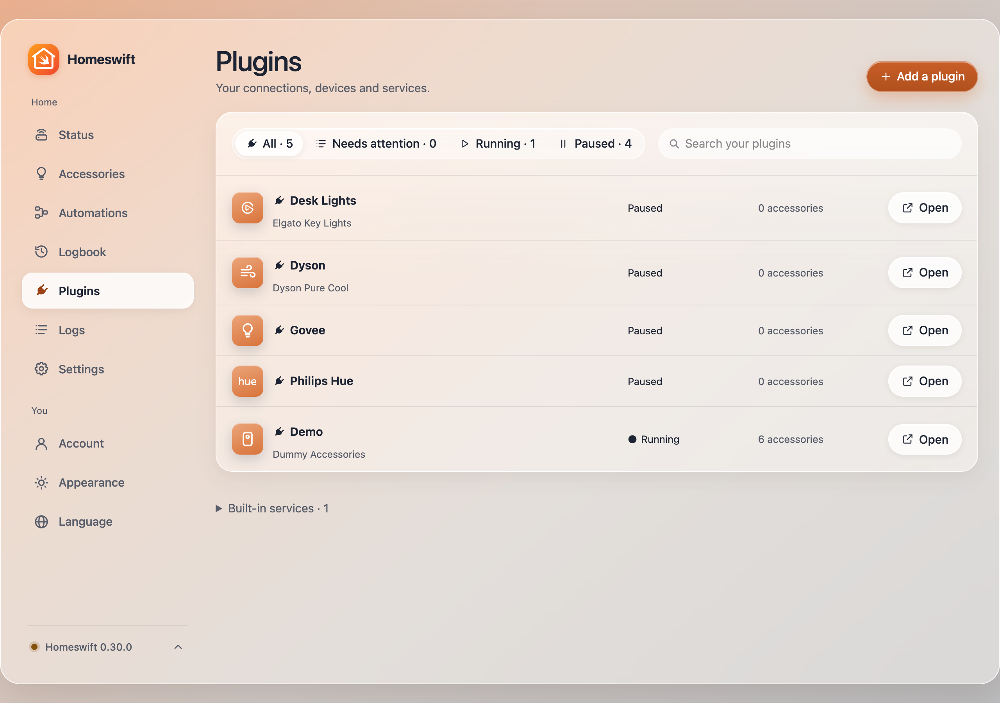

The list shows each plugin's status and accessory count, with attention states first. Search by name or platform,
then filter **All**, **Needs attention**, **Running**, or **Paused**. Built-in services are folded below the list.
**Add a plugin** opens the searchable catalog of plugins compiled into this homeswift.

A name or **Open** opens an opaque inspector over the list, without resizing it. On phones it slides up from the bottom.
The grouped tabs show **Overview** (state and primary action), **Accessories** (live accessories and their settings),
**Settings** (the existing validated editor and management actions), and **Events** (recent plugin log entries).
Escape, the close button, or a swipe on the phone's grabber closes it and returns focus to the row.

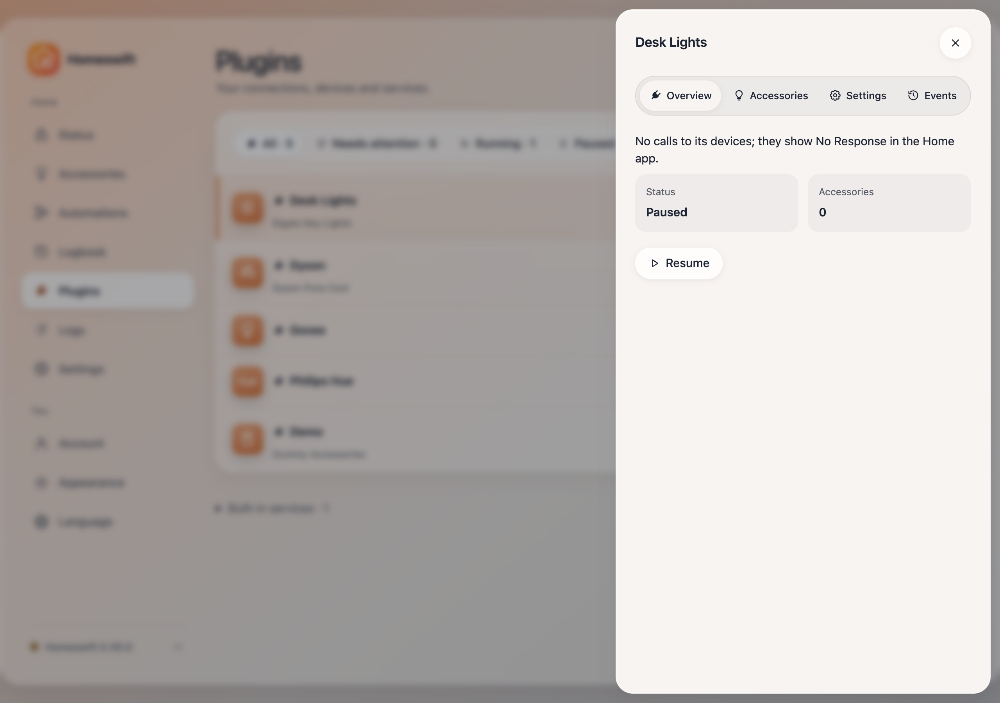
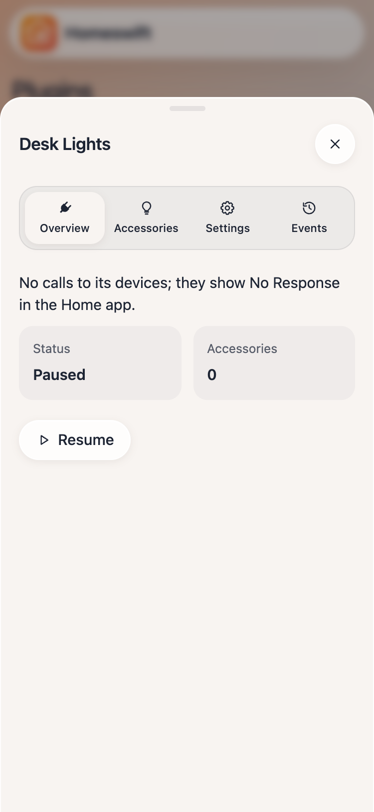

A plugin whose account Needs Authorization says **Needs sign-in**, **Needs pairing** or **Needs keys**.
Its Overview offers **Set up** or **Set up again**, using the existing Setup flow. One whose every accessory shows
No Response says **Not responding** and its Events tab provides the log.

- **Settings** also offers config.json, pause or resume, [Diagnostics](#diagnostics), and removal.
  Removing a plugin that kept sign-ins or tokens in the vault offers to delete them too (off by default).
- **Pause** (also at the top right of a plugin's page) stops the plugin's calls to its devices, for when an app sharing
  the account would be signed out by them. Its accessories stay in the Home app, showing No Response, and the page
  offers **Resume**.
- **A plugin's page**: a running plugin with a page of its own (pairing a TV, finding lights; [For plugin
  authors](#for-plugin-authors)) does its everyday work there, at `/plugins/<slug>` (the block's name in lower case,
  dashes for spaces: `/plugins/dyson-pure-cool`), from the list or an accessory's menu. **Add** on such a plugin writes
  an empty block and opens its page, as Homebridge's custom UIs do.
- **Settings** (`/plugins/<slug>/settings`; a plugin without a page of its own has them at `/plugins/<slug>`, and a
  plugin's page links to them at the right of its breadcrumb, before Pause; the old `/expert` and `/expert/json`
  addresses lead there). One surface in sections:
  - **Account**, for a plugin that signs in to an account or pairs with a hub: where it stands and **Set up** (**Set up
    again** once it has been), which opens the Setup sheet. An account the plugin's devices come with reads "Not set up
    yet: its devices show once it is"; an optional one (`AccountRequirement.optional`) says what it adds, and one the
    account refused says so in orange. The header's state says the same as the plugin's card. Its sign-in is kept in the
    vault, never in the form.
  - **Settings**: the Plugin Settings as a form built from the plugin's schema (the same `config.schema.json` the
    Homebridge version ships), read and saved through `GET`/`PATCH /api/settings/plugins/<platform>/<name>`. One Save
    sends what changed from the form as it opened (a key taken out is cleared; one the form does not show, such as a
    secret kept in the vault, is left alone); the plugin reloads once, its accessories kept.
  - **Devices**: every Discovered Device of the instance, as Setup's discovery finds them, with where each stands: one set
    up opens its accessory's Settings sheet, an Excluded one has **Include**, one that Needs Authorization has **Set
    up**. **Find again** asks the plugin again. A plugin that adds a device by address has **Add by address…** under
    its devices, the Add accessories page's sheet. `?accessory=<Accessory Id>` opens that accessory's sheet over the
    page (a plugin page's link to one of its devices, or to a scene through `scenePictures`' `settings` option), and the
    address loses it once the sheet closes.
  - What the form does not show is in config.json: the page links to its editor (Settings › Config), the one place to
    write a block as it is, **Save anyway** included. Then **Remove this plugin**.

  The runtime's own blocks (`HomeswiftUI`, `HomeswiftAiKit`: the web UI, the Assistant and the MCP server) keep their form
  at `/plugins/<slug>`, saved whole, as a new block's (`/plugins/add/<platform>`) is.

#### Diagnostics

**Download diagnostics**, in a plugin's ⋯ menu and an accessory's (administrators), saves one JSON file
(`homeswift-diagnostics-<name>-<day>.json`) to attach to an issue. It holds homeswift's version and platform (not the
machine's name), the plugin's state (running, paused, why it did not start, its account), its Plugin Settings and
Accessory Settings, the accessories' services and current values, the plugin's last 1,000 log lines and how many
errors and warnings it logged over the last week, with its last error. Secrets are masked through `Redaction`:
values under secret-named keys, sealed values, and in every other text (settings and log lines alike) what the log
masks, with each URL's credentials: a password before the host, secret-named query values (`?pwd=…`, `?token=…`), and
the whole path and query of an RTSP URL (a UniFi Protect stream alias). A `vault:` reference keeps its name. Names and rooms are kept, because they are what lets a helper find their way; read
the file before sharing it. An accessory's file has that accessory alone and its own Accessory Settings. `GET
/api/diagnostics/plugins/<platform>/<name>` and `GET /api/diagnostics/accessories/<id>` serve it, and MCP clients get
the same bundle from `get_diagnostics` (administrators only).

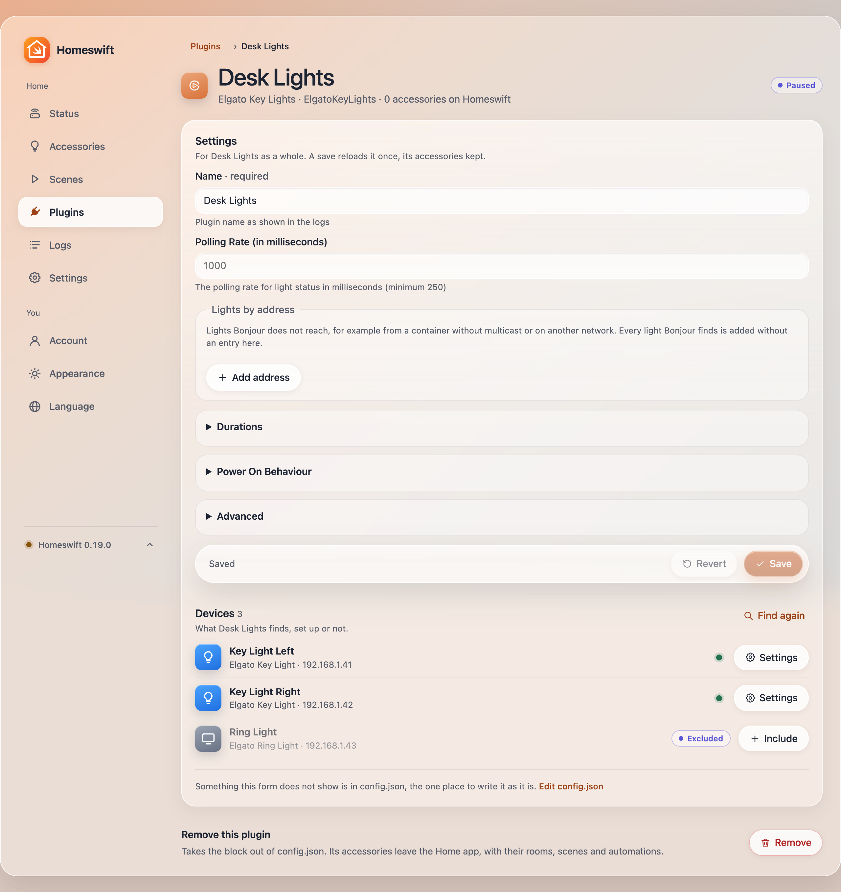

The form follows the schema's `condition`s (`functionBody` or an expression, as Homebridge's form reads them): a field
shows only when its condition holds for the block or, in a list, for its entry (`arrayIndices`). The page runs no code
from the schema: it reads the part of JavaScript conditions use (`model.a.b`, `[arrayIndices]`, literals,
`.includes()`, `!`, comparisons, `&&`, `||`) and shows a field whose condition it cannot read. A field with
`"x-schema-form": { "requiredWhen": "model.route === 'app'" }` is marked required, and its input `required`, only while
that condition holds and the field is on screen: settings that depend on another (an account or keys, by the route
chosen). A boolean with
`"x-schema-form": { "invert": true }` shows its switch on while the value is false, for a key that turns something off
under a title that turns it on (the web UI's daily backup). A certificate or key field takes a dropped PEM file, which
the bridge checks and keeps owner-only under `files/` next to config.json.

With the Assistant on, **Describe your setup** above the form writes the block from a sentence and the plugin's schema; the change shows as a
diff, and **Use it** puts it in the form to review and save. Passwords and tokens never reach the provider.

**Saving** validates the block, backs up the previous file and applies it at once ([Applying changes](#applying-changes-and-restarts)).
A save also checks what it
changes against the plugin's schema (a type, a bound, a choice outside the list, a required setting): the problems show
in the save bar, and nothing is written. Settings left as they were are not checked, so an old mistake never stops
another change; **Pause** is checked the same way (`PUT /api/config/block/<platform>/<name>`),
and only config.json's editor's **Save anyway** writes without the check.

The settings routes are what MCP's `get_settings` and `update_settings` read and write (docs/mcp.md), for
administrators, secrets as the placeholder: `GET`/`PATCH /api/settings/accessories/<accessoryId>` an accessory's
Accessory Settings and their fields (`?instance=` names the block of an accessory not on the bridge whose platform has
several), `PATCH /api/settings/accessories` several accessories' in one write (`{"<accessoryId>": {…}}`), and
`GET`/`PATCH /api/settings/plugins/<platform>/<name>` an instance's Plugin Settings with its `schema` and
`accessorySchema`. A `PATCH` merges its body, objects key by key, and `null` clears a key. `DELETE
/api/settings/accessories/<accessoryId>` Forgets the device (MCP's `forget_device`).

### Add accessories

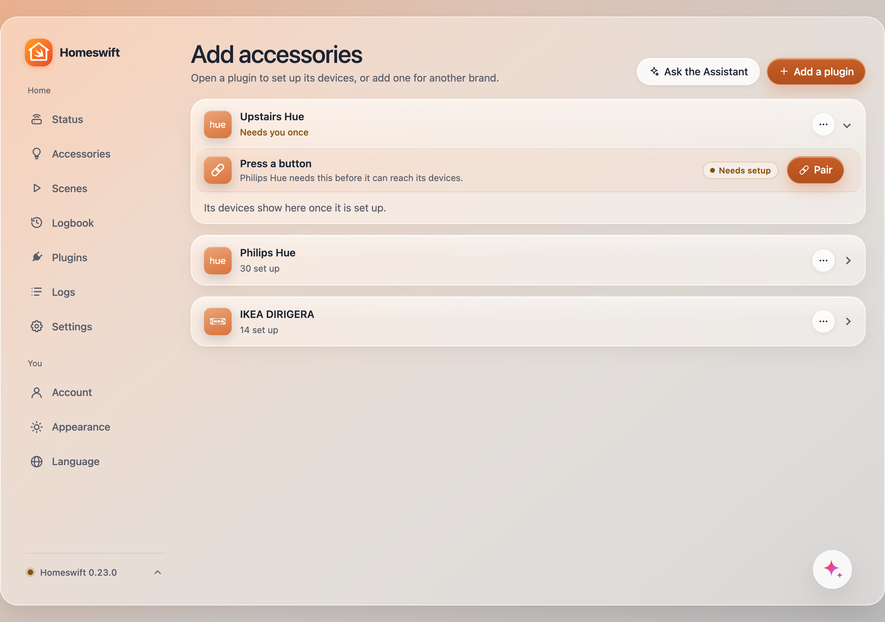

`/setup`, from the Accessories page's **Add accessories** (a plus alone on a phone), an empty wall, and a plugin card's
⋯ (`/setup#<slug>`), for administrators.

Each plugin in use is one row: its name and where its devices stand ("10 set up · 1 excluded", or "Needs you once" in
orange). A row opens on its devices; its ⋯ beside the chevron looks for devices again (**Find again**) and signs in to its account
again. One that needs someone opens by itself and comes first, and when there is only one plugin it is open. Opened, a plugin whose account is not set up yet
(a hub not paired, a cloud not signed in) leads with that row, as nothing else works before it; then each device that
needs a code, a button or a sign-in, with **Set up**; then the devices set up, a quiet dot each (**Not responding** for one set up that its plugin cannot reach now, such as a
UniFi console that is off), and those excluded.
While a plugin looks for devices, its row says so and its devices dim.

A plugin whose devices cannot be found, reached by their address (Elgato's lights on another network; Add by address,
[plugins.md](plugins.md#setup)), has **Add by address…** under its devices and in its ⋯. It opens the Setup sheet on
what the plugin asks: the device's IP address or host name, perhaps a port, a user and password or a camera's code. The
plugin asks the device who it is; one that does not answer says so in the sheet ("No light answered at
192.0.2.50:9123") and is asked again, and one that does ends at done with its Accessory Settings under it, named by
the device, as a device's Setup does. It is then in the list, set up, and in the Home app.

**Ask the Assistant**, when the Assistant is configured, opens the chat for it: it finds the plugin, starts the
Setup and answers what you tell it (a PIN), and hands a step with a password, a sign-in page or a button to press back to
the Setup sheet through a card in the conversation.

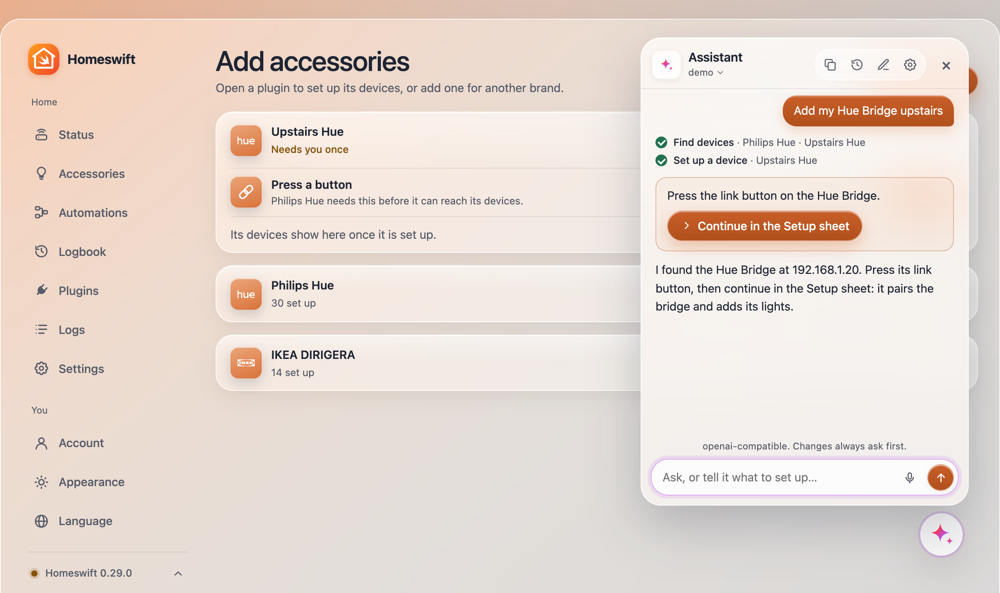

**Add a plugin**, at the top right, opens a sheet listing the plugins compiled in, those not in use first, each with
what it reaches, and a search. A plugin with an account opens its Setup at once, and its block is saved when the Setup
is done; one without an account is added as it is, and the page scrolls to its row, open. Before any plugin is set up,
the page shows the brands themselves, two a row on a phone, with how each connects (a sign-in, keys, a button on a hub,
nothing to sign in to).

**Set up** opens one sheet, the same for every plugin, with the plugin's tile, its name and where the Setup stands: the
sign-in (or the pairing), the devices, done. It draws what the plugin asks ([Setup](plugins.md#setup)): the link button to
press, a ring calling for it and a bar for the time left while it retries; a PIN the TV shows; an email then the code sent
to it; keys; or a sign-in page to open while the sheet waits for its redirect (or for its address, pasted). A plugin with
more than one way to sign in (Daikin's Developer Portal or the Onecta app, LG's page or a password, EcoFlow's developer
API, app or both) asks which first, the block's own picked. An answer that did not work is asked again; Cancel ends the
Setup. What it gives goes in the vault, and the plugin reloads with it.

An account set up for the first time then lists what the plugin finds, every device switched on: those switched off are
excluded (they can be included later), and the sheet ends on the accessories added. A device that brings devices of its
own (a UniFi console: its cameras, doors and sensors) lists those the same way once the plugin reaches them. Another
device's Setup ends at done with the device's Accessory Settings under it, the same editor as the wall's **Settings…**
(each field saved as it is changed), so what a plugin declares once shows in both places, then **Done**; an account
signed in again ends at done.

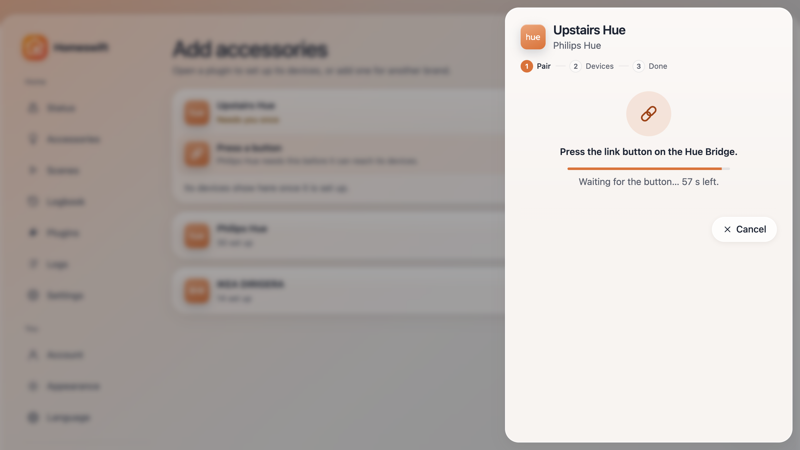

A device's ⋯ opens its **Settings…** (the wall's sheet), **Exclude**s it (its Accessory Settings' `excluded`: the plugin makes no accessory of it, in the Home app or
Matter) or **Include**s it again; one excluded by the plugin's own settings (a Homebridge exclude list) opens them
instead. **Find again** asks the plugin again.

### Logs

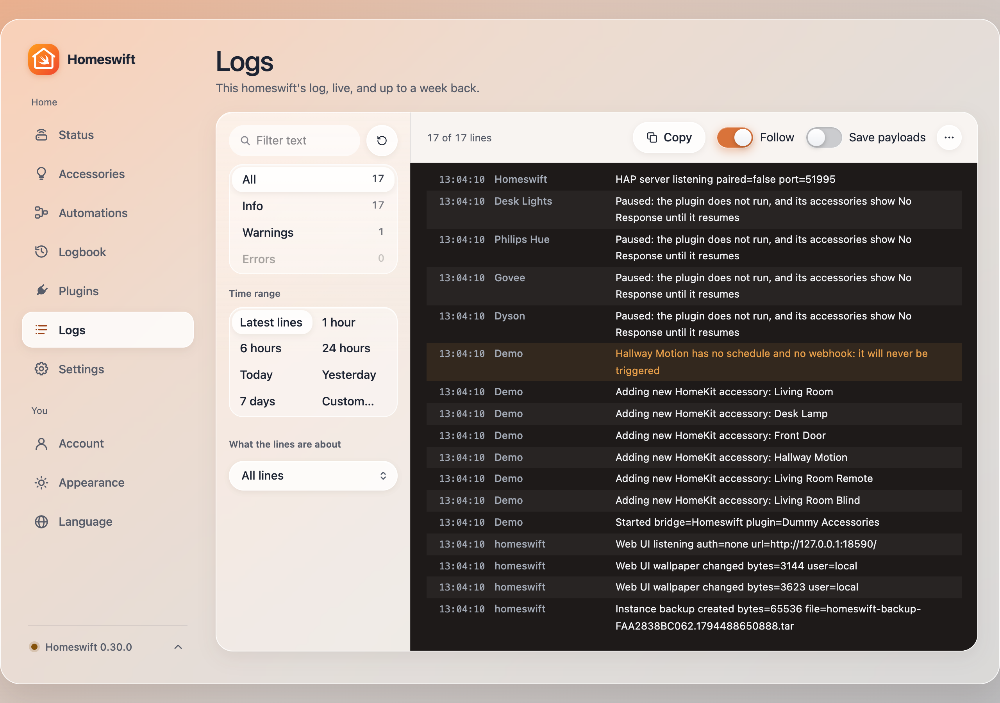

The live log, filtered by the following; in a window 1180 px wide or more they sit in a column down the log's left, the
levels and time ranges as lists, and the log takes the window's height:

- **Level**: All; Info (info and above); Warnings or Errors alone, each with how many lines it has.
- **Text**, which looks inside a line's JSON payload too.
- **Time**: the latest lines, the last hour, 6 or 24 hours, today, yesterday, the last 7 days, or **Custom…** (the
  Status page's time range control).
- **What the lines are about**, one menu: every line; the bridges' own lines (their servers' connections, pairings and
  controllers), every bridge's or one's; a plugin's own lines (its pairing, devices, clouds and errors); or an
  accessory's (those of its own server and those that name it, its id or its address), grouped by plugin.

**Copy** puts the lines shown on the clipboard as text. **Diagnose** (Log Doctor, with the Assistant on) sends the lines
shown, the latest 3,000, to the Assistant, which groups the issues with their causes and fixes as it writes; secrets and
addresses are masked first. The **⋯** menu downloads the range shown, or the whole log for the latest lines, as a text
file, and **Empty the log** removes every line, in memory and on disk, after asking (the MCP server's `truncate_logs`,
admin-only, does the same).

A line that carries JSON of 160 bytes or more (a device's state, a cloud's message) shows a marker such as `{…} 1.4 KB`
instead, in the terminal too; its **JSON** button shows the payload under it, formatted. The payload is kept with the
line, its secrets masked (values of keys such as `password`, `token` or `apiKey`, and bearer tokens, JWTs and setup
codes anywhere). The latest lines keep their payloads in memory; **Save payloads** also writes them to the log on disk,
so you or the Assistant (`search_logs` with `hours`) can read them after the lines moved on or the bridge restarted. It
is off until turned on, and the choice is kept in `logs/settings.json`.

The bridge keeps its log on disk under `logs/` next to config.json: segments of 8 MB at most, a new one each day, the
oldest removed past 64 MB or 7 days, written in batches once a second so logging never waits for the disk.

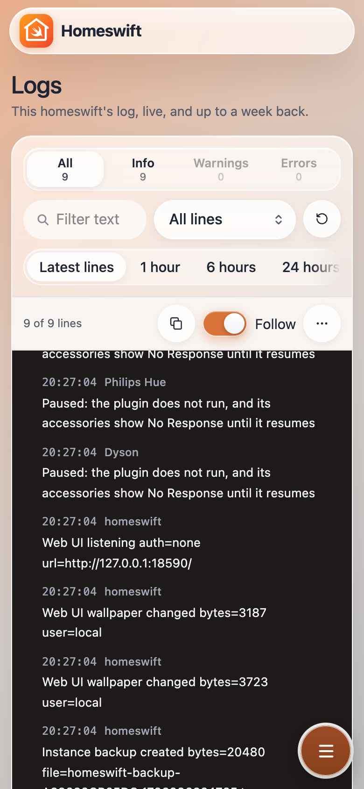 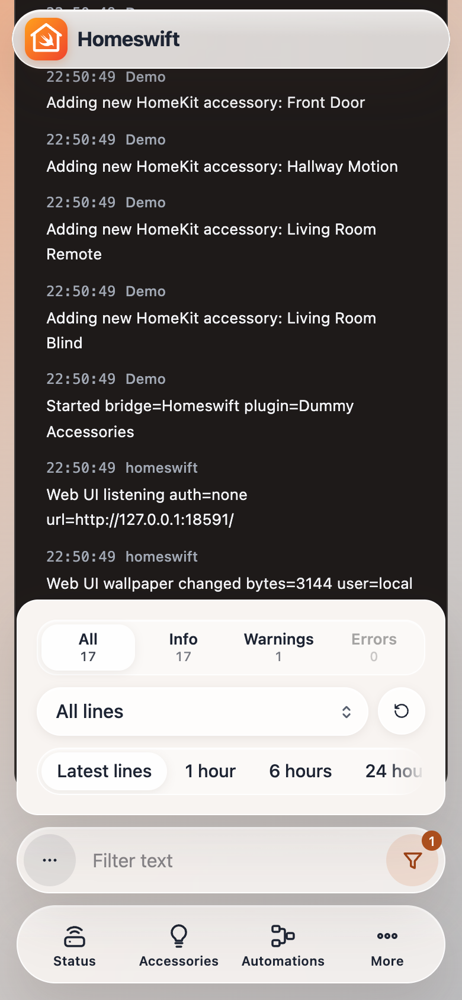

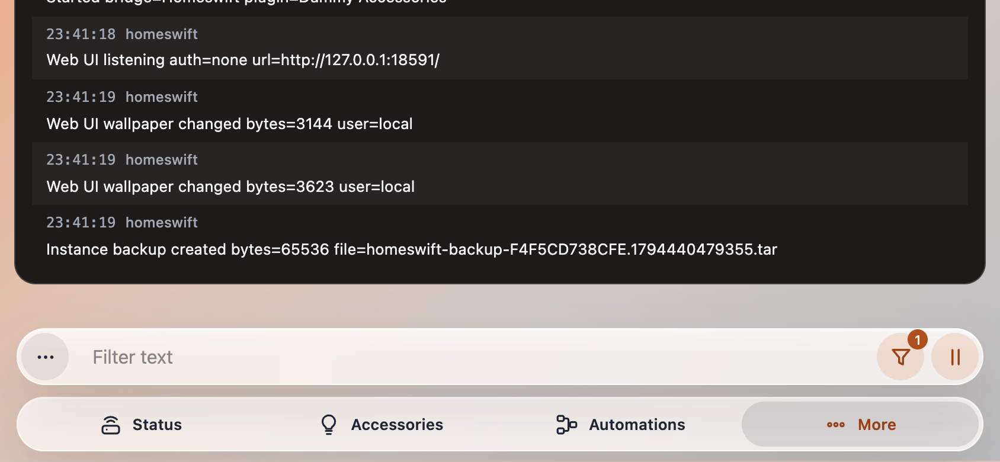

On a phone the log is the page: it scrolls as the page does, under the title alone, its newest line just above the
bar, where new lines arrive (a short log grows upwards from it), and Follow keeps the page's end in view. Scrolled up, a round arrow over the bar goes back to the latest lines. A phone held sideways keeps this layout, with a compact tab bar, and the
header scrolls away with the page. Every other line is a shade lighter, so a wrapped line reads as one. Its actions are one glass bar above the tab bar: the **⋯** menu (the count, Copy, Follow, Save payloads, Download,
Empty the log), the text filter, **Filters** (its badge counts the filters that are not the defaults) and the
Assistant's Diagnose. Follow is on from the start. **Filters** opens the levels, what the lines are about and the time range in a sheet above the bar.

### Settings

For administrators, after the Homebridge UI's settings, child bridges, backups and restart pages. Its tabs:

- **Bridge** (`/settings/bridge`, where `/settings` opens): config.json's `bridge` block as a form (name, port, setup
  code, manufacturer, model, firmware, and how long the History is kept: **History kept (days)** and **Hourly history
  kept (years)**; **Home Time**, the home's time zone, which Tariffs, Automations, the History and the log run on (the
  host's when empty: set it when a container runs in UTC, which the Status page's System card points out); the **Home
  Language**, for notifications on the shared channels (ntfy, Pushover, Telegram, the webhook) and the daily digest,
  set to the first account's language when the bridge was set up; saving restarts homeswift, except for the Home
  Language alone; the device ID stays). The setup code shows as the
  bridge runs with it, whether config.json keeps it sealed or in the vault, with a copy button and the pairing QR code;
  it is written back only when it changes. Then the network (the addresses, the
  advertiser), each server's HomeKit pairing with **Reset pairings…** in its ⋯ menu, the cached accessories (stale ones
  first, ten in view and the rest scrolling in their card) with **Remove from the cache…** and **Reset every cache…**, and a link to the schedules and proxy settings of
  the HomeswiftUI block. A HomeKit port is checked before it is saved; an empty one picks a free port. Homeswift listens
  and advertises on every interface with the system's mDNS (Bonjour, or Avahi on Linux): there is no interface to bind
  or advertiser to choose, as Homebridge's `bind` and `advertiser` settings do, and no Node-specific setting
  (environment, debug mode, keep orphans). **Location**, under the form: where the home is, for scenes' sunrise and
  sunset and for plugins such as Weather (GLOSSARY.md). It is folded under its head, which names the place
  (`/settings#location` opens it), so no map tile loads until it is opened. Click the map or finish dragging to place the pin and save the
  coordinates (clicks in a row send one save, the last); arrow keys move the pin for review. **Use this device's location** asks the browser and centres
  the map; **Save** keeps the reviewed position, and the coordinates stay editable. Visible map tiles come straight from
  OpenStreetMap while the section is open; the coordinates work without the map service. Address suggestions appear
  after three characters, with a short typing delay and a spinner; a result centres the map and saves its coordinates.
  Searches go straight to [Photon](https://github.com/komoot/photon) and are cached for the page. No restart
  (`bridge.location` in config.json, `{latitude, longitude, name}`; `GET` and `PUT /api/settings/location`,
  `get_settings` and `update_settings` with `bridge: true` over MCP).

  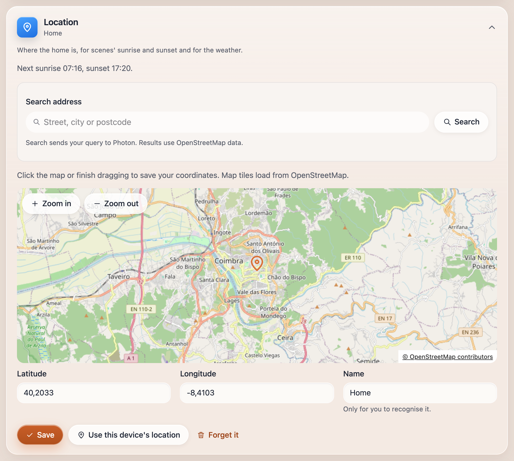

  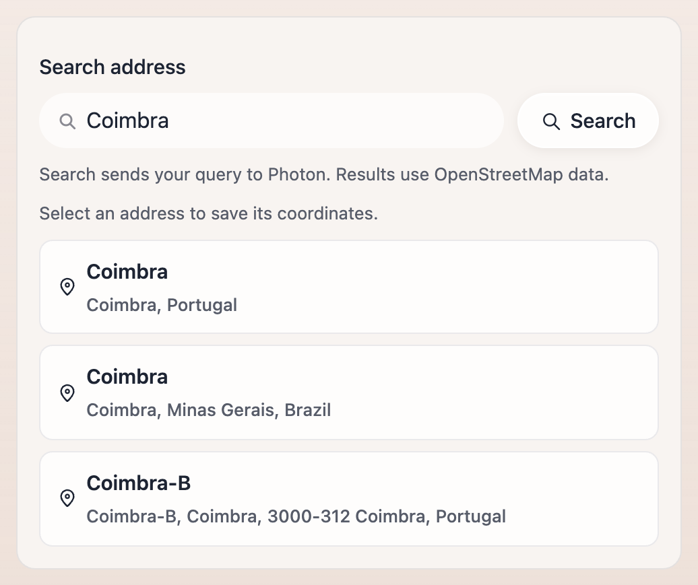

  **Energy tariff**, under it: what the home pays per kWh, for the costs
  on the Status page. It edits the latest Tariff (GLOSSARY.md): the day it applies from, the currency, the export price (empty when a
  kWh sent back is not paid) and the prices, a row per period (a name, from, to, every day, weekdays or weekends, a
  price per kWh), which must cover each part of the week once; a period ending before it starts runs past midnight.
  Saved with another first day, it is a new Tariff from that day and the days before keep their prices; the earlier
  Tariffs are listed under it. No restart (`bridge.tariffs` in config.json; `GET` and `PUT /api/settings/tariffs`,
  `update_tariffs` over MCP). Once the bridge has a gas or water Meter (or a Tariff of that kind), a **Gas tariff** and
  a **Water tariff** follow: the same form, priced per m³ and with no export price, each kind with Tariffs of its own
  (`"kind": "gas"` in `bridge.tariffs`).
- **Config** (`/settings/config`): the whole config.json in an editor; see [Config](#config) below.
- **Child bridges**: each with its status, uptime, restarts, the plugins that did not start and why, and, until the Home
  app has it, its setup code and QR code. Its ⋯ menu restarts, stops or starts it, shows its log, and resets its
  pairings.
- **Backups**:

  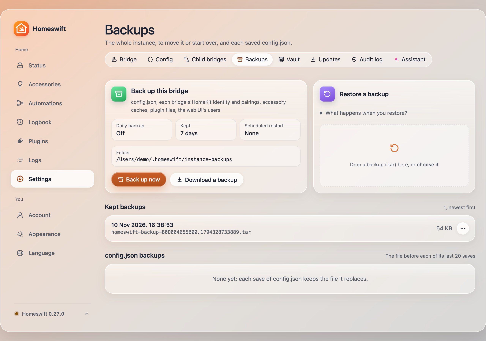

  - **Download a backup** makes an archive of the instance (a tar: config.json, each bridge's HomeKit identity and
    pairings, the accessory caches, the plugins' files under `plugins/`, `files/`, the web UI's users and certificate,
    the MCP audit log). Left out, at any depth, as upstream does: the backups, `logs/`, `metrics/`, the web UI's
    sessions, what other systems put there (`node_modules`, `.git`, `@eaDir`…), and files over 10 MB.
  - **Back up now** keeps one in the backup folder, as the daily backup does at a random time before 7:00 (unless
    `scheduledBackupDisable`), removing this bridge's older than `scheduledBackupDays`. Each kept one downloads,
    restores or goes.
  - **Restore a backup** takes one, dropped or chosen (64 MB at most). The bridge checks it whole (its `info.json`, a
    config.json that runs, only plain files under relative paths: links, devices, absolute paths and `..` are refused),
    stages it in `.restore-pending/` and restarts; the new process puts the files in place before it reads anything,
    keeping this machine's bridge and web UI ports. Files the backup does not have stay.
  - **config.json backups**: the file before each of its last 20 saves, each compared with the file as it is (a diff)
    or restored. A settings write that changes only an accessory's Name, room, Hidden or Not in Home (a rename in the
    Home app, a move Apple Home made) keeps none.
- **Vault** (docs/vault-design.md), for administrators:

  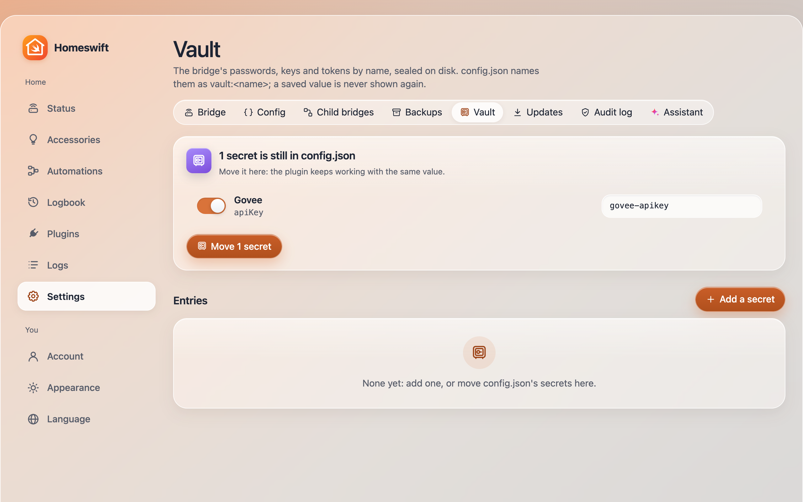

  - The secrets still in config.json, each with the entry it would become (identical values share one): untick one to
    leave it, rename an entry, then **Move to the vault**, which backs config.json up and writes it with `vault:`
    references.
  - The entries: kind, field names, who uses them (settings that name them, or the plugin that keeps a token), when
    they were last used (a reference resolved or the plugin read its token; noted once an hour at most) and when they
    expire. **Add a secret** and **Replace the value…** take values that are never shown again; an entry config.json
    still names cannot be deleted.
  - What needs attention is listed on top, each with the step that fixes it: references to entries that are gone (the
    bridge does not start with them, **Add it…**), references that cannot read their entry (a field it does not have,
    or another plugin's entry), and entries expired or expiring within 30 days (**Replace the value…**). The Status
    page's Vault widget and the daily digest say so too.
  - In a settings form, a secret's field has a key button: its menu searches the vault's entries and puts the one
    chosen as `vault:<name>`, shown as it is.
- **Updates** (`/settings/updates`): this version, how it was installed, when GitHub was last asked, a switch for the
  checks twice a day (the HomeswiftUI block's `checkForUpdates`, written at once: `PUT /api/updates/automatic`),
  **Check now** and **Restart homeswift…**. When a newer
  release is out, its card: **Install and relaunch** on a Homebrew install (`POST /api/updates/install`, then
  `GET /api/updates` while it installs; an upgrade that leaves the old version in place, as when the tap has not caught
  up yet, is an error), **Relaunch now** once it is on disk, how to upgrade elsewhere.
- **Audit log**: the MCP audit log (`homeswift-mcp-audit.jsonl`): every write of MCP clients and of the Assistant's chat,
  and every change made in this UI (client `web UI`, the user, the route, a small body with its secrets masked), newest
  first, filtered by time, outcome, tool and client (`/settings/audit?since=7d&outcome=failed&tool=…&client=…`).
  `auditLog: false` in the MCP block turns it off.
- **Assistant** (`/settings/assistant`): the HomeswiftAiKit block's whole form (the provider, model and key, the MCP
  server and the rest) with its save bar, under a card with **Test connection** (it takes the form's settings, saved or
  not), what the Assistant used today and this month against its budgets, by model and by user, and **Edit the budgets**,
  saved with the form. The block's own page under Plugins is the same form. Without a block, the page offers to set
  one up.

The pages' changes that cannot be undone (pairings, caches, a restore) ask first, some with a word to type.

#### Config

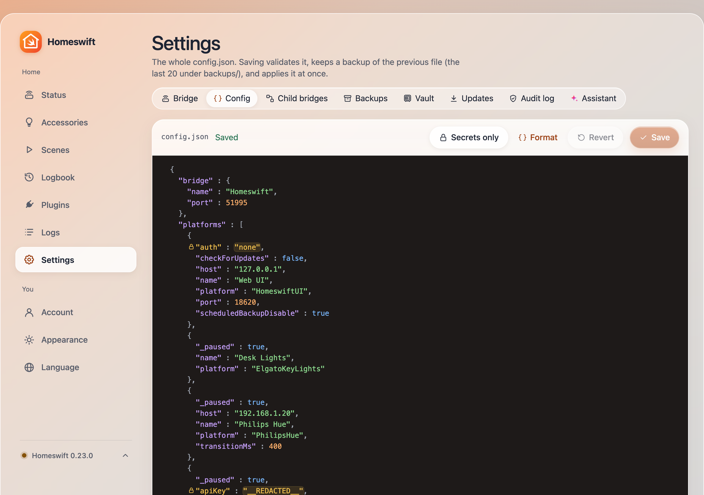

A tab of Settings (`/settings/config`; `/config`, its address before, leads there). The whole file in an editor. Saving validates it, checks each plugin block's changes against its schema as a plugin's Settings
do, keeps a backup under `backups/` (the last 20), sorts the keys and applies it. A syntax error's line is
marked as you type.

- **Folding**: a block that spans lines folds from the chevron beside its first line (Option-click folds or opens every
  block at that indentation; ⌘⌥[ and ⌘⌥] at the caret), and a click on its ⋯ opens it. What is saved, copied or
  formatted is always the whole text. A plugin's JSON view folds the same way.
- **Secrets**: a key that holds one (the bridge's redaction rule: passwords, tokens, keys, the setup code, `auth`) is
  gold with a lock before it, in both editors, and its value shows as `__REDACTED__`. A save that keeps the placeholder
  keeps the stored value, so the page never needs to show a secret to edit the rest. **Secrets only** (the lock in the
  bar) folds everything else, leaving the secrets and the way down to each; while it holds, the button is gold and a
  strip above the text says how many show, with **Show all**. Opening a fold, Format or Revert end it.

### Appearance

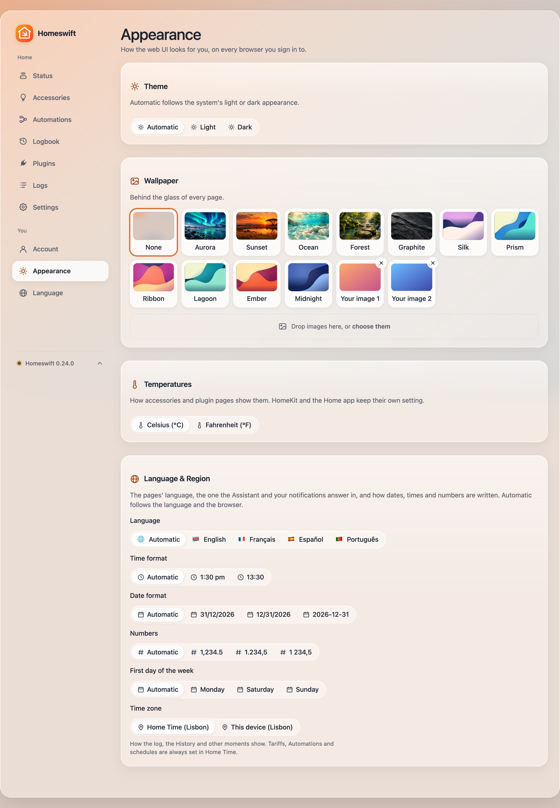

`/appearance`, from the account menu. Each user's own, kept in `ui-preferences.json` (owner-only) and applied on every
browser they sign in to; a browser remembers the last ones it saw, so a page opens in them at once.

- **Theme**: Automatic (the system's light or dark appearance), Light or Dark.
- **House style**: choose **Simple**, a clean model, **Realistic**, detailed rooms with warm lighting, **Beach house**, an airy coastal home beside the ocean, **Woodland cabin**, a cozy timber home among the trees, **Rooftop apartment**, a penthouse with an elevated city terrace, or the seasonal **Snow**, **Christmas**, and **Halloween** (a haunted house with tombstones and mist) scenes, for the Energy flow card. Preview tiles show all eight choices. Realistic is the default; the choice follows your account across browsers. All eight keep live readings, day/night artwork and the mobile layout with readings below the house. Solar modules have even sizes and spacing in both the live card and the previews, with the same roof geometry across day/night and battery variants.
- **Wallpaper**, behind the glass of every page: photographic Aurora, Sunset, Ocean, Forest and Graphite presets; original abstract Silk, Prism, Ribbon, Lagoon, Ember and Midnight designs; or one of up to 12 images of your own. Drop images on
  the card's zone or choose them, several at once: each is scaled down to 2,560 pixels, kept under
  `ui-wallpapers/<user>/` (JPEG, PNG or WebP, checked by its bytes) and shown as it is added. A tap on its tile shows it
  again; the ✕ on its corner removes it, and removing the one shown leaves no wallpaper.
- **Temperatures** in °C or °F, on accessory cards and plugin pages. HomeKit and the Home app keep their own setting.
- **Language & Region**:
  - **Language**: English, French, Spanish or Portuguese, or Automatic, the browser's ([translations.md](translations.md)).
    The Assistant answers in it, and so do the browser notifications this account's devices receive. The selector uses
    the same flag icons as sign-in; Automatic uses a globe.
  - The **Regional Formats**: **Time format** (12- or 24-hour), **Date format** (31/12/2026, 12/31/2026 or 2026-12-31:
    numeric dates only; a month written out stays the language's), **Numbers** (1,234.5, 1.234,5 or 1 234,5) and **First
    day of the week**. Each is Automatic until chosen: the Language and the browser's region decide, as before.
  - **Time zone**: **Home Time**, the bridge's (the default), or **This device**'s, for the log, the History and other
    moments. Tariffs, Automations' times and schedules are always written and shown in Home Time
    ([ADR 0008](adr/0008-rules-are-written-in-home-time.md)); with the device's zone chosen and different, their pages
    say so beside the fields.

  A change reloads the page, which reads these as it opens. The JSON API, the MCP tools and exports never use them:
  they write ISO 8601 with Home Time's offset and plain numbers.

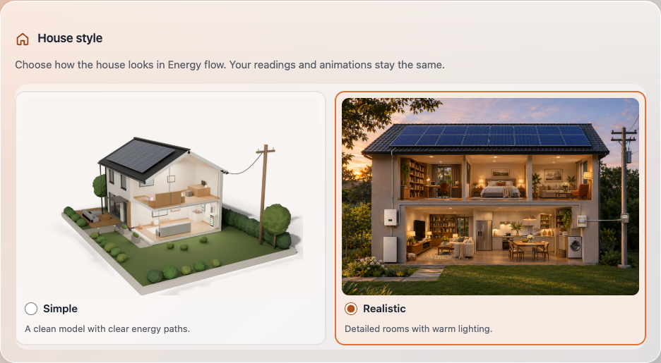

### Addresses

Every view is a path: `/status`, `/accessories` (and `/accessories/graph`), `/quick`, `/scenes` (and `/scenes/<id>`,
`/scenes/new`), `/notifications`, `/plugins`, `/plugins/<slug>` and its `/settings` (`/expert`, its address before, leads there), `/plugins/add/<platform>`,
`/account`, `/appearance`, `/users`, and `/settings` with `/bridge`, `/config` (`/config` alone leads there),
`/child-bridges`, `/backups`, `/vault`, `/updates`, `/audit` and `/assistant`. A view's choices go into its address: the web UI block's page with `?section=proxy` or
`?section=schedules` (`/plugins/web-ui?section=proxy`) opens and scrolls to that part of its settings, and the Logs view is
`/logs/<accessory>?bridge=<bridge or all>&plugin=<plugin>&since=24h&level=warning&q=text`: the accessory by its name's
slug or its id, the plugin by its slug (and `/logs/<platform>` from a plugin's page), `bridge` and `plugin` not both
(400), and `since` one of `1h`, `6h`, `24h`, `today`, `yesterday`, `7d` or `custom` with `from` and `to`. A link
changes the view in place.

## Applying changes and restarts

Saving a plugin's block applies it at once: the plugin stops and starts again with the new settings on the same
accessories (their aids, iids and pairings stay), a new block starts, and a removed one leaves HomeKit. A few changes
need a restart: the `bridge` block, the runtime's own blocks (`HomeswiftUI`, `HomeswiftAiKit`) and child bridges
(`_bridge`). The page says which, and its **Restart now** does it; the HomeswiftUI form checks its address and port
first (a check of the moment: another process can still take the port before the restart).

A restart, from that button or **Restart homeswift…**, asks first, then shows a modal over a blurred page while the
bridge comes back. The process replaces itself with a fresh copy (`execv`: the same binary, arguments and PID), so
launchd, systemd and `brew services` see nothing happen; it marks its descriptors close-on-exec first, so the new
process starts with none of the old one's connections. The page polls `/api/status` until a younger process answers,
usually within two seconds, then fades the modal and reconnects its event stream without reloading: what you had open,
scrolled or typed stays. Should the bridge not come back within 90 seconds, the modal says so and offers **Try again**.

A shutdown that stalls (a plugin that never stops) is cut short after 30 seconds and the process replaced anyway; a
failed `execv` exits with status 1, so a service manager can start it again. Sign-ins survive a restart: sessions are
kept in `ui-sessions.json` next to config.json.

## Users, roles and API tokens

As in Glass UI, a user is an **administrator** or not. An administrator does everything. Any other user sees **Status**
(without the pairing codes and the restart button) and **Accessories**, controls accessories (locks, garage doors and
alarms included, asking first as for everyone), uses the Assistant's chat with its read-only tools, and changes their
own password and two-factor authentication. The plugins, their pages and settings, config.json, the log, pairing codes,
restarts, users and tokens are refused with a 403, whatever the page shows. The role is read at every request, so a
change applies at once. The first account is an administrator, and so is the account of a `ui-users.json` from before
roles.

**Users** (`/users`, in the account menu for administrators, and from **Account**) shows a card per user: their name,
username, role, whether two-factor authentication is on, and a **⋯** menu to edit them (the name shown, the role, a new
password, which signs them out everywhere) or remove them (signed out at once). **Add user** asks for a username, a
name and a password ([Passwords](#passwords)). The last administrator can be neither removed nor demoted.

**Two-factor authentication**, under **Account**: **Set up** shows a QR code and the key for an authenticator app
(Passwords on iPhone and Mac, Google Authenticator, 1Password…; TOTP after RFC 6238: SHA-1, 6 digits, 30 seconds), and
the app's first code turns it on; the user's other browsers are then signed out. Signing in then asks for the app's code
after the password; each code works once, and one step of clock drift either way is allowed. **Turn off** takes the
password. The secret is kept with the user in `ui-users.json` (owner-only) and never logged. As in Glass UI, only its
user turns it off: someone who lost the app is removed and added again by an administrator, and the last administrator
deletes `ui-users.json` and restarts.

**API tokens**, on the Users page, are for scripts: a name, a scope and an expiry (never, 30 or 90 days, a year). The
token (`hst_…`) is shown once; the bridge keeps its SHA-256 in `ui-api-tokens.json` (owner-only), with when it was made,
by whom and when it was last used. Send it as `Authorization: Bearer hst_…` to `/api/*`:

```sh
curl -H "Authorization: Bearer $HOMESWIFT_TOKEN" http://bridge.local:8581/api/accessories
```

A `read` token reads what any user may (status, accessories, the plugins list, metrics, cameras, events); an `admin`
token does what an administrator does, except managing accounts: a token names no account, so it cannot change
passwords, two-factor authentication, users or tokens. Requests with a token need no `Origin` (no cookie rides along,
so no other site can make them), but bodies are still JSON. **⋯ › Revoke** refuses the token at once. User management is
not an MCP tool: a model never creates accounts or tokens.

**Connected apps**, under **Account**: with the MCP server on, the UI also serves it at `/mcp` for clients that sign in
with OAuth, claude.ai and the Claude apps first ([mcp.md](mcp.md#claudeai-and-the-claude-apps)). They send the user to
`/oauth/authorize`, which signs in with the UI's sign-in (two-factor code included) and asks what the app may do, up to
the user's role. The card gives the address to add as a custom connector, lists the apps the user allowed, what each may
do and when it last came, and **⋯ › Disconnect** ends one at once.

## The Assistant's chat

With a `HomeswiftAiKit` block that names a provider, a sparkle button opens a chat on every page, plugin pages included:
in the header, floating at the bottom right of a window 1180 px wide or more, where the chat opens above it, and on a
phone floating just above the sections' button, within the thumb's reach. Its head
has Copy, Earlier chats, New chat and a cog whose menu opens Settings › Assistant (the provider, for an administrator)
and sets the voice's language (A to Z, the browser's first); the field is at the very bottom, under the provider's
note. With a mouse, drag the head to move the panel anywhere in the window (the browser remembers where; a double click
puts it back); **Cmd+K** (Ctrl+K elsewhere) opens and closes it. Ask it what the bridge runs or why an accessory does
not answer, or tell it what to do: "add the Elgato light at 192.168.1.50", "pair my Philips TV", "turn off every light".
It looks at the setup and acts through the MCP server's tools, the plugins' own actions included (find TVs, pair one,
check a light's address, recall a Hue scene; [plugins.md](plugins.md)).

- **Every change asks first.** A tool that changes configuration or unlocks something shows a card with what would
  change (a dry run's settings and their new values) and waits for **Allow**; **Don't allow** leaves everything as it
  was, and a change that would fail anyway is never put to you. Writes are in the audit log as the client
  `web UI chat`.
- **Secrets stay home.** A password a device hands out while pairing reaches config.json as a handle (`__SECRET_1__`)
  the model passes on without reading it; configuration it reads has `__REDACTED__` values, which a write restores.
- **The model.** Under the title, the model that answers opens a menu of the provider's others (its models list, asked
  with the bridge's key); the block's `model` is marked Default. Anyone who may chat can switch, from the next message
  on: the choice is the user's own (`assistantModel` in `ui-preferences.json`), the budgets and usage stay the bridge's,
  and choosing the default again clears it. A model the provider no longer offers falls back to the block's.
- **Voice.** The mic dictates a message (tap, or hold while speaking with a mouse), and the answer to a spoken message is read out,
  in the language chosen under the field (the browser's unless you pick one; each browser keeps its choice). Browsers
  allow the microphone only on `localhost` or over HTTPS: turn on `https` to use it from a phone or another computer.
  Safari sends the audio to Apple and Chrome to Google for recognition. On an iPhone or iPad, dictation needs
  Settings › General › Keyboard › Enable Dictation; when it is off, the note under the field says so.
- **Conversations are kept**, per user, in `ui-chats.json` (owner-only): the open one, which a reload, another browser
  or a restart finds, and the ten before it. **New chat** files the open one away; **Earlier chats** (the clock) lists
  them and opens one again where it was, the Assistant remembering it, or forgets one. The copy button puts the
  conversation on the clipboard as Markdown (the messages, the steps and the changes asked for, not the tools' arguments
  or answers), to paste in a report. Each answer's cost shows under the field for priced models.
- **Limits.** The Assistant's requests from pages (Explain, Describe your setup, the chat) take 20 a minute per user, as
  Glass UI's limit (then 429 with `Retry-After`), stop at the HomeswiftAiKit block's budget, and count in its usage
  (`ai-usage.json`, `homeswift usage`) for the signed-in user.

On a wide window the chat is a panel beside the page; on a phone, a sheet you drag down to close.

## Security

- **Sessions and mutations.** Every API call needs the session cookie (`HttpOnly`, `SameSite=Strict`) or an API token.
  Mutations must be JSON and, with the cookie, come from the page: a request whose `Origin` names another site, or whose
  `Sec-Fetch-Site` is not the page's own, is refused.
- **Headers.** Pages carry a content security policy (scripts, styles, media and the web app manifest from the UI
  itself; `blob:` for the camera cards' Media Source; no `<base>`, forms posting only to the UI), no-store, no framing,
  `nosniff`, no referrer, and a permissions policy that leaves the UI the microphone (dictation) and full screen (a
  camera) and nothing else. Search engines are asked to keep away (`X-Robots-Tag: noindex, nofollow` on every reply and
  a `/robots.txt` that disallows everything), for a UI published through a tunnel or a proxy.
- **Caching.** Pages are never stored. The files a page uses are asked for at an address of their bytes
  (`/app.js?v=<its ETag>`), which a browser keeps for a year (`immutable`); any other address of a file is revalidated
  (`no-cache` and its ETag). The page knows its build (`<meta name="homeswift-build">`, `build` in `/api/status`) and
  loads again when the bridge's differs: after a restart, when it comes back in view (a web app on a phone stays open
  for days) and when its event stream reconnects, but not while it holds unsaved changes.
- **The first account** needs the set-up code, so nobody else on the network can claim the bridge before its owner
  does. The code is printed at startup and never logged: the MCP log tools cannot see it.
- **Passwords** are hashed with PBKDF2-HMAC-SHA256 (210,000 iterations, a random salt) and verified in constant time.
  Five failed sign-ins, two-factor codes, current passwords or set-up codes from an address slow the next attempts
  down; being asked for the code is not a failure.
- **Host names.** Requests are answered only when their `Host` is an IP address, localhost, this machine's name or an
  `allowedHosts` entry (421 otherwise), so a page that rebinds its own name to this address gets nothing, with
  `auth: none` too.
- **Behind a reverse proxy**, `trustProxy` names it: only a request from one of those addresses may say who the client
  is (`X-Forwarded-For`, the right-most address that is not a trusted proxy: for the sign-in throttle and the log) and
  that the browser came over HTTPS (`X-Forwarded-Proto`, for a `Secure` cookie and `Strict-Transport-Security` for a
  year: the proxy holds a real certificate). Never every address: a client could pick its own and step around the
  throttle. Add the proxy's host name to `allowedHosts`. The event streams (the live log, accessory values, the
  Assistant's answers, `/mcp`) say `Cache-Control: no-store, no-transform` and `X-Accel-Buffering: no`, so a proxy that
  compresses (Cloudflare) or buffers (nginx, DSM's reverse proxy) passes each event on as it comes.
- **HTTPS.** With `"https": true` the UI serves HTTPS and the cookie carries `Secure`. Name a certificate and its key
  (`certificate`, `privateKey`, PEM files), or let the bridge make a self-signed one, kept next to config.json
  (`ui-certificate.pem`, `ui-key.pem`, owner-only): it names this machine, its `.local` name, `localhost`,
  `allowedHosts` and the LAN addresses, lasts 397 days and is made again before it expires or when an address changes.
  The banner prints its SHA-256 fingerprint, which the browser's warning shows. To trust it once and for all, download
  `/homeswift-ui.crt` and add it to the keychain (macOS: Always Trust), or install it on an iPhone and turn it on under
  Settings › General › About › Certificate Trust Settings. The UI's own HTTPS never sends `Strict-Transport-Security`:
  under it a browser offers no way past a certificate warning, which a self-signed certificate gets until it is trusted.
  Without `https`, keep the UI on the home network or behind a reverse proxy with TLS; with `auth: none`, set `host` to
  `127.0.0.1`.
- **Secrets on the pages.** Config and a plugin's JSON show secrets as `__REDACTED__` ([Config](#config)), for
  administrators too; notification tokens as `********`. Other users never get config.json.
- **OAuth.** `/mcp`, `/oauth/*` and `/.well-known/oauth-*` answer only with the MCP server on. Their tokens reach `/mcp`
  and nothing else, an API token cannot approve an app, and the sign-in page cannot be framed and never approves on the
  keypress that signed in.
- **Irreversible changes** (pairings, caches, a restore) ask first, some with a word to type; the pairing and cache
  resets refuse without `"confirm": true` in their body. They are an administrator's; an accessory's History is anyone's
  to read.

## Passwords

The first account and every password change follow the ANSSI's recommendations (*Recommandations relatives à
l'authentification multifacteur et aux mots de passe*, PG-078, 2021): at least 12 characters and about 85 bits of
estimated entropy, the guide's "moyen à fort" level for a 90-character set (table 3), with no maximum short of 1024
bytes. The estimate is the guide's length × log₂(character set); since the guide warns it only holds for random
characters, repeated or sequential characters, common words and the username earn nothing. The server checks
(`PasswordPolicy`); the pages show a gauge with the guide's bands (65, 85, 100 bits) as you type. A passphrase of several
random words is the easy way over the bar. **Account** changes your password; your other browsers are then signed out.

## On a phone

On a phone a floating menu button at the bottom right opens the sections, Settings and Account included; the current one
is highlighted. Save bars sit beside the button, toolbars keep their glyphs where a wide window also shows the words (the
Accessories page's grouping, the Assistant's sparkle, Revert, Copy), and a card's ⋯ menu opens as a sheet from the
bottom of the screen that a swipe down puts away.

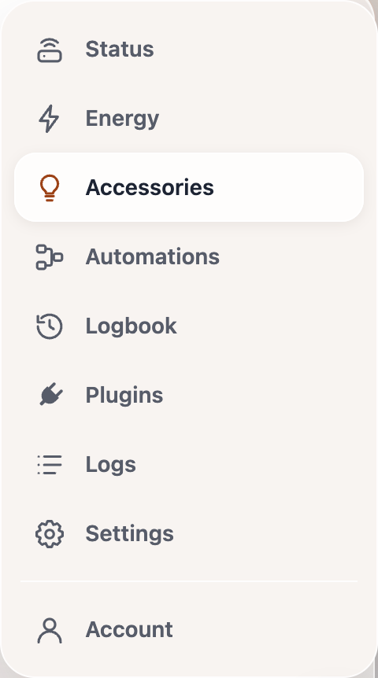

The UI is an installable web app: `manifest.webmanifest` (standalone, starting on Status), PNG icons (192, 512 and a
maskable 512) and an `apple-touch-icon.png`, all served without a session like the other static files. Over HTTPS the
page carries the touch icon inline: iOS fetches a home screen icon without the exception accepted for a self-signed
certificate, and would show a letter instead. In Safari, Share › Add to Home Screen; in Chrome, Install app. It opens full
screen; `/quick` makes a good first page to keep there (a manifest shortcut opens it). The service worker (`/sw.js`) only
shows notifications and keeps nothing offline: the bridge must be reachable.

## The look

Apricot frost, the design system of `style.css` ([design-system.md](design-system.md#tokens) lists the tokens):

- **Backdrop.** A 140° gradient from apricot to stone (`--backdrop`); in dark mode, Ember: warm charcoal with an apricot
  glow in the top left corner. A wallpaper chosen on Appearance replaces it.
- **Glass.** Cards are frosted glass (`--material`); a wide window's frame is a thinner one (`--material-frame`). Details
  set on a card (figures, rows) take white (`--surface`).
- **What is current is white.** The current section, a segmented control's choice and the Settings tab are a white pill
  (`--control`) with their icon in the accent, not an orange fill. Orange stays for the one primary action of a view
  (Save, Open the vault, Add a secret), switches and focus rings.
- **One dark card.** `.card.attention` (`--attention`, its apricot glow `--attention-glow`) is for what needs attention or
  an important action: the Vault's entries that expired or expire soon, and the Status page's Vault summary while one
  does. It redefines the text, state and control tokens for its children, so rows and buttons inside need no rules of
  their own.
- **Charts.** A chart of one series (the Status page's memory and CPU) draws it in the accent; charts of several keep
  the palette's series colours.
- **Type.** A page's title is large and light (`--text-display`, medium weight, tight tracking); the rest keeps the
  system font and the type ramp.

## For plugin authors

**A settings form.** Ship a `config.schema.json` in the plugin's directory and run `swift Scripts/embed-assets.swift
plugin Plugins/<Name> <Type>` to embed it (a test checks it is current); the Plugins page then shows a form. The form
understands the Homebridge dialect: `properties` in order, `required: true` on a property, `oneOf` with `enum` and
`title` for menus, `placeholder`, `default`, `description`, arrays of objects (rows to reorder, named as
docs/plugins.md's "Settings" says) or of values (checkboxes for an array of choices), nested objects, the
top-level `layout` with `fieldset` groups, and `condition`s ([Plugins](#plugins)). Keys the schema does not know
(`_bridge` for one) are kept as they are.

**A page of its own.** A plugin that has more to show than settings (the devices it sees, a scan, a diagnostic) ships
a `Web/` directory with an `index.html` and whatever files it needs, embedded by `swift Scripts/embed-assets.swift web
Plugins/<Name>/Web Plugins/<Name>/Sources/WebFiles.swift <Type>` (a test checks it is current).
[Philips Hue's](../Plugins/PhilipsHue/README.md) and [IKEA DIRIGERA's](../Plugins/Dirigera/README.md) are full examples,
`Plugins/ElgatoKeyLights/Web` a small one (the lights, their state, an Identify button).

- **Serving.** The UI serves each instance's page at `/plugins/<slug>` and its files beside it, to signed-in users only
  (anyone else gets the sign-in page, then this one). The page gets a `<base>` for its relative files and a
  `<meta name="homeswift-plugin">` naming its platform and instance, which `plugin.js` reads.
- **The document.** A full page: link `/style.css` for the look of the rest of the UI, then load `/common.js` and
  `/plugin.js` for the helpers. The content security policy allows scripts and styles from files only, no inline
  script. A page that asks for a time range uses `HomeswiftCommon.rangeControl(params, { presets, fallback, changed })`,
  the UI's own control, never an `<input type=datetime-local>`.
- **Its instance.** `homeswift.request(path, { method, body })` sends `/api/plugins/<platform>/<name>/<path>` with the
  session cookie and parses the JSON answer; the plugin answers in `handleWebRequest(_:)` with a `PluginWebResponse`
  (JSON and a status). Mutations must be JSON, like the rest of the API. `homeswift.platform`, `homeswift.name` and
  `homeswift.home` (the Plugins page) are there too.
- **Building.** `homeswift.el(tag, attributes, ...children)` and `homeswift.$(selector)` build and find elements the
  way the UI's own pages do; `homeswift.tile(icon, tone)` draws an icon on a colour and `homeswift.fact(label, value)` a
  labelled value of a `.facts` grid. `homeswift.act(button, work, report)` runs `work` with the button disabled and a
  spinner and hands an error's message to `report` (`alert` by default; with `report` null the error is thrown).
- **Its settings.** A page shows views, diagnostics and actions, and writes no settings
  (docs/adr/0002-schema-declares-every-setting.md): its schema declares them and the Settings page edits them. It links
  there: `homeswift.settingsAddress` is the instance's Settings, `homeswift.accessorySettings(accessoryID)` one
  accessory's there (`?accessory=`, its Accessory Settings over the page: its Name, room, Excluded and the plugin's own).
  `homeswift.openAccessorySettings({ accessoryID, name, glyph, trigger, after, section })` opens that same editor in the
  side sheet over the plugin's own page instead (it loads `forms.js` and `settings.js` the first time; `after(changed)`
  once it has gone; `section` opens one group of the schema's `layout` and shows it first, by its title as a slug), so a
  "Settings" action need not send the person away; the page itself still writes nothing. A field with more than ten
  choices (a home's lights) shows what is chosen and a searchable menu of the rest. And `homeswift.scenePictures({ settings })` gives a scene tile's menu the link. `poll(refresh)` refreshes while the
  page is visible, `renderKeyed` redraws only the cards whose item changed, and `canonicalMAC` spells a MAC address as the
  server does.
- **Setup.** A page signs in and pairs nowhere: `homeswift.setupCard({ title, text, glyph, tone, start })` is a card
  whose button opens the instance's row on Add accessories (`homeswift.setupAddress({ start })`, `/setup?start#<slug>`;
  with `start`, its account's Setup sheet opens there), for a page whose account or hub is not set up yet or a "Sign in
  again" or "Pair again" of its own.
- **Accessories as the Accessories page draws them.** Load `/remote.js`, `/camera.js` and `/widgets.js` after
  `/common.js`, take the accessory from `/api/accessories`, add `HomeswiftWidgets.card(accessory, { size })` (`small`,
  `medium` or `large`; the kind's own size when left out) to a `.wall`, open every control with
  `HomeswiftWidgets.open(accessory)`, and call `HomeswiftWidgets.listen()` once for live values. A camera's view is
  `HomeswiftCamera.view({ id, name })` from `/camera.js`.
- **The Assistant.** `homeswift.assistant()` says whether it is on. `homeswift.explain({ error, context, device })` is
  an Explain button whose answer streams into a card; `homeswift.ask(prompt, { context, onChunk, signal })` asks a
  question and resolves to `{ text, model }`, with `onChunk(text)` for each piece as it is written and an
  `AbortController`'s signal to stop it. Both carry the plugin's `assistantBackground` (`POST /api/assistant/explain`
  and `/ask`; with a `requestId` in the body the answer comes as server-sent events, `start`, `chunk`, then `done` or
  `error`, and `POST /api/assistant/cancel` with that `requestId` stops it: homebridge-ai-kit's `/ai/*` routes and
  `ai:chunk` events).
- **Units.** `homeswift.formatTemperature(celsius)` shows a temperature in the user's unit
  (`homeswift.temperature(celsius)` gives `{ value, unit }`).

## Working on the pages

The UI's own pages are under `Sources/HomeswiftUI/Web`, compiled into the binary as
`Sources/HomeswiftUI/WebAssets.swift` (and each plugin's as its `Sources/WebFiles.swift`) by `Scripts/embed-assets.swift`,
so a Homebrew install carries them and no build step needs Node. To work on them without a rebuild, point
`HOMESWIFT_WEB_ROOT` at the checkout:

```sh
HOMESWIFT_WEB_ROOT=$PWD swift run --scratch-path ~/Library/Caches/homeswift-build homeswift
```

The UI then reads `Sources/HomeswiftUI/Web` and `Plugins/<platform>/Web` from disk on every request, and open pages
follow the files: a saved stylesheet swaps in place (what is open on the page stays), a saved script or page reloads
it. Embed the files again before committing; a test fails while they differ:

```sh
swift Scripts/embed-assets.swift web Sources/HomeswiftUI/Web Sources/HomeswiftUI/WebAssets.swift
```

### Screenshots

This page's images in `images/ui/` come from a throwaway bridge, retaken with:

```sh
node Scripts/ui-screenshots.mjs
```

It runs the bridge built at `~/Library/Caches/homeswift-build/debug/homeswift` (or the binary given) from a temporary
folder with a new identity: the web UI on `127.0.0.1` without sign-in, plugin blocks with demonstration names, all
paused, so nothing reaches a device or a cloud, a Dummy block of accessories that exist only on the bridge with a
generated day of History and Logbook (`writeHistory`), and two generated images as wallpapers. It renders in headless Chrome in
light mode at 2x, replaces this machine's name and the folder's paths in what the API answers, answers a plugin's
discovery with demonstration lights (so a plugin's Settings and an accessory's sheet never show this network's devices),
and removes the folder when it ends. The Accessories page's images are [widgets.md](widgets.md#screenshots)'s. The Scenes page's shots that need lights (hubs' scenes,
the templates, a scene card and its Stop) come from `node Scripts/plugin-screenshots.mjs`, against its fake Hue Bridge
and DIRIGERA hub.

### Quick controls on phones

Quick controls groups its heading, page link and shortcuts in one card. Saved scenes use photographic tiles
with readable names; the row scrolls horizontally on a phone. Scenes without artwork keep a plain tile.

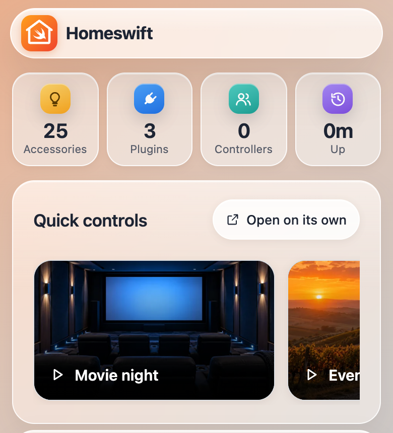

In **Appearance → Your house**, upload a JPEG, PNG or WebP photo, add a name and details, and place the Solar panels, Battery, Electrical board and Home markers. Select a marker and tap the photo, or adjust its horizontal and vertical position with the keyboard-accessible sliders. Save and use photo keeps the picture and marker positions privately for your account. Animated paths start at the marked source equipment and meet at Home; readings still come from connected devices. Replace a photo to start its marker placement again, or remove it to return to the realistic house.

### Editing Status on a phone

Edit mode reduces sections to compact rows with a title, remove button and move handle. Drag a row to reorder it; Done restores the full cards. Desktop retains full cards under the same edit header. Lifted sections use frosted glass across the whole drag zone.


