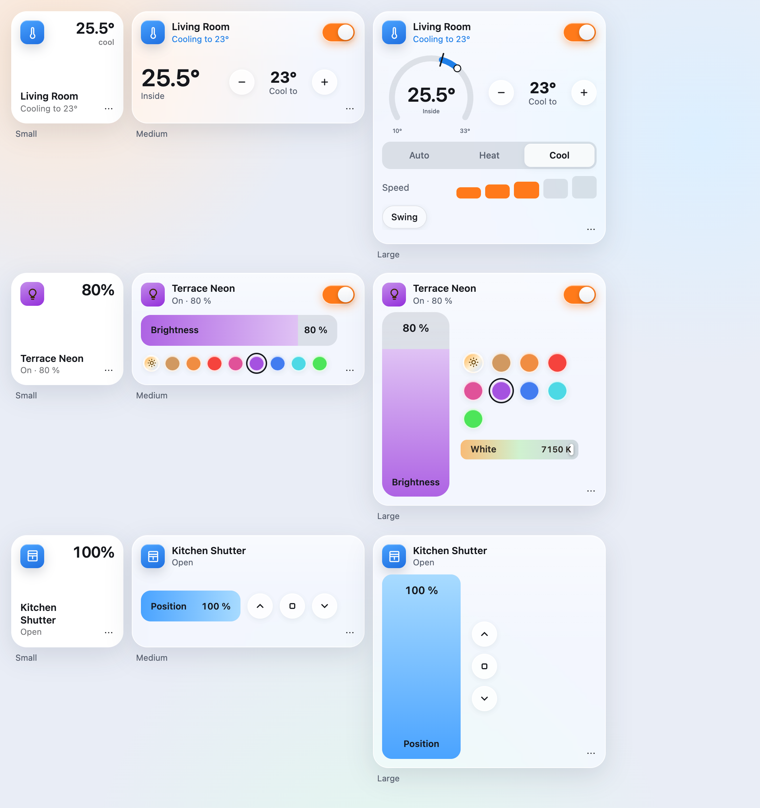
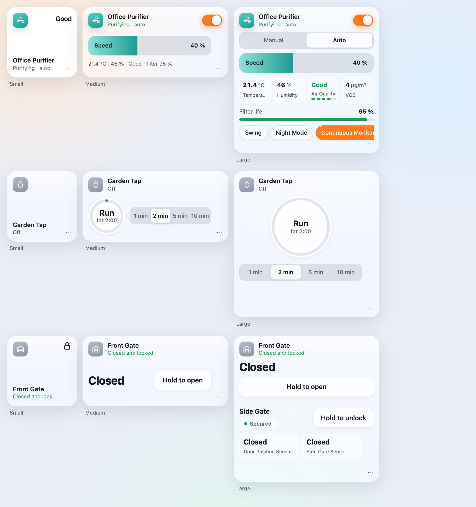
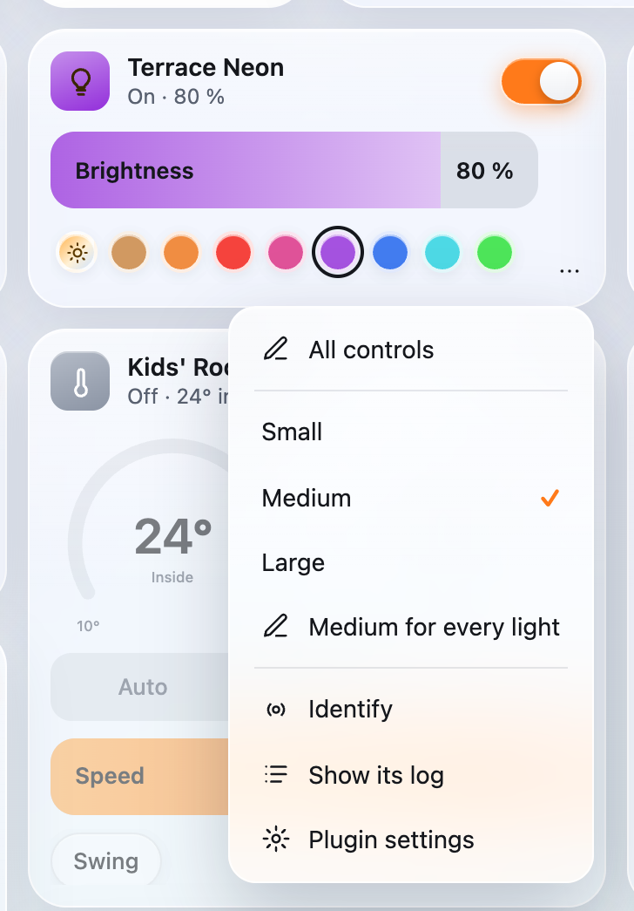
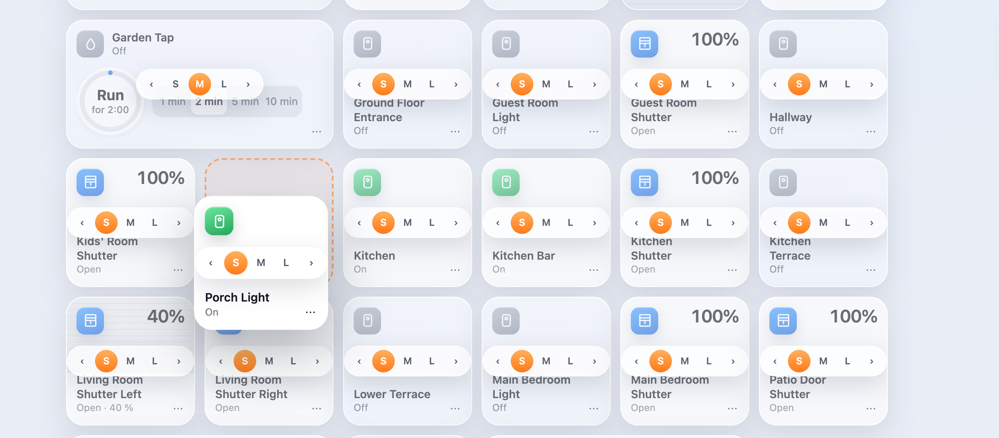
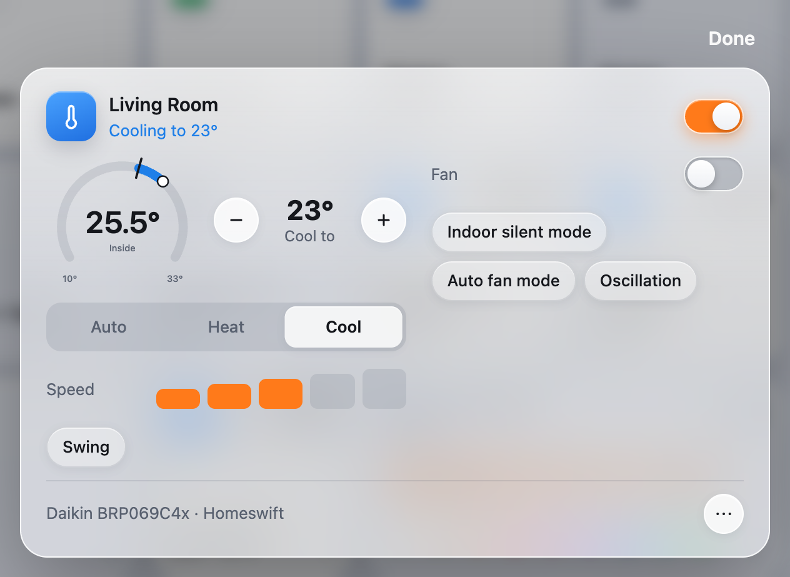
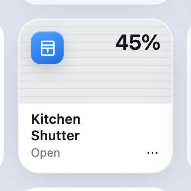
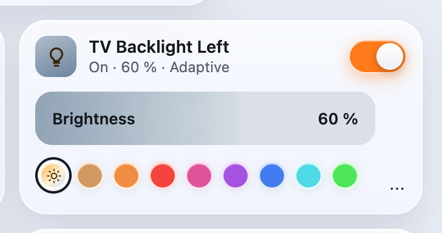
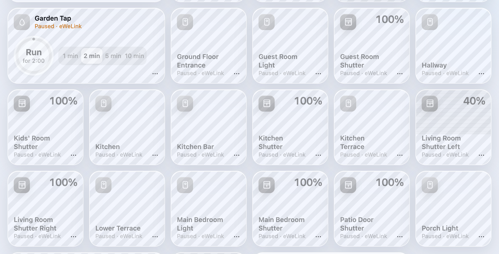

# Accessory widgets

The web UI's Accessories page draws every accessory with the widget of its kind: an air conditioner gets a
gauge, its setpoints and modes; a light its brightness, colours and white temperature; a shutter a tile you
slide; a gate a button you hold. Widgets sit on a wall of square units, packed with no gaps, in the size you
choose for each one. They are built from what HomeKit already knows about an accessory (its services, their
characteristics, formats and ranges), so a plugin gets them without writing a line of web code.


The page is `Sources/HomeswiftUI/Web/widgets.js` (the widgets) and `app.js` (the wall). The screenshots on this
page use demonstration names.

## On the page

### Three sizes

A widget is a fixed box of the wall's grid:

| Size | Box | What it shows |
|---|---|---|
| **Small** | 1×1 | A tile a tap acts on (on and off, open and close, run and stop), lit while the accessory is on, with one figure: a temperature, a brightness, a position. What opens or unlocks is held instead. |
| **Medium** | 2×1 | The main control: a brightness and the colours, a setpoint, a position with its buttons. |
| **Large** | 2×2 | Everything the kind has: the gauge and modes of a climate, a purifier's readings, a TV's remote. |



Every kind has the three sizes, and a default: large for climate, purifiers and televisions, medium for lights
with colour, valves, gates and groups of switches, small for switches, shutters and sensors. A unit is 160
points, two columns on a phone, where the units stretch to fill the width.



### Choosing sizes and places

A widget's **⋯** menu (a right click on a small tile) sets its size, makes its size the one of every accessory
of the kind ("Medium for every light"), and opens **All controls**. **Edit** shows the sizes and ‹ › arrows on
every widget, and lets them be dragged: the widget lifts and follows the pointer or the finger, the others make
room as it passes, and it lands where it is let go. Near the window's top or bottom the page scrolls. **One wall**
(the default) puts every accessory on one wall; **By plugin** gives each plugin a wall of its own.





The bridge keeps the layout in `ui-layout.json` next to config.json, the same for every user of the web UI: the
order, the size of each accessory you sized, the size of each kind, and the grouping. An accessory the layout
does not list yet goes at the end, by plugin and name.

### All controls

A fixed box shows what fits. **All controls** opens every control of the accessory in a sheet: the widget's
own, the services linked to it as chips, readouts, meters and blocks, and under **More**, as rows, whatever no
widget shows. An accessory no widget knows gets those rows, so nothing a plugin exposes is out of reach.



### Shutters, lights, locks

- **A shutter's small tile slides.** With a mouse, drag it up to open, down to close; with a finger, hold it a
  moment first, so a swipe still scrolls the page. The shade follows, and the position is written when you let
  go. A tap opens or closes it fully.

  

- **Adaptive Lighting.** A light with Adaptive Lighting has a sun swatch first among its colours (a round button
  beside the white slider for a light without colours). HomeKit starts Adaptive Lighting: when you turn it on in
  the Home app, the Home app sends a day's schedule of whites, which a home hub renews. The bridge keeps the last
  schedule; the swatch turns it off, and on again by resuming that schedule, moved by whole days so it keeps its
  times of day. A light whose Adaptive Lighting was never turned on in the Home app says so when the swatch is
  pressed. Picking a colour or a white turns it off, as in the Home app.

  

- **Security.** Opening a gate or a garage door, unlocking a lock, turning an alarm off, and turning on a switch a
  plugin marked as a security control are held for a moment, the fill running across; let go early and nothing
  is sent. Closing, locking and arming are a tap. On a small tile the tile itself is held.

### Paused plugins

A paused plugin's accessories answer HomeKit with No Response. Their widgets are drawn striped and grey with
"Paused · *the plugin*" under their name, and their controls are out of reach; the ⋯ menu stays, with **Resume
*the plugin***. A write that reaches the bridge anyway is refused in words ("eWeLink is paused: resume it on
the Plugins page…"), as is one to a device that does not answer.



## The widgets

The widget is chosen from the accessory's primary service (the one marked `isPrimary`, else the first of the
list below that it has):

| Primary service | Widget | Small | Medium | Large |
|---|---|---|---|---|
| Television | Television | power | input, volume, mute | remote, input |
| HeaterCooler, Thermostat | Climate | temperature, mode by colour | inside and the mode's setpoint | gauge, setpoints, modes, fan speed, swing |
| AirPurifier | Air purifier | air quality | speed, readings on a line | mode, speed, four readings, filter, switches |
| SecuritySystem | Alarm | hold to turn off | state, arm, hold to turn off | the same, larger |
| GarageDoorOpener | Gate | hold to open | state, hold to open or close | with its locks and sensors |
| LockMechanism | Lock | hold to unlock | state, hold to unlock or lock | the same |
| WindowCovering, Door, Window | Shutter | slide, tap | position, open, stop, close | a window to slide, tilt |
| Valve | Valve | run or stop, time left | ring and duration | larger ring |
| Fanv2, Fan | Fan | speed | speed | speed, modes, direction, swing |
| Lightbulb | Light | on and off, brightness | brightness, colours or white | tall brightness, colours, white |
| Switch, Outlet (one) | Switch | on and off | a big switch | a power button, its facets |
| Switch, Outlet (several) | Group of switches | how many are on | chips | a tile each |
| Sensors | Sensor | the reading | the readings | the readings, battery |
| (a camera) | Camera | the picture | the picture | the picture with its buttons |
| anything else | Rows | power | its first rows | more rows |

What a widget does not show of the primary service, and the accessory's other services, become **facets**:
switches as chips, sensors as readouts, a filter or a battery as a meter, a secondary light, fan, thermostat or
lock as a block.

The controls follow the characteristics:

- A writable value with two to four choices (`validValues`, or a known enumeration) is a segmented control.
- A range of six positions or fewer (`(maxValue − minValue) / minStep ≤ 6`, such as a fan's speed in steps of
  20) is a row of bars; a larger one a level, which moves with the pointer and writes when let go.
- A colour temperature in mireds shows and is set in kelvin, on a track of its own whites.
- A change shows at once and goes to the device; a refusal puts the value back and says why under the name.
  Values follow the device live (the page's event stream).

## For plugin developers

Nothing in a plugin is specific to the web UI: shape your accessories for HomeKit, and the widgets follow. A
few choices make them better.

### Mark the primary service, link the rest

The primary service picks the widget; the others become its facets, named after their `Name` (minus the
accessory's name), else their subtype ("climateControl:indoor_silent_mode" reads "Indoor silent mode").

```swift
// An air conditioner: the climate widget, its fan speed as five bars, a swing chip, the room's humidity as a
// readout and the filter as a meter.
let climate = Service(
    .heaterCooler, name: "Living Room",
    optional: [.rotationSpeed.with(minStep: 20), .swingMode, .coolingThresholdTemperature.with(minValue: 18, maxValue: 32, minStep: 0.5)],
    isPrimary: true)
let humidity = Service(.humiditySensor, name: "Living Room Humidity", subtype: "humidity")
let filter = Service(.filterMaintenance, name: "Filter", subtype: "filter", optional: [.filterLifeLevel])
let quiet = Service(.switch, name: "Quiet", subtype: "quiet")
climate.linked = [humidity, filter, quiet]

climate.characteristic(.active).onWrite { value in try await device.setPower(value.intValue == 1) }
climate.characteristic(.targetHeaterCoolerState).onWrite { value in try await device.setMode(value.intValue ?? 0) }
climate.characteristic(.coolingThresholdTemperature).onWrite { value in try await device.setTarget(value.doubleValue ?? 24) }
climate.characteristic(.rotationSpeed).onWrite { value in try await device.setFan(Int(value.doubleValue ?? 0) / 20) }

try context.add(Accessory(
    id: "\(Self.platform):\(device.id)", name: "Living Room", manufacturer: "Acme", model: "AC-1",
    category: .airConditioner, services: [climate, humidity, filter, quiet]))
```

### Give ranges their real steps and bounds

A `minStep` that leaves six positions or fewer turns a slider into bars; `minValue` and `maxValue` give the
gauge and the setpoints their range. Restrict `validValues` to the modes the device has: a thermostat with only
Off and Heat gets a two-choice control.

```swift
// A heater: Off and Heat only, 5 to 30 °C in half degrees.
let thermostat = Service(
    .thermostat, name: "Studio",
    optional: [],
    extra: [
        Characteristic(.targetHeatingCoolingState.with(validValues: [0, 1])),
        Characteristic(.targetTemperature.with(minValue: 5, maxValue: 30, minStep: 0.5), value: .double(20)),
    ],
    isPrimary: true)
```

### Shutters: report where they are, and how to stop

The shutter widget reads Current Position and Position State and writes Target Position; with Hold Position, its
Stop button sends it, else it writes the current position as the target.

```swift
let shutter = Service(.windowCovering, name: "Kitchen Shutter", optional: [.holdPosition], isPrimary: true)
shutter.characteristic(.targetPosition).onWrite { value in try await motor.move(to: value.intValue ?? 0) }
shutter.characteristic(.holdPosition).onWrite { _ in try await motor.stop() }
// As the motor reports: 0 closing, 1 opening, 2 stopped.
await motor.onProgress { position, moving in
    shutter.characteristic(.currentPosition).value = .int(position)
    shutter.characteristic(.positionState).value = .int(moving)
}
```

### Mark what opens or unlocks

Lock Target State, Target Door State and Security System Target State are security controls already: their
widgets hold to confirm. A characteristic of your own that unlocks or opens something gets the same:

```swift
// A switch that releases the gate's latch: held to turn on in the web UI, confirmed by MCP clients.
let release = Service(.switch, name: "Release Latch", subtype: "latch", isPrimary: true)
release.characteristic(.on).isSecurityControl = true
```

### Adaptive Lighting

A light with Brightness and Color Temperature can have Adaptive Lighting: make an `AdaptiveLightingController`
for its lightbulb before the accessory is added, keep it (the lightbulb holds it weakly), and pass it to
`context.configureController` so its schedule survives restarts. In automatic mode the controller sets the
temperature through your Color Temperature write handler; turn it off when the light's colour changes outside
HomeKit.

```swift
let lightbulb = Service(.lightbulb, name: name, optional: [.brightness],
    extra: [Characteristic(.colorTemperature.with(minValue: 143, maxValue: 344), value: .int(250))], isPrimary: true)
lightbulb.characteristic(.colorTemperature).onWrite(changesOnly: true) { value in
    try await device.setTemperature(value.intValue ?? 250)
}
let adaptiveLighting = AdaptiveLightingController(lightbulb, mode: .automatic, logger: context.logger)
let accessory = Accessory(id: "\(Self.platform):\(device.id)", name: name, category: .lightbulb, services: [lightbulb])
context.configureController(adaptiveLighting, accessoryID: accessory.id)
self.adaptiveLighting[device.id] = adaptiveLighting   // kept as long as the light is on the bridge
try context.add(accessory)

// The light was set from its own app: Adaptive Lighting stops, as when the Home app sets a white.
await device.onTemperatureChange { mireds in
    if adaptiveLighting.isAdaptiveLightingActive { adaptiveLighting.disableAdaptiveLighting() }
    lightbulb.characteristic(.colorTemperature).value = .int(mireds)
}
```

The web UI's sun swatch then appears on the light, and `PUT /api/accessories/<id>/adaptive-lighting` turns it off
or resumes the Home app's last schedule (`resumeAdaptiveLighting()`). The Govee, Elgato Key Lights and Philips
Ambilight TV plugins do this.

### Widgets on your plugin's own page

A plugin page (see [ui.md](ui.md)) can draw accessories as the Accessories page does:

```html
<link rel="stylesheet" href="/style.css">
<div class="accessory-walls"><div class="wall" id="lights"></div></div>
<script src="/common.js"></script>
<script src="/remote.js"></script>
<script src="/camera.js"></script>
<script src="/widgets.js"></script>
<script src="/plugin.js"></script>
<script>
  (async () => {
    const all = await homeswift.api("/api/accessories");
    const mine = all.filter((accessory) => accessory.platform === "ElgatoKeyLights");
    const wall = document.getElementById("lights");
    for (const accessory of mine) wall.append(HomeswiftWidgets.card(accessory, { size: "medium" }));
    HomeswiftWidgets.listen();   // live values from the bridge's event stream
  })();
</script>
```

`HomeswiftWidgets.card(accessory, { size, actions })` answers the widget (`small`, `medium` or `large`; the kind's
own size when left out; `actions(accessory)` the items of its ⋯ menu after All controls).
`HomeswiftWidgets.open(accessory)` opens All controls in a sheet. `HomeswiftWidgets.kindOf(accessory)` answers
`{ kind, size }`, its kind of widget and that kind's size.

### A widget of your own

For an accessory the built-in widgets draw poorly, a page can register its own, tried before them. `build`
answers the parts the frame draws, for `small`, `medium`, `large` and `full` (the sheet):

```js
const { level, chip } = HomeswiftWidgets.controls;
HomeswiftWidgets.register({
  name: "aquarium", types: ["Lightbulb"], icon: "bulb", tone: "blue", size: "medium",
  match: (ctx, primary) => ctx.accessory.model === "Reef LED",
  build(ctx, primary, size) {
    const on = ctx.take(primary, "On"), brightness = ctx.take(primary, "Brightness");
    const dim = level({ label: "Daylight", min: 0, max: 100, format: (v) => `${v} %` }, (v) => ctx.write(primary, brightness, v));
    ctx.watch(() => dim.set(brightness.value));
    return {
      body: size === "small" ? [] : [dim.node],
      power: { service: primary, characteristic: on },
      tap: () => ctx.write(primary, on, !on.value),
      on: () => on.value === true,
      status: () => [on.value ? `Daylight ${brightness.value} %` : "Night"],
    };
  },
});
```

`ctx.char(service, type)` finds a characteristic, `ctx.take` finds it and marks it shown (the rest goes under
More in the sheet), `ctx.write(service, characteristic, value)` writes it (at once on the page, back with the
reason when the device refuses), `ctx.watch(paint)` repaints after every change of the accessory.

## The HTTP API

| Request | What it does |
|---|---|
| `GET /api/layout` | The wall: `{ order, sizes, defaults, grouping }`. |
| `PUT /api/layout` | Keeps it, checked: ids in `order` and `sizes`, sizes `small`, `medium` or `large`, `defaults` by kind (`climate`, `light`…), `grouping` `none`, `plugin` or `room` (the rooms of `/api/rooms`). |
| `PUT /api/accessories/<id>/adaptive-lighting` | `{ "on": true }` resumes the Home app's last schedule, `false` turns it off; `service` picks the lightbulb when there are several. 409 with what to do when there is no schedule. |

In `/api/accessories`, a light with Adaptive Lighting has `adaptiveLighting: { active, resumable }` on its
service, and an accessory of a paused plugin `paused: true`.
